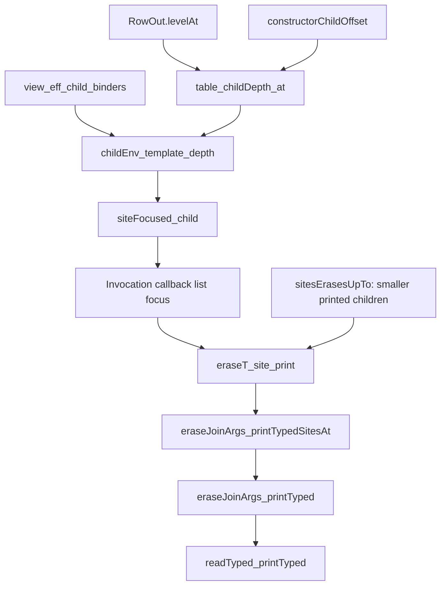
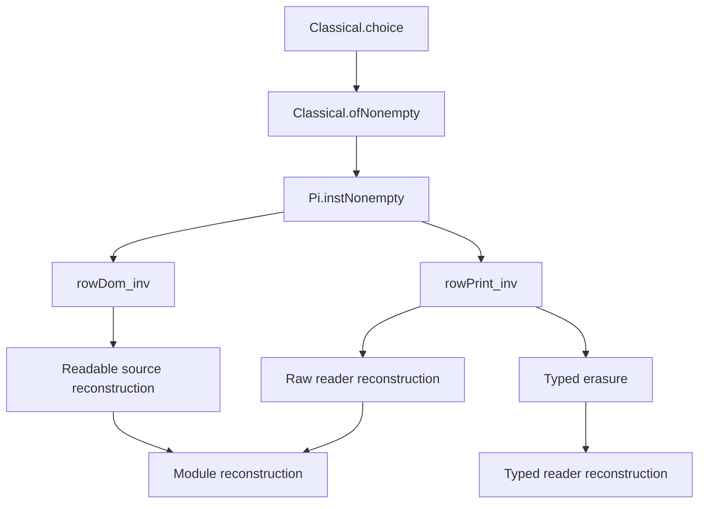

# Invocation reconstruction after HO-3b

The proof graph adds invocation TypeScript printing cases to the existing R8 claims.
The independent audit rejects its current axiom dependencies.
The public theorem statements retain their previous premises.
`source-review.json` records their comparison and the independent source review.

## Shared depth

`RowOut.levelAt` in `src/Effect4/Codegen/Templates.lean` gives invocation argument two one additional binder.
The following declarations live in `src/Effect4/Laws/Codegen/PrintTyped.lean`.

`view_eff_child_binders` no longer excludes invocations.
`childEnv_template_depth` still requires the actual successful child context.
`siteFocused_child` carries that context into the erasure proof.
Callback siblings keep their depth while their declared parameter slots advance.
These steps reuse the existing source, annotation, and focus structures.

## Independent observations

`print_node` in `src/Effect4/Laws/Codegen/PrintReadable.lean` obtains callback prints from its child induction at caller depth plus one.
`eraseT_print` in `src/Effect4/Laws/Codegen/PrintTyped.lean` covers the ordinary typed printer.
`eraseT_site_print` covers the printer that uses recorded contexts.
Both require lawful names and readable source.
The public erasure claims also require successful printing.
Their induction assumes the child result only for smaller printed children.

The earlier empty-list refusal does not contradict these conditional erasure claims.
It prevents their successful-printing premise in the affected examples.
Keep its repair and its finite controls as a separate step.

## Existing placement

Concept: `exact-codecs`, required reconstruction property in `docs/core/semantics.md`.
Claims: `typed-print-erasure` and `typed-print-read`, role `compatibility`.
Pointers: `eraseJoinArgs_printTyped` and `readTyped_printTyped`, both in `src/Effect4/Laws/Codegen/PrintTyped.lean`.
Reach: readable source, lawful names, successful printing, and the actual callback contexts under rows 325 and 340.
Limits: no source typing, target compiler acceptance, runtime observation, or progress follows.
Consumer and unlock: typed reader reconstruction under R8, after the named erasure.

The raw module reconstruction path retains its existing G6 premises.
It does not assert that the raw reader checks callback count.
Source typing owns that separate condition.

## Trust dependency requiring repair

`rowPrint_inv` and `rowDom_inv` live in `src/Effect4/Laws/Codegen/ReadPrint.lean`.
Both root paths below are measured by the cycle-aware audit in `audit.log`.

The arrows show proof dependencies used by the next node.
The last groups summarize consumers; `audit.log` names the affected declarations.
The two local constructive instances remove these paths in the isolated helper audit.
They do not change the graph's claims or introduce another program representation.
The owner must rebuild and audit the downstream consumers after applying the repair.
