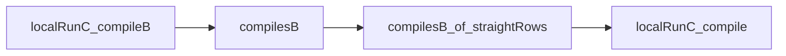

# Review of host meaning on loops

The loop results have no confirmed semantic defect at `74cc52c5`.
The proposed removal of the straight proof needs a dependency change before deletion.
The generated proof report also needs regeneration.

## Scope and verdict

| Item | Scope |
| --- | --- |
| Reviewed head | `74cc52c5c66d750d5875bb745fd26cdb00d8617a` |
| Proof diff | `f25bea3d..74cc52c5` |
| Process diff | `d1c5b566`, reviewed separately |
| Source rules | `AGENTS.md`, decisions rows 310, 313, 314 and 338 |
| Contract | [The widening packet](../2026-10-10-host-meaning-widening/README.md) and its `Goals.lean` |
| Review worktree | Branch `codex/review-loop-host-meaning` |
| Edits | This research directory only |
| Independent review | Three GPT-6.1 Sol agents inspect the statements, local reasoning and integration |

The scoped build, production controls and axiom gate pass.
[ReviewAudit.log](ReviewAudit.log) records proved status for both loop results and their forward connection.
The audit finds no planned goal beneath the reviewed declarations.
It admits only `propext` and `Quot.sound`.
[verification.json](verification.json) records commands, results, pins, control counts and file hashes.

No production file changes here.
The review does not run a full battery, an outside implementation or a whole-tree axiom gate.
The unrelated working edit of `TyView.lean` in the primary checkout stays untouched.

## Findings and next actions

### R1. Regenerate the proof report

Evidence kind: checked source comparison.
Severity: minor reporting defect.

`registry` in `tools/ProofGraph/Registry.lean` registers four new loop claims.
They are `rows-loop-session`, `rows-loop-host`, `rows-loop-straight` and `rows-loop-looped`.
`generated/semantics.md` contains none of them at the reviewed head.
The producer therefore trails the registry and `docs/STATE.md`.
Tools or readers that consume the committed report miss the new results.

Run `make gen-semantics` and retain its generated diff.
This finding concerns reporting, not the loop proofs.

### R2. Extract leaf proofs before removing the straight proof

Evidence kind: checked proof dependency and import comparison.
Severity: correction to the proposed next change.

`localRunC_compileB` in `src/Effect4/Laws/Program/Agreement/LoopCalls.lean` still depends on the straight theorem.
The helper `compilesB_of_straightRows` calls `localRunC_compile` in `src/Effect4/Laws/Program/Agreement/Calls.lean`.
The current dependency is:



Making the last theorem depend on the first would create a cycle.
The imports also run from `LoopCalls` through `Hosted` to `Calls`.

1. Extract the supporting relations and five leaf proofs into a lower module.
2. Make the loop proof consume those leaves directly.
3. Derive the straight theorem through the conservative connector.
4. Keep `hostRun_of_asExit` with the supporting declarations.
5. Give `HostedLoop` an explicit `Hosted` import after the split.

The present proof has no such cycle.
The problem concerns the suggested deletion order.

### R3. Use the existing fold generator for the new meaning

Evidence kind: Lean proved research probe.
Status: optional consolidation, with a checked connection.

`denoteRowsB` in `src/Effect4/Laws/Program/DenoteRowsB.lean` is a new hand traversal.
The existing straight and host-free meanings already have generated fold connections.
[FoldProbe.lean](FoldProbe.lean) derives the new connection with one existing command:

```lean
fold_of Effect4.Program.Denote.denoteRowsB (family := Effect4.Program.Eff)
```

The command generates its algebra, homomorphism and `denoteRowsB.eq_cata`.
[FoldProbe.log](FoldProbe.log) states the resulting equation.
[ReviewAudit.log](ReviewAudit.log) audits the generated declarations separately.
The paired carrier retains syntax because the fallback clause passes its node to `denoteRows`.
This probe therefore does not claim a smaller carrier or faster execution.

Place this connection beside the existing fold connections before consolidating the meanings.
It needs no new generator or program representation.
The probe header gives its five-point placement.

## Why the reverse argument works

`RunsToDB` in `src/Effect4/Laws/Program/Agreement/LoopCalls.lean` gives a budget cut a useful lower bound.
A cut at budget `k` requires the local run to remain live through at least `k` steps.
`ReachesC` supplies that fact when its remaining budget is zero.

`localRunC_to_rowsB` in `src/Effect4/Laws/Program/Agreement/HostedLoop.lean` chooses the step bound of an already finished local run.
A cut at that bound contradicts the observed finish.
A wait or a visited compile frontier also contradicts it.
Run determinism fixes the same exit, stores and host state.
Budget stability then extends that finished answer to every larger semantic budget.

This strengthens the forward relation without weakening H8 or H9.
Their final propositions match the original packet's propositions.
The earlier estimate overstates the work after this stronger forward statement removes the separate reverse proof.

## Evidence and limits

`ReviewMeaning.lean` imports the landed meanings and provides aliases for the original control files.
It imports no research interpretation.
`ReviewControls.lean` and `ReviewBoundaryControls.lean` retain the original cases with only their imports redirected.
The verifier checks that exact transformation.

The cases cover:

- a paged loop, its result, all stores, exact reply consumption and cleanup requests;
- low budget, an unanswered cleanup call and a host that continues beyond recorded answers;
- open failure, pull failure, combined failures and stores written before failure;
- a wrong request, missing row, handle answer and the excluded scoped TodoPaged program;
- an empty closed scope whose completion receipt still needs its administrative step.

These are finite evaluations against the landed definitions.
They are not new general theorems about waiting state or scope cleanup.
The general results are `h8_loopedRows` and `denoteRowsB_eq_session_host` in `src/Effect4/Laws/Api/SessionMeaningLoop.lean`.
Their hypotheses remain reached, funded, resting, host-driven runs and both fragment checks.
H9 also requires a finished root and a host that gave the recorded answers.
Neither theorem equates compile fuel with semantic budget.

H8 still maps both waiting and budget cuts to the coarse result `none`.
The detailed waiting connection, scopes, acquisition, forks, driver connection and typed-host connection remain outside this landing.
The review finds no regression in those deferred parts.

The law-root import boundary remains intact.
The process change keeps the standalone gates callable.
Not running the batteries follows the current landing rule and is not a finding.

## Reproduction

Run from this review worktree:

```sh
python3 docs/research/2026-10-10-host-meaning-landing-review/verify.py
```

The script runs one Lake command at a time with `LEAN_NUM_THREADS=3`.
It checks only the named dependencies, research probes, source comparison and receipt language.
It records all results before reporting success.
