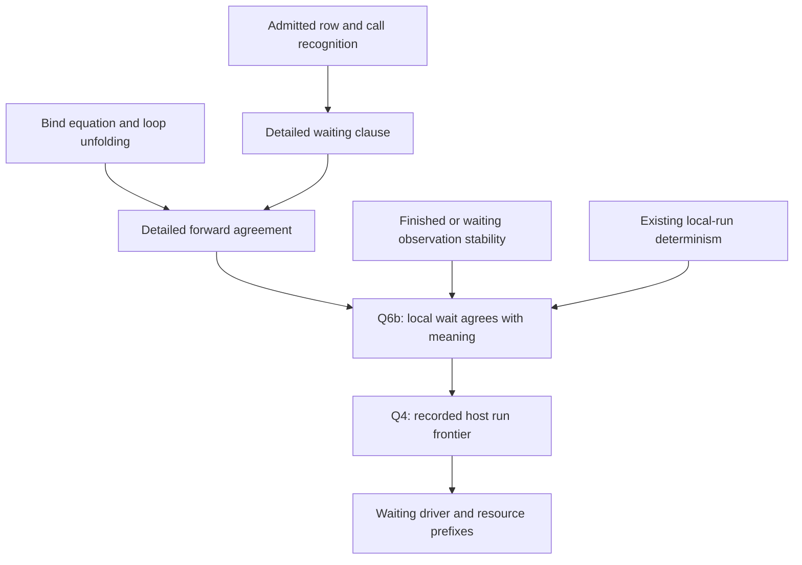

# L4a frontier review

The next agreement statement needs row admission. Naming a waiting call does not establish that its row exists.
L4a keeps the waiting payload as intended. This review finds no new defect in that committed change.

## Scope and checkpoint

- Previous checkpoint: `9e818b39596971d62b89299ca9ccc4e96ad8ea07`.
- Reviewed commit: `4a83527ac91e6df820d3a13d422cec9c3a6a0b1d`.
- Review branch: `codex/review-host-frontiers`.
- Review commit: the commit containing this packet.
- Changed files: this packet only. Production files, owner rulings, and the implementation session remain unchanged.

`0511c572` records the earlier shared-layer finding in the CX note.
That design decision remains open at this checkpoint. This packet does not repeat the earlier defect report.

Claude's inspected session has cwd `/Users/pooks/Dev/lean4-effect4`.
The bounded recent tail shows L4a committed and L4b observation composition under development.
The session reports a successful build. This review reproduces its own narrower checks separately.

The working changes in `src/Effect4/Laws/Program/DenoteRowsB.lean` remain outside this committed review.
The unrelated working change in `src/Effect4/Laws/Program/TyView.lean` also remains outside it.

## Checked result

`RunEnd.waits` in `src/Effect4/Laws/Program/Agreement/Segment.lean` carries the waiting code, stores, and host state.
`localRunC` records those values where `localStepC` returns no answer.
`ReachesC` keeps its definition and therefore compares those fields.

[Controls.lean](Controls.lean) applies `ReachesC.refl` and `localRunC_waits` at a declared data row.
Negative controls separate different requests, stores, and host states.
Another control distinguishes zero local-step budget from a waiting call.

The saved continuation remains outside this observation.
A kernel-checked control relates two waiting fibers with different continuation stacks under the same silent host.
This is a stated observation limit. It does not contradict L4a.

## Admission premise for the next slice

`callOf` in `src/Effect4/Laws/Program/Agreement/Segment.lean` recognizes a call's code without inspecting its table.
The negative control uses row zero with an empty table.
`callOf` names that call, and `hostAnswer` returns no answer.
The local run therefore waits.

`denoteRowsB` in `src/Effect4/Laws/Program/DenoteRowsB.lean` instead finishes with `outsideExit` for that missing row.
The positive control uses a declared data row. Its source meaning and local run both wait on the same request.
These are finite observations, not a general agreement theorem.

The smallest correction is to name `LoopedDataRows` in Q4's statement row of the L4 plan.
Section 3 already uses that fragment. No production change follows from this excluded-input control.

For `callOf_hostAnswer`, require a valid row index.
Reuse `hostAnswer_call` in `src/Effect4/Laws/Program/Agreement/Calls.lean`.
Use `dataRow` when the later step also needs unchanged stores during reply preparation.
Row existence alone does not discharge that stronger premise.

## Proof support and placement

These are proposed helpers for `rows-loop-frontier`, not new registry claims.
[PLAN.md](PLAN.md) records the placement before the controls.
The table gives each helper its concept, exact reach, consumer, limits, and requirement.

| Helper or statement | Concept and question | Reach and required premises | Consumer | Limits and requirement |
| --- | --- | --- | --- | --- |
| `callOf_hostAnswer` | Translation-simulation; Q6b helper | Recognized external call and a valid row index, under one fixed host and state | Waiting clause of `RunsToDO` | No reply admission or progress; R6 |
| Detailed bind equation | Translation-simulation; Q6b helper | Run the continuation from the first result's stores and host state; retain waiting payloads | Sequence, handlers, and `onExit` arms of `CompilesBO` | Generic bind can continue from `none`; only `thenOpt` treats it as a cut; R6 |
| Observation stability | Translation-simulation; Q6b helper | `Approx`, with a finished or waiting observation, under the same host and initial state | Eventual bound in Q6b and Q4 | A budget-cut observation can change at a larger budget; R6/R12 |
| Detailed forward agreement | Translation-simulation; Q6b helper | `LoopedDataRows`, a code address, related stores, and explicit local/loop budgets | `localWaitC_to_rowsB` and the coarse projection | Cut-state equality needs an additional residual relation if claimed; R6 |
| `localWaitC_to_rowsB` | Translation-simulation; Q6b | A local run waits on an admitted unanswered call; compare row, request, stores, and host state past a bound | Q4 | No arbitrary lower-budget claim, resumability, or host progress; R6/R12 |
| `rows_loop_frontier` | Host-session-protocol; Q4 | Recorded run of `LoopedDataRows` parked on a call; the host matches the applied prefix and does not answer the pending request | Waiting driver and resource prefixes S1/S2 | No forks, scopes, interruption, or resource theorem; R6/R12 |



Reuse `localRunC_agree` in `src/Effect4/Laws/Program/Agreement/Segment.lean` for uniqueness of the waiting payload.
Reuse `Holds.hostAnswer_eq` in `src/Effect4/Laws/Program/Agreement/Hosted.lean` for the machine-to-host bridge.
No second determinism proof is needed.
For an arbitrary host, agreement on past answers does not establish that it leaves the pending request unanswered.
Q4 needs that stopping premise separately.

The `onExit` arm must retain stores and host state produced before failure.
It must pass the actual exit to cleanup and retain `Exit.restoreAfterFinalizer`.
Waiting and budget exhaustion must not start cleanup.

`RowsObservation` in `src/Effect4/Laws/Program/DenoteRowsB.lean` contains no loop cursor or residual body.
Resource composition needs a separate relation to a resumable configuration.
L4's detailed observation can serve that later relation without claiming it already exists.

## Authoring and consolidation

The inspected L4b draft introduces a generic detailed run and one bind equation.
Its projections connect the existing coarse run and budgeted observation.
This approach can concentrate sequencing, handler, and finalizer reasoning behind one law.
This paragraph is a source-review observation about unfinished work, not reproduced proof evidence.

Keep the coarse agreement as a projection of the detailed agreement, as the plan proposes.
Keep the source fragment and admission premises at that shared statement.
This avoids separate agreement proofs with different hidden assumptions.

## Verification

[verification.json](verification.json) records the commands, results, input hashes, and measured control counts.
[build.log](build.log), [controls.log](controls.log), and [audit.log](audit.log) retain their output.

The narrow build includes the changed agreement modules and their immediate consumers.
The cycle-aware audit checks the changed modules and the controls.
The audit reports the permitted axiom ceiling and no dependency on planned goals in those declarations.
This does not close the future detailed waiting agreement.

Reproduce the checks with:

```sh
python3 docs/research/2026-10-10-l4a-frontier-review/verify.py
```

The verifier runs one Lake process at a time with `LEAN_NUM_THREADS=3`.
The packet changes no executable production code or generated target.
No outside-runtime comparison, TypeScript compiler run, full sweep, merge, or push forms part of this review.

## Open work

- State Q4 over the admitted data-row fragment.
- Carry waiting payloads through the detailed forward agreement.
- Prove the waiting bridge from that agreement and stability.
- Keep the existing cross-scope layer decision separate from this host-frontier work.
