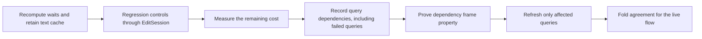
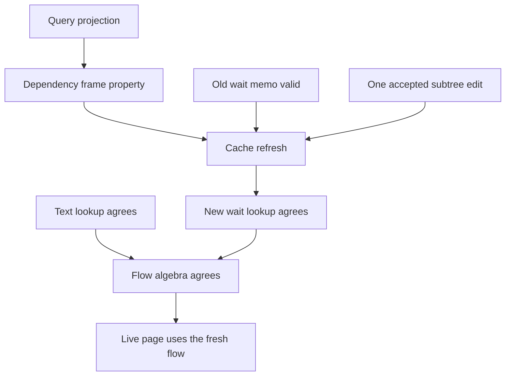

# Separate local text reuse from dependency-based wait reuse

The program remains the one `Eff` tree.
The graph and its caches are derived tool data.
The repair changes neither program typing nor machine state.

## One observation per calculation

`Program.ownText` reads a constructor and its non-child arguments in `tools/Tools/View/Program.lean`.
A subtree replacement leaves that observation unchanged at other nodes, including ancestors.

`Flow.forkOf` in `tools/Tools/View/Flow.lean` reads more than the await's own syntax.
It reads the binder metadata along the address and the source selected by that binder.
An unchanged binder does not imply an unchanged bound source.

Use the wait result at each await address as the agreement observation.
`Inc.flow` consumes that result by key lookup.
List ordering is not its observation.
Require unique await addresses before reasoning through lookup.

Keep `Flow.Targets.unresolved` with the result.
An empty edge list alone loses the distinction between an unresolved query and a query with no selected fork.
The existing `Flow.targets` already supplies that distinction.

## Landing order

Land the conservative repair before caching wait queries again.
Keep the current fresh functions as specifications.
Measure the repair before adding another cache or index.

## A useful dependency record

A future entry can hold an await address, its `Flow.Targets`, and the source observations that produced it.
This is a proposed derived tool record, not stored program syntax.

The record must include failed queries.
The reverse-edit control changes an unresolved query into a resolved query.
A cache containing resolved edges alone cannot find that missing dependency.

Separate two kinds of source observation:

- binder metadata along the await's address;
- the bound source inspected by `spawnAt`.

Do not record every ancestor as an entire subtree dependency.
The root would then invalidate every query on every edit.
Binder metadata depends on the node's own shape.
The bound-source dependency can initially cover that source's subtree.
This is conservative and may recompute more than necessary.

Instrument the existing query once to return its answer and dependencies.
Keep the original answer as a projection of that query.
Do not create another recognizer with a separate list of binders or fork forms.
The existing generated binder metadata remains the common input.

When an edit intersects a recorded source dependency, recompute that await's answer and dependencies.
Also recompute awaits inside the edited subtree.
Delete entries for removed awaits and create entries for new awaits.
Rebuild the wait-edge projection from the retained `Flow.Targets` values.

## Proof outline and placement

Every item below is proposed.
None is a proved theorem or an open goal added to the law graph by this packet.
All serve `initial-algebras-folds`, R14, and the live page under row 334's tool-law boundary.

| Obligation | Role | Exact reach and hypotheses | Immediate consumer | Exclusions |
| --- | --- | --- | --- | --- |
| Query projection | Compatibility | Removing dependency data from the instrumented query answers the existing `Flow.targets` query | Dependency frame property | No cache validity or runtime resolution |
| Dependency frame property | `.preservation` of the query observation | The await remains, its term and binder metadata agree, and every recorded source observation agrees | Cache refresh | No claim from address disjointness alone |
| Text memo validity | Compatibility | Retained node text matches `Program.ownText` outside the replaced subtree | Incremental line and flow folds | Says nothing about wait targets |
| Wait memo validity | Invariant | One entry per existing await, including unresolved queries; each answer equals the fresh query | Cache refresh and edge projection | Invariance alone gives no refresh procedure |
| Cache refresh | `.preservation` of wait memo validity | The old memo is valid; one subtree replacement produces the new program; affected queries are recomputed | Cached edge agreement | No performance bound without a cost model |
| Cached edge agreement | Compatibility | The refreshed memo is valid and await keys are unique; lookup matches the fresh edge projection | `Inc.flow` | No runtime schedule or dynamic fiber identity |
| Live flow agreement | Compatibility | Text and wait lookups match their fresh functions; the remaining flow algebra agrees | `Live.page`, then `Live.step` | No claim about C patch application or pixels |

Use agreement of the existing flow algebras for the last connector.
Keep release handling, scopes, loops, and parallel branches in that shared structure.
Do not add a second traversal with another environment rule.

The five placement points are explicit in [PLAN.md](PLAN.md) and the table above.
A production proof must name its tool consumer and retain its observation and hypotheses.
It must not claim that the diagram establishes absence of runtime waits or deadlocks.

## Initial regression set

Retain the checked forward and reverse sibling edits in [SiblingWait.lean](SiblingWait.lean).
Add statement-binding sources when a dependency cache lands.
Add removal and insertion of awaits, including unresolved awaits.
Keep a no-op edit and a change within a fork's body as controls.
Use the same fresh query as the comparison for every case.
