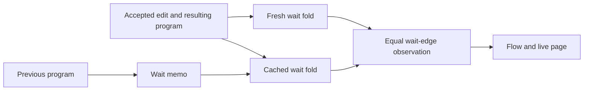

# Wait-cache probe placement

The probe tests the proposed incremental wait graph against the existing fresh wait graph.
The two programs have the same result type.
The edit replaces the source of a bound fiber.
The await remains outside the edited subtree.

| Placement point | Scope |
| --- | --- |
| Concept and property | `initial-algebras-folds`; a cached tool fold must answer the fresh tool fold's observation |
| Question, role, consumer | Proposed tool law `waits_cached_eq_fresh`; role: compatibility on the wait-edge observation; consumers: `Inc.flow`, `Live.page`, and `Live.step` |
| Registry relationship | Row 334 places layout laws in tools. This review adds no registry claim and changes no M5–M7 statement |
| Reach and hypotheses | A memo from the old program, one accepted fill at `[0]`, and the resulting program; both programs have a checked type |
| Exclusions | No machine simulation, runtime scheduling result, absence of a runtime wait, performance bound, or general cache law |
| Requirement | R14 live authoring: the graph after an accepted edit must match the fresh graph |

A text memo and a wait memo need separate hypotheses.
A node's own text reads local program syntax.
A wait query can read a bound source outside the await's subtree.

This packet first probes the proposed equality and its missing dependency premise.
No general proof starts here.
