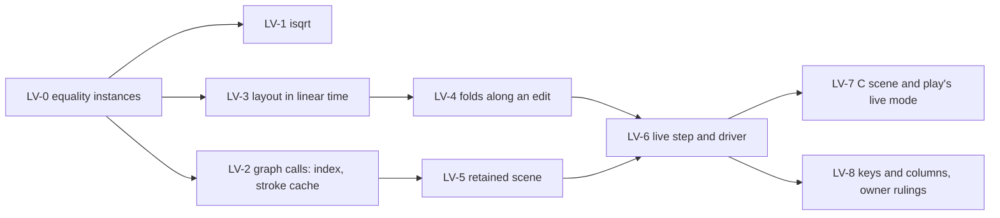

# Landing kit: the live view (slices LV-0 to LV-8)

**The one thing.** Each slice replaces named declarations of `tools/Tools/View/` with a probe
module that a written check already finds equal on every frame. LV-0 to LV-4 change no picture.
LV-5 to LV-7 add the live loop beside the batch. Only LV-8 changes what a picture keys.

The probes are in `probes/src/ProbeView/` (one module each), their checks in `probes/checks/`,
and the C side in `probes/c/`. `sh probes/run.sh NAME…` builds the modules with
`-DwarningAsError=true` and runs the named checks, one Lean process at a time. Their outputs are
in `probes/results/` (base `1c98dd948`, `refactor/phase1-phase3`).

The view's layout is a tool's (decisions row 334, point 3). Its laws are statements of the tool,
not registry claims, and they serve concept `initial-algebras-folds` and R14's live authoring.

## LV-0: equality instances

- **Edit.** `tools/Tools/View/Picture.lean`: `Call` and `Keyed` derive `DecidableEq` beside
  `Repr`; `Cubic` derives `Hashable`.
- **For the checks only.** `GNode`, `Placed`, `Route`, `Region`, `FlowMark`, `Laid`
  (`Graph.lean`) and `Flow.PreparedPlacement` derive `DecidableEq`; `Flow.Flow` derives `BEq`.
- **Then** delete the `deriving instance` lines at the head of `ProbeView.Fast` and the checks.

## LV-1: the integer square root

- **Source.** `Tools.View.Fast.isqrt` (`probes/src/ProbeView/Fast.lean`).
- **Target.** The body of `Grow.isqrt` (`tools/Tools/View/Organic.lean`): start Newton's steps at
  `1 <<< (n.log2 / 2 + 1)` instead of `n`. Every start above `⌊√n⌋` falls to `⌊√n⌋`.
- **Check.** Move the module's three `#guard`s beside `Grow.isqrt`'s own. They cover every
  `n < 2^15`, the powers of two to `2^60` with their squares and neighbours, and four large values.
- **Gain.** About five steps instead of about twenty on a squared distance in thousandths, at every
  sample of every organic stroke.

## LV-2: the graph's calls with a key index and a stroke cache

- **Source.** `Fast.Ix`, `Fast.StrokeCache`, `Fast.cachedStroke`, `Fast.segments`,
  `Fast.organicCalls`, `Fast.routeCalls`, `Fast.calls`.
- **Target.** `tools/Tools/View/Graph.lean`, namespace `Laid`:
  - build `Ix` once in `calls`;
  - pass its `find` and `onBar` to `segments`, `organicCalls` and `routeCalls`, for `Laid.find`
    and `Laid.onBar`;
  - add `Laid.callsCached (L) (l) (dx dy) (cache : StrokeCache) : List (Keyed Call) × StrokeCache`;
  - keep `Laid.calls L l dx dy := (callsCached L l dx dy {}).1`, so no caller changes.
- **Callers that gain from the cache.** `tools/Drivers/View.lean`'s `writeFrames` and the motion
  pictures (`sample`) thread one cache through a sequence; the live step does (LV-6).
- **Check.** `checks/FastCheck.lean`: `calls` equals `Laid.calls` on every frame of every probe
  build, with organic and with plain strokes, and with one cache over a whole sequence.
- **Law to state** (tool): `Grow.stroke_move`. A stroke of segments moved by `(dx, dy)` is the
  stroke moved by `(1000 dx, 1000 dy)`. Every step of `stroke` is a difference of points. The
  cache is right exactly when this law holds. `probes/measure/Equi.lean` checks it in 160 cases.
- **Gain.** A sequence of frames 4.5 to 7.3× faster (`results/FastCheck.out`).
- **Not taken.** `Fast.sessionPageIx` indexed the table and gained nothing (34 against 35 ms).

## LV-3: the layout in linear time

- **Source.** `probes/src/ProbeView/Layout.lean`: `FastLayout.kahn`, `orders`, `orderFor`,
  `assignHeights`, `preparePlacement`, `heightTable`, `placeWith`, `layout`.
- **Target.** `tools/Tools/View/Flow.lean`. Keep the list functions as the specification, as
  Codex kept `assignHeights` beside `assignHeightsIndexed`. Switch `preparePlacement`,
  `placeWith` and `layout` to the tables.
- **The laws to keep proved.** `FlowLaws` reaches the layout through `orders` (`orders_serves`),
  `orderFor` (`orderFor_serves`) and `preparePlacement_height`. Three connectors keep them:
  - `ordersTable_eq : FastLayout.orders ord es = Flow.orders ord es`. The positions' table answers
    `before` on an order with no repeat;
  - `heightTable_eq`: the table of a newest-first list answers `heightAt`;
  - `assignTable_eq`: `FastLayout.assignHeights` is `assignHeightsIndexed` from `[]`.
  `orderFor_serves` needs no fact of `kahn`: the order is checked. So `FastLayout.kahn` needs only
  its finite check, and no connector.
- **Check.** `checks/LayoutCheck.lean`: `kahn`, `preparePlacement` and `layout` equal the tree's on
  every intermediate sketch of every probe build, and on a wide parallel flow.
- **Gain.** 1.5 to 11× faster; 21 ms against 222 ms at 481 items, growing linearly
  (`results/LayoutCheck.out`).

## LV-4: the folds along an edit

- **Source.** `probes/src/ProbeView/Inc.lean`: `Memo`, `lines`, `waits`, `flow`, `Memo.next`.
- **Target.** A new module `tools/Tools/View/Inc.lean`. `Program.lines` and `Flow.ofProgram`
  stay as the specification.
- **The facts it rests on.** An edit at `a` keeps every node's own text outside the subtree at
  `a`, ancestors included, since `ownText` reads no child. It keeps every await's targets outside
  that subtree, since an edit's binders do not scope outside it.
- **Law to state** (tool), with its premise as data: `MemoValid memo a p`, every remembered text
  outside `a` is the text of `p`'s node there. Then `Inc.lines memo (some a) p = Program.lines p`,
  by the fold; and `Memo.next` of the old program is valid for any fill or omit at `a`.
- **Check.** `checks/IncCheck.lean`: lines, waits and flow equal the fresh folds at every step of
  every probe build.
- **Gain.** Lines 16 to 23×, waits 16 to 26×, flow about 10× (`results/StageBench2.out`).

## LV-5: the retained scene

- **Source.** `probes/src/ProbeView/Retained.lean`: `ObjId`, `Obj`, `Group`, `Scene`, `runs`,
  `Scene.ofGroups`, `Scene.flatten`, `Op`, `Patch`, `diff`, `Scene.apply`, `Patch.size`.
- **Target.** A new module `tools/Tools/View/Retained.lean`.
- **Laws to state** (tool):
  - `of_flatten`: a picture read as objects and flattened is the picture. It needs
    `Call.move_move` and `Call.move_zero`;
  - `apply_diff`: a scene patched by the diff to another flattens to the other.
- **Check.** `checks/RetainedCheck.lean`: both, on every two consecutive frames of every build.
- **Gain.** 2.3 to 3.2× fewer rows than whole streams on the larger programs.

## LV-6: the live step and its driver

- **Source.** `probes/src/ProbeView/Live.lean`: `Settings`, `ratchet` with `ratchet_ge_own` and
  `ratchet_ge_before` (proved), `State`, `codeCallsKeyed`, `pageGroups`, `sessionPageOf`, `page`,
  `patchRows`, `step`.
- **Target.** `tools/Tools/View/Live.lean`, and a driver `tools/Drivers/Live.lean`. The driver
  reads one session request a line on its standard input, as `tools/Drivers/Session.lean` does. It
  writes each answer's patch rows to its standard output.
- **Compiled.** A `lean_exe` for the driver is the coordinator's (`lakefile.toml`). Every timing
  here is the interpreter's.
- **Check.** `checks/LiveBench.lean`: after every step, the scene flattened is the tree's
  `pageCalls` of the same page. The calls are equal; the keys are equal except the code lines'.
- **Gain.** 2.2 to 2.6× faster than the batch on the larger programs; a mean of 37 to 113 ms an
  edit, interpreted (`results/LiveBench.out`). `checks/StageBench2.lean` times what remains.
- **The patch rows** extend the stream (`O`, `o`, `M`, `X`, `G`, `I`, `Q`, `E`). The module's
  docstring holds the table.

## LV-7: the C scene and `play`'s live mode

- **Source.** `probes/c/scene.h`: a retained store with a chained hash table, the order of
  painting and the groups. `scene_apply_row` takes a patch row; `scene_flatten` writes the stream
  that `replay_stream` paints (`tools/view/replay.h`). A row moves by `Dev.move`'s rule.
- **Target.** `tools/view/scene.h` and `tools/view/scene_test.c`. Then `play.c`'s live mode reads
  patch rows from a pipe, applies them, and paints the flattened stream: `fmemopen` stands in for
  `replay_stream`'s path. The motion of a move is the next slice of theory (README §6).
- **Check.** `probes/c/check.sh`: strict warnings, the address and behaviour sanitizers. Every
  frame's flattened stream equals Lean's whole stream, byte for byte: 59 frames, 3 programs.
- **Gain.** Chain 6's patches are 5.5× fewer bytes than its whole streams.

## LV-8: keys and columns (owner rulings first)

- **Code lines keyed by their text.** `Live.codeCallsKeyed` keys each line `code:` and its text;
  the tree's `codeCalls` keys every line `""`. Only keys change, and a kept line becomes a move.
- **Causal columns in the batch.** `Build.frames` fixes the gutter and the code's column at the
  widest of the whole sequence. The live step uses `ratchet`. The batch may keep its look-ahead,
  or take the ratchet so the batch and the live loop draw the same frames.
- **How an address reads.** A gutter bounded in width ends the page's moves across.

## Commands

1. Build and check one slice's probe: `sh docs/research/2026-10-10-live-view/probes/run.sh FastCheck`.
2. After an edit in the tree: `LEAN_NUM_THREADS=3 lake build Tools.View.Flow` (or the module edited).
3. The C side: `sh docs/research/2026-10-10-live-view/probes/c/check.sh`, after `run.sh PatchFiles`.
4. The frames still play: `tools/view/v -t pFork` and `tools/view/v -F`.

No behaviour gate is owed: no slice changes the checker, the machine, the codec or the printed
TypeScript.

## Traps met

- A record literal split across lines needs its fields at the brace's column; `Constructor.mk`
  avoids it.
- `IO.lazyPure` forces a timed value only through what the size function reads.
- `deriving instance DecidableEq` fails on a type that already has one (`Branching`, `LineState`).
- `Flow.Flow` is nested; derive `BEq`, not `DecidableEq`.
- The probes' modules compile outside Lake with `lean -R src -o build/…`, through `lake env` for
  the tree's paths.
