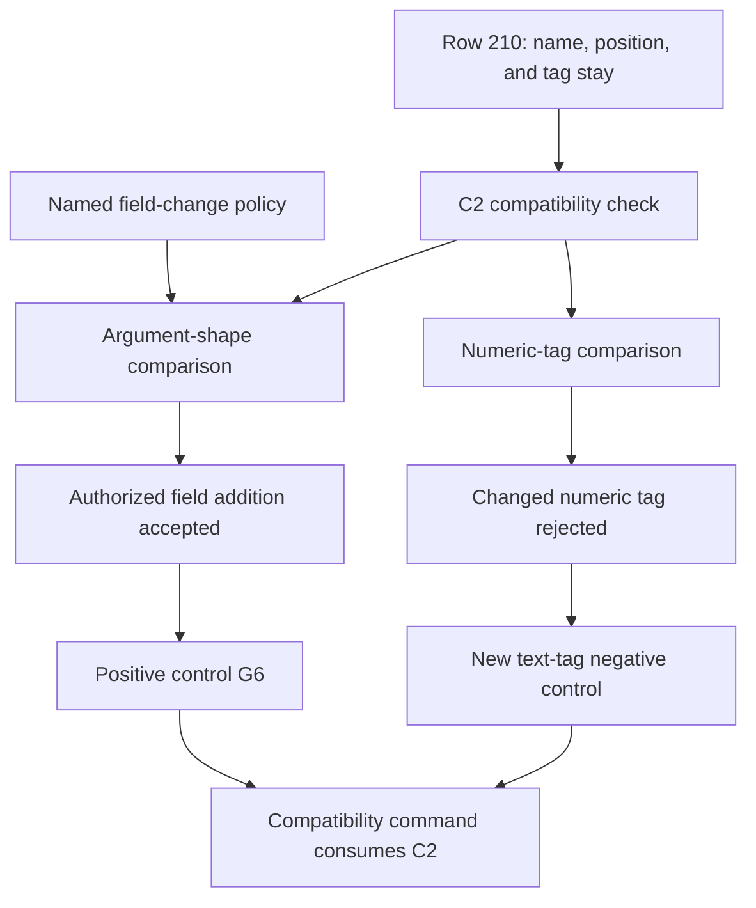

# Module-layer landing review

Fix the named field-change exemption before relying on clause C2 to reject changes to numeric tags in every manifest.
The committed tags agree today.
The finite probe changes only a candidate copy in memory.

## Reviewed state

| Item | Revision or evidence |
| --- | --- |
| Shared-layer landing | `235403a03b8843d4b86cb05759df4090a9d9bdb1` |
| Primary head | `1c98dd94831c060e591cd7e5bef19d6528c5d22a` |
| Previous review commit | `16fb2477b93d2944622d0beae519fef003a90663` |
| Review branch | `codex/schedule-independence-review-20261010` |
| Current implementation | Step 2b in the separate `module-layers` worktree |
| Ownership | Review packet only; no implementation, ruling, generator, or session changes |

The active Claude session remains `9ebf38b2-8b2f-44e5-8fd9-2dc0cb5a1f50`.
Its recent records report cwd `/Users/pooks/Dev/lean4-effect4`.
Its edits name the `module-layers` worktree.
The bounded session tail reports TypeScript printing, reading, authoring, and related law work for step 2b.
Those reported builds are owner evidence, not independent results from this review.

## ML2-C2-01: named field changes also exempt a numeric tag

**Evidence status:** independently reproduced finite counterexample.
**Scope:** clause C2, with committed inputs and candidate changes in memory.
**Consequence:** C2 accepts one changed numeric tag in its text manifest.

Row 210 in `docs/core/decisions.md` permits a named constructor to gain fields.
The constructor must retain its name, position, and tag.
The first named constructor is `Eff.defs`.

The affected declarations are `c2`, `item_name`, and `retyped_names` in `scripts/lib/conservativity.py`.
Review them at `git:235403a03:scripts/lib/conservativity.py`.
The source remains unchanged at the reviewed primary head.

The manifest collection includes argument shapes and numeric tags.
`item_name` removes either suffix before C2 checks the field-change exemption.
Thus `defs=30` and `defs=99` have the same extracted constructor name.
C2 accepts their difference because the policy names `Effect4.Program.Eff.defs`.

The reproducer changes `defs=30` to `defs=99` in `ocaml/goldens/eff/wire-tags.txt`.
It leaves `tools/Effect4Gen/wire-tags.json` unchanged.
The retained C2 output labels the text-tag difference as a named field change.

This is a missed rejection in a compatibility check.
It is not evidence that the committed program bytes have a wrong tag.
The JSON tag table still rejects a changed tag.
No result here establishes acceptance by the entire compatibility command or a behavior gate.

## Smallest repair

Keep the shared constructor-name extraction for retirement handling.
Restrict the field-change exemption to argument-shape manifests.
The proposed patch excludes the numeric-tag manifest at that one exemption.
It adds no program representation and changes no accepted authoring syntax.

[repair.patch](repair.patch) contains the proposed source change.
The probe applies it only in memory.
[additional-control.json](additional-control.json) contains a proposed negative control for the existing mutation battery.
The coordinator can select its final control name.

| Control | Landed C2 | In-memory repair |
| --- | --- | --- |
| Authorized `Eff.defs` field addition | Accept | Accept |
| Same field addition without its policy name | Reject | Reject |
| Numeric tag changed in JSON | Reject | Reject |
| Numeric tag changed in text during the landing | Accept | Reject |
| Numeric tag changed in text after the landing | Accept | Reject |
| Existing unnamed field-change control R4 | Reject | Reject |
| Existing named field-change control G6 | Accept | Accept |

The table records the results in [results.json](results.json).
These controls exercise C2 only.

## Placement and dependency map

This packet proposes a gate obligation, not a new Lean theorem.
No existing theorem changes its statement.

| Placement point | Scope |
| --- | --- |
| Concept and property | `exact-codecs`, with a proposed cross-revision tag-stability check under DI-47 and row 210 |
| Question and consumer | Does a named field-change exemption retain each existing numeric tag? The consumer is `run`, through `c2`, in `scripts/lib/conservativity.py` |
| Registry relation | Role: compatibility. `sketch-wire` and `json-read-exact` concern canonical data within a signature. Neither states this cross-revision contract |
| Reach and premises | Well-formed, uniquely named manifest entries; an existing constructor and family remain active; C2 accepts the candidate under a named field-change policy |
| Exclusions | No codec retraction proof, source typing, machine progress, runtime compatibility, whole-gate result, or host observation follows |
| Requirement served | R2's representation compatibility under DI-47. The check adds no premise or conclusion to the M5–M7 typed-run spine |

The proposed contract requires the existing constructor's text tag to equal its candidate text tag under those premises.
A named field addition changes only the permitted argument-shape comparison.
There is no registry claim for this cross-revision check today.
Keep it as gate evidence unless the coordinator places a separate formal obligation.



## Other landing evidence

The prior review audited selected law modules and their compiled dependencies.
[law-source-match.json](law-source-match.json) compares its recorded source hashes with the committed shared-layer landing.
Every recorded source matches.
The earlier audit remains evidence for that snapshot, with its existing limits.
This review runs no new Lean build and no new axiom gate run.

The refusal-detail repair lands at `1c98dd948`.
`Tools.Query.refusalJson` now includes the canonical refusal data through `Tools.JsonBridge.printJson`.
`Tools.Session.viewJson` uses that same projection.
This source change addresses the earlier projection loss without another reason enumeration.
This review does not independently execute the repaired Lean tool.
The earlier distinction between structural editor reasons and richer checker reasons remains relevant.

The owner reports behavior gates for step 2a and a separate schema-TypeScript rerun after a script repair.
The first full-gate log ends with exit 2.
Do not present its tail, or the later successful rerun, as an independently reproduced full sweep.

## Reproduce and integrate

1. Run the probe from this review worktree.
2. Inspect its expected and actual C2 results.
3. Apply the proposed source change in the implementation worktree after its owner accepts it.
4. Add the proposed negative control beside R4 and G6.
5. Run the compatibility controls before recording the repair as landed.

```sh
python3 -B docs/research/2026-10-10-module-layer-landing-review/probe_c2.py
```

The script reads git blobs at pinned commits.
It writes only this packet's evidence files.
It runs no producer, build, or behavior gate.
[inputs.json](inputs.json) records input hashes.
[probe.out](probe.out) records the reproduced result.

## Checkpoint

[checkpoint.json](checkpoint.json) records the reviewed commits and open findings.
ML2-C2-01 is open in the implementation.
The in-memory repair is checked but unapplied.
Step 2b and per-call layer identity remain separate implementation work.
No new typing counterexample appears in this review.
