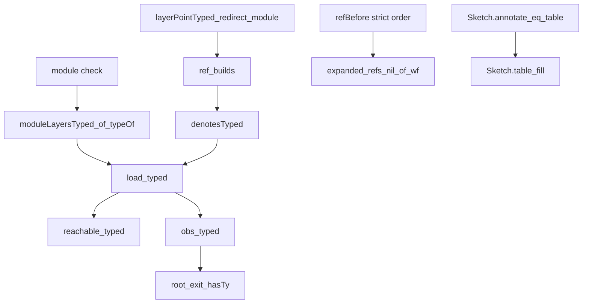

# Module-layer law review

The changed laws pass the independent dependency audit. The implementation still needs its behavior gates before landing.
This packet reviews the uncommitted step 2a draft above `cd61d93378275c276a2c0206a8391b881b1f9864`.
It follows review commit `a071a0ab4b6507742fa395efea25c91f27dacecf`.
The primary checkout remains at `9fb3b66cd0c80fe26468e9bef143e993fd3bf3f8` during this check.

## New evidence

Claude's law build reports success in [the retained output](owner-law-build-tail.out).
That output is observed evidence. This review does not reproduce the implementation build.

The independent audit runs from the isolated review worktree against compiled draft modules.
[The output](audit.out) records 1,703 audited declarations within `[propext, Quot.sound]`.
None depends on a planned goal. The audited modules contain no planned goal.
The same run reports eleven named consumers as proved, with no next goal.
[The input records](inputs-before.json) contain 956 source and artifact hashes across 319 repository modules.
The hashes remain unchanged after the run.

| Statement | Source | Evidence status |
| --- | --- | --- |
| `moduleLayersTyped_of_typeOf` | `src/Effect4/Laws/Program/Typed/Denotation.lean` | Proved; the module check supplies the new internal premise |
| `layerPointTyped_redirect_module`, `ref_builds` | `src/Effect4/Laws/Program/Typed/LayerArm.lean` | Proved; the module-layer reference hop keeps its point typed |
| `denotesTyped`, `load_typed` | `src/Effect4/Laws/Program/Typed/LayerArm.lean` | Proved; no new caller certificate appears in checked loading |
| `reachable_typed`, `obs_typed` | `src/Effect4/Laws/Program/Typed/Commands/Clauses/All.lean` | Proved; existing checked-program and admitted-tape premises remain |
| `root_exit_hasTy` | `src/Effect4/Laws/Program/Typed/Results.lean` | Proved; a recorded root exit has its declared type |
| `expanded_refs_nil_of_wf` | `src/Effect4/Laws/Program/ReferenceExpansion.lean` | Proved; well-formed layer references expand |
| `Sketch.annotate_eq_table`, `Sketch.table_fill` | `src/Effect4/Laws/Program/Typing/PartsTable.lean` | Proved; their existing fragment and replacement premises remain |

The proof roles and five placement points are in [the plan](PLAN.md).
The audit adds no theorem, changes no statement and edits no implementation file.

## Proof dependency outline

The diagram shows selected consumers. It omits intermediate lemmas.



The module-layer premise remains internal to checked loading.
An author does not supply another proof for each layer reference.
The reference rule admits whole module declarations and keeps their empty parameter context.
Authors keep the checked loading interface while modules gain shared layers.

## Exact run

From `/Users/pooks/.codex/worktrees/module-design-review/lean4-effect4`:

```sh
LEAN_NUM_THREADS=3 lake env python3 docs/research/2026-10-10-module-layer-law-review/run_audit.py
```

[The result](result.json) records exit zero, Lean 4.33.1, the command, elapsed time and imported paths.
[The audit source](Effect4/Review/ModuleLayerAudit.lean) names nine reviewed modules and eleven proof consumers.
The runner reads implementation artifacts and uses a separate copy of the proof-graph tools.
It starts no Lake process in Claude's worktree.

## Remaining work

Claude adds whole-module editor controls in [the observed change](owner-editor-controls.diff).
Those controls cover the module-layer source path, a same-type replacement and a replacement that changes its type.
This review reads that change but does not claim its build result.
The earlier packet already reproduces these cases independently, including undo and located refusal.

The earlier diagnostic findings remain unchanged: `ML2-OW-01` and `ML2-OW-02`.
They concern refusal messages and their precedence. They do not identify a typing defect in a program the checker accepts.
The smallest next action is to finish the reached behavior gates and retain the two diagnostic controls.

The TypeScript printer, reader and authoring placement belong to step 2b.
Per-call memo identity belongs to step 3.
Their absence is an explicit deferral, not a regression in this slice.

## Evidence limits

The audit checks the compiled draft's proof dependencies. It does not independently rebuild that draft.
The retained diffs keep Git's blank context lines, including their leading space.
The whitespace check excludes only those two evidence files. All other packet files pass.
The stable hashes detect changes during this run. They do not establish the source provenance of an artifact by themselves.
The owner build supplies the separate build evidence.
This review makes no new target-runtime, termination, progress, schedule-independence or host-agreement claim.
The checked-program, admitted-tape and reference-formation premises remain part of their respective statements.
The state and host boundaries remain those of the existing statements.

All changed files belong to this review packet. [The manifest](manifest.json) lists their hashes.
[The checkpoint](checkpoint.json) records reviewed inputs, resolved verification limits and remaining work.
[The reviewed diff](reviewed-laws.diff) retains the law changes above the implementation base.
