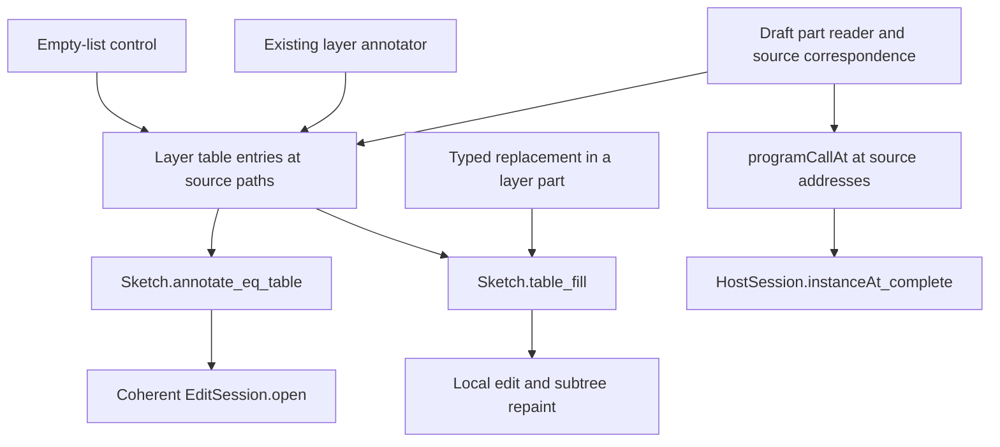

# Module-layer parts: editor and call-reader support

The editor table must include the module's layer child at its source addresses.
Use the existing layer annotator for a nonempty list.
Keep one empty-list entry with no environment or answer, matching the draft part reader.

## Scope and result

Reviewed dependency code: `cd61d93378275c276a2c0206a8391b881b1f9864`.
The isolated review worktree starts at packet commit `0e4b15a427fc2ec7e9853e0856edb468e7efd9cb`.
The primary checkout advances to `f6ee9ae5941e418837380809070063899f03fe3b`, which records the row 342 ruling only.

Claude's module-layer implementation is uncommitted work at the earlier code base.
The [snapshot](draft-snapshot.json) records the inspected files' hashes and time.
The [draft difference](draft-diff.patch) retains those changes.
This review identifies migration requirements, not a defect in a claimed landing.

[Probe.lean](Probe.lean) contains finite controls over existing layer-list syntax.
It mirrors the new part reader without changing the production constructor.
[The result](probe-result.json) and [the output](probe.log) record the check.
They do not certify the whole uncommitted implementation.

The controls cover empty declarations, ordinary layers, a refused variable, a bound variable, a checked call, finalizer environments, nesting and a reference.
They compare all entry fields: paths, environments, answers and located refusals.
The rejected head control checks that an independent later declaration remains visible.

## The reuse that works

`Part.layersProgram` in `src/Effect4/Program/Typing/Parts.lean` wraps a declaration list with `provideLayer` and `mergeAll`.
This temporary program lets the existing focus and call readers inspect programs inside the list.
It introduces no stored syntax or new checker.
Its source correspondence maps `2 :: rest` to `0 :: 0 :: rest` inside the wrapper.

The finite controls check that correspondence at a nested body.
They check replacement in the wrapper and the original layer list.
They also compare the call's request and answer columns with the direct call reader.
These are address and typing observations, not execution or host-reply observations.

The wrapper must stay inside the reader adapter.
Running it would build the declarations, which differs from merely declaring unused layers.
Keep source paths in editor commands, run points, rendered objects and call-table keys.
`programCalls` already enumerates source addresses before asking `programCallAt`.
Retain that order.

## The annotation migration

The inspected `annotateModule` in `src/Effect4/Program/Typing/PartsTable.lean` ignores the new layer field.
Its new constructor pattern ends with `_`.
This is unfinished migration work.

`EditSession.open` in `src/Effect4/Program/Edit.lean` uses that table.
Without the layer segment, its view omits the declaration programs.
`EditSession.feed` cannot select its local splice when the edited address has no table entry.

Append the layer segment after the main program, matching `Node.addresses`.
Use this existing annotator:

```lean
match layers with
| .nil => [⟨[2], none, none⟩]
| .cons _ _ => (Annotate.checkLayers (s.withDefs decls) [2] layers).1
```

`Annotate.checkLayers` lives in `src/Effect4/Program/Typing/Annotate.lean`.
It gives every declaration its closed environment and checks nested programs at their source paths.
Its traversal also visits a later declaration after an earlier refusal.
No wrapper traversal or result-path repair is needed.
This is a source-derived cost observation, not a measured speedup or cost theorem.

Two controls prevent tempting mistakes:

- The empty declaration list checks, but `mergeAll` refuses an empty list.
  The draft therefore returns no part for the empty child.
  Direct annotation of that empty list records a closed environment, which differs from the draft's address-table specification.
- Renaming only entry paths works on the positive fixture.
  It fails on the refused fixture because the refusal still carries a wrapper path.
  Annotation at `[2]` supplies the correct refusal path directly.

The proposed branch matches the current part specification.
Changing that specification deliberately would require its table and proof consumers to change together.

## Proof dependency graph



[PLAN.md](PLAN.md) places each proposed connector using the five required fields.
`module-annotate-table`, `module-table-splices` and `block-call-instance` already own the questions.
Add no second claim family for the wrapper.

For the table connector, retain refused inputs and the empty child in its reach.
For replacement, retain the admitted-module and same-type filling premises.
For calls, retain the actual source call address and checked module premises.
None establishes reference expansion, per-call memo identity, cleanup execution, progress or host meaning.

## Remaining integration controls

Run these after the new constructor and its dependencies build:

1. Compare `Sketch.annotate` with `Sketch.table` on empty and nonempty module layers.
2. Fill `[2,0,0]` with a program of the same type and require the splice result.
3. Check the resulting session table against the specification.
4. Undo the edit and check the original sketch.
5. Confirm that rendered identifiers and call-table keys contain source addresses only.

Those whole-module controls remain open here.
The current probe checks their layer-reader components at the committed code base.

## Ownership and evidence limits

A Sol 6.1 reviewer independently inspects the wrapper and its edit-session consumers.
It finds the annotation migration above and no additional wrapper-address defect by source inspection.
The parent runs the retained finite controls.
No production file, owner ruling, implementation session or build configuration changes.
No full sweep, TypeScript check, external-runtime gate, merge, push or message to Claude occurs.

The retained Git patch and its diagnostic log keep the original context prefixes and source whitespace.
The whitespace check excludes these two evidence files only.
[The check record](diff-check.json) gives the exact exclusion and result.
