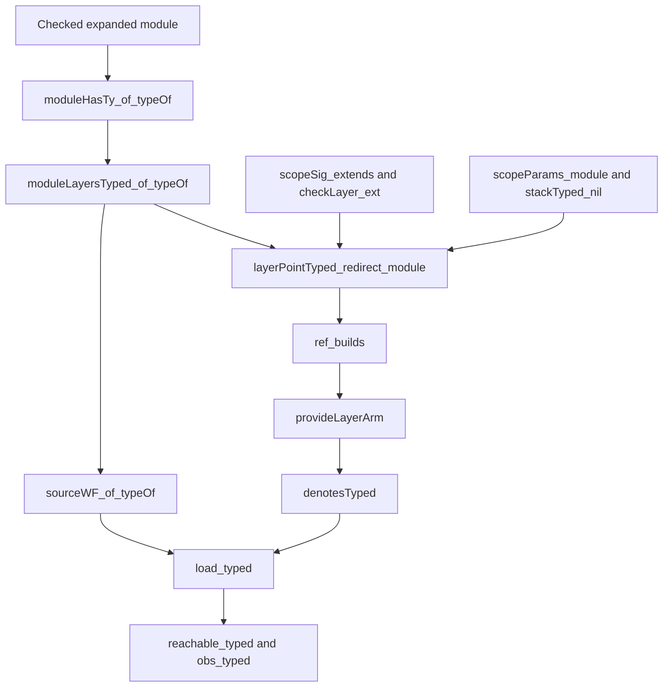

# Module-layer step 2a: editor, typing and refusal review

The editor migration passes the whole-block controls left open by the earlier review.
Keep the new located-refusal controls when landing step 2a.
Clarify the scope table: earlier reference faults take precedence over `otherScope`.

## Reviewed state

The primary checkout is `9fb3b66cd0c80fe26468e9bef143e993fd3bf3f8`.
Claude's module-layer worktree starts at `cd61d93378275c276a2c0206a8391b881b1f9864`.
Its step 2a changes remain uncommitted during this review.
[The retained difference](draft.patch) and [source hashes](inputs-before.json) identify the inspected draft.
[The checkpoint](checkpoint.json) identifies the reviewed law sources and remaining checks.

The earlier component review is `752d363f0`.
Its note is `docs/research/2026-10-10-module-layer-parts-review/README.md` at that commit.
This packet starts from review commit `acf7cf41`.
It changes no production file, owner ruling or implementation-session file.

## Resolution: module-layer edits use the shared table

`Table.moduleLayers` and `annotateModule` in `src/Effect4/Program/Typing/PartsTable.lean` now include child `2`.
A nonempty list uses `Annotate.checkLayers` at the source address.
An empty list retains one entry without an environment or answer.
This matches the earlier recommendation without adding another checker.

[Probe.lean](Probe.lean) checks the actual definition block with its new field.
Its nine samples produce ninety table entries.
All entries match `Sketch.table`, including refused programs and finalizer environments.
An independently typed later declaration remains visible after an earlier refusal.

The same probe exercises `EditSession.feedStep` at `[2,0,0]`.
A same-type replacement splices the table.
The resulting table matches both fresh annotation and the address-table specification.
Undo restores the program, table and hole list.
An invalid replacement rechecks and reports its refusal at `[2,0,0]`.
Editing the layer-list node itself leaves the session unchanged because that node holds no program.

`programCallAt`, `programCalls` and `Api.HostSession.callTable` retain the call's source address, `[2,0,0]`.
The temporary reader wrapper's address does not become the call-table key.
The probe does not inspect rendered identifiers or execute an external host.

## ML2-OW-01: one malformed reference changes its reason

Evidence status: finite checked comparison.
Scope: a missing target in the new module-layer address range.

[DiagnosticBase.lean](DiagnosticBase.lean) names absent target `[2,0]` from main-program site `[1,0]`.
The old block has no child `2`, and the refusal is `notBefore`.
[DiagnosticDraft.lean](DiagnosticDraft.lean) adds the empty module-layer field.
The draft refusal is `noLayer`.
Both programs remain refused at the same source address.

`Eff.inModule` in `src/Effect4/Program/Refs.lean` classifies the address before the target lookup.
Therefore `Eff.refBefore` admits that ordering even when the layer does not exist.
`Eff.refFault` then reports the missing layer.

Smallest action: retain this control and name the diagnostic compatibility change in the landing receipt.
This finding does not justify rejecting the new module-first order.
It does not establish changed behavior for an admitted program.

## ML2-OW-02: the scope table must retain guard precedence

Evidence status: finite checked controls and source review.
Scope: references to pieces inside module layers.

The scope table in `docs/research/2026-10-10-layer-scopes.md` says such references return `otherScope`.
That reason applies only after the earlier guards pass.
[RefusalOrderDraft.lean](RefusalOrderDraft.lean) retains these observations:

| Target condition | First refusal |
| --- | --- |
| The target follows the site | `notBefore` |
| The target encloses the site | `encloses` |
| The target is another reference | `toReference` |
| The earlier guards pass, but the target is an internal piece | `otherScope` |

Smallest action: qualify that scope-table row and keep the precedence controls.
The checker refuses every case in this group.

The mixed-fault control checks another useful distinction.
`Eff.firstRefFault` follows source traversal: bodies, main, then module layers.
Reference expansion ranks module-layer paths first through `Eff.refBefore`.
The editor must not sort refusals by that expansion order.
These are two purposes over the same source paths, with separate ordering rules.

## Typing dependency review

Evidence status: source reviewed by a Sol 6.1 reviewer and the parent.
Scope: the new formation premise and its public consumers.
The implementation's current proof build and dependency audit remain outside this packet's reproduced evidence.

`ModuleLayersTyped` in `Laws/Program/Typed/Admission.lean` records the module layers' checks at the source signature.
`moduleLayersTyped_of_typeOf` derives that fact from the checked expanded module.
`sourceWF_of_typeOf` in `Laws/Program/Typed/Assembly.lean` supplies it at load.
It does not become a new obligation that application authors discharge manually.



The module hop uses its target's base check and signature extension to obtain the reference site's verdict.
The target has no program parameters in scope.
Retaining the point's stack does not grant access to caller parameters.
The layer point still requires its closed environment and typed completed exits.
The build still requires a live scope and memo map.

`layersTyped_ext` feeds `moduleHasTy_ext`.
The existing machine updates retain `SourceWF`, including its new layer fact.
Ordinary references retain the same-scope requirement.
References into the module must name whole declarations.

Two summaries still need updating: `MachineTyped.sourceWF` and `denotesTyped` mention references and bodies without the new layer evidence.
This is documentation work, separate from the proof build.

## Reference expansion review

Evidence status: source reviewed by a second Sol 6.1 reviewer.
Scope: ordering premises and their consumers in the existing expansion proof.
No new cycle counterexample appears in this review.

`RefsWithin` uses `Path.rankBy root.refBefore` over the original reference occurrences.
It does not require physically sorted occurrences or decreasing occurrence counts after expansion copies a target.
`refBefore_irrefl`, `refBefore_trans` and `refBefore_append` supply the order facts used by `target_refs_prior`.
`layerAt_ne_nil` supplies the required nonempty target path.
The final expansion retains the existing additional round.

`layerRefsWF_module` combines the whole-declaration shape with the existing target lookup.
`Path.spineHead` alone does not admit an absent layer.
This is a review of the proof structure, not a reproduced proof of the whole draft.

## Verification and limits

[PLAN.md](PLAN.md) places each check before its probe.
[The main result](result.json) records the command, compiler, input hashes and elapsed time.
[The diagnostic results](diagnostic-results.json) record the base and draft comparisons.
[The audit result](audit-result.json) records the finite probe's dependency audit.

| Run | Result |
| --- | --- |
| Whole-block probe | 23 guards pass; nine samples and ninety table entries |
| Base diagnostic | Three guards pass |
| Draft diagnostic | Three guards pass |
| Refusal precedence | Seven guards pass |
| Probe dependency audit | Twenty declarations within `[propext, Quot.sound]`; no planned goal or declaration resting on one |

Commands, from the isolated review worktree:

```text
LEAN_NUM_THREADS=3 lake env python3 docs/research/2026-10-10-module-layer-step2a-review/run_probe.py
LEAN_NUM_THREADS=3 lake env python3 docs/research/2026-10-10-module-layer-step2a-review/run_diagnostic.py
LEAN_NUM_THREADS=3 lake env python3 docs/research/2026-10-10-module-layer-step2a-review/run_audit.py
```

The runners use the implementation worktree's compiled modules read-only.
The main probe records 583 source and artifact hashes before and after its run.
None changes during that run.
The dependency audit covers the probe's declarations, not the implementation's new law modules.
No Lake process runs in Claude's worktree for this packet.

The first two audit attempts lack tooling imports in Claude's partial build.
The retained logs show the missing `ProofGraph.AxiomAudit` and `Tools.Graph.Path` artifacts.
The runner supplies those unchanged tooling artifacts from the review worktree in a separate cache.
The third audit passes.

These checks establish finite editor and refusal observations.
They establish no execution speedup, host agreement, general progress or per-call memo behavior.
TypeScript printing, reading and authoring placement remain step 2b.
The printer's named refusal in step 2a is an intentional limit.

The retained Git patch keeps source context whitespace exactly.
The whitespace check excludes only `draft.patch`; it checks every authored file.
The packet runs no full sweep, merge, push or implementation-session message.

## Next checks

1. Finish Claude's current law build and audit the changed law modules.
2. Retain the finite editor and refusal controls when preparing the landing.
3. Qualify the scope-table diagnostic and update the two formation summaries.
4. Run the behavior gates reached by the constructor-field change.
5. Review step 2b separately, especially hoisted addresses and authoring placement.

The typed-run premise is discharged in source.
Its landing remains pending until the implementation's own gates pass.
