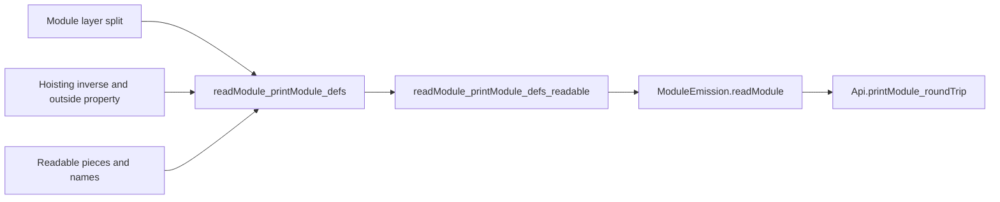

# Module-layer step 2b review placement

The review imports the implementation worktree without changing its files.
The implementation base is `1c98dd94831c060e591cd7e5bef19d6528c5d22a`.
The reviewed change remains uncommitted when this plan is written.

## Completion criteria

Compile the finite controls and inspect their output.
Audit the changed law modules and inspect their dependency status.
Record the imported sources and artifacts before and after both checks.
Commit the review packet locally.

## Placement

No new theorem or planned goal is proposed.
Each control tests a boundary of an existing claim.

1. Concept: `exact-codecs`, the module round trip in `docs/core/semantics.md`.
   The property is reading a successfully printed module back to its program.
2. Question: `module-defs-round-trip`, role `compatibility`, in `tools/ProofGraph/Registry.lean`.
   Its pointer is `readModule_printModule_defs` in `src/Effect4/Laws/Codegen/Module.lean`.
   Consumers are `readModule_printModule_defs_readable`, `ModuleEmission.readModule`, and `Api.printModule_roundTrip` in `src/Effect4/Laws/Api/ModuleReadable.lean`.
3. Reach: finite blocks with module layers, definition references, ordered layer dependencies, and ordinary hoisted layers.
   Refusal controls cover missing, duplicated, reordered, and nested module declaration paths.
   Decisions row 341 bounds the admitted reference scopes.
   Definitions retain the theorem's readable columns and empty requirement row.
4. Limits: finite evaluations do not establish a universal round trip, TypeScript acceptance, runtime agreement, progress, or cleanup correctness.
   The audit checks compiled law dependencies, not source freshness through a whole rebuild.
   Source and artifact hashes record precisely which inputs were read.
   The host boundary stays at `docs/core/host-boundary.md`.
5. Requirement: R8, the generated program's connection to the stored program.
   This review changes no M5, M6, or M7 claim.

## Checks

- Check a block whose second module layer names its first layer.
- Check a definition and the main program naming that second layer.
- Check coexistence with an ordinary hoisted layer.
- Check exact module reconstruction and declaration order on those finite blocks.
- Check malformed module path lists at the reader's split.
- Check that the public checker still refuses a nested module-layer target.
- Check that a body's own layer remains outside this printing slice.

## Repair probe

The initial cycle-aware audit rejects `moduleLayersOf_split` for reaching `Classical.choice` through `List.filter_eq_nil_iff`.
Four round-trip consumers inherit that dependency.
The candidate changes only the two proof bodies using that lemma.
It keeps the theorem statement and its R8 placement above.
It follows the constructive membership argument in `Slice.omitted_full`, in `src/Effect4/Laws/Slice/Lattice.lean`.
The candidate recompiles the changed module and its direct round-trip consumer before repeating the audit.
It remains an isolated proposal; the implementation worktree stays unchanged.

The initial finite examples also use a service key with the wrong value type.
The corrected examples retain distinct service identities and give both keys the natural-number value type.
That fixture correction is not an implementation defect.
