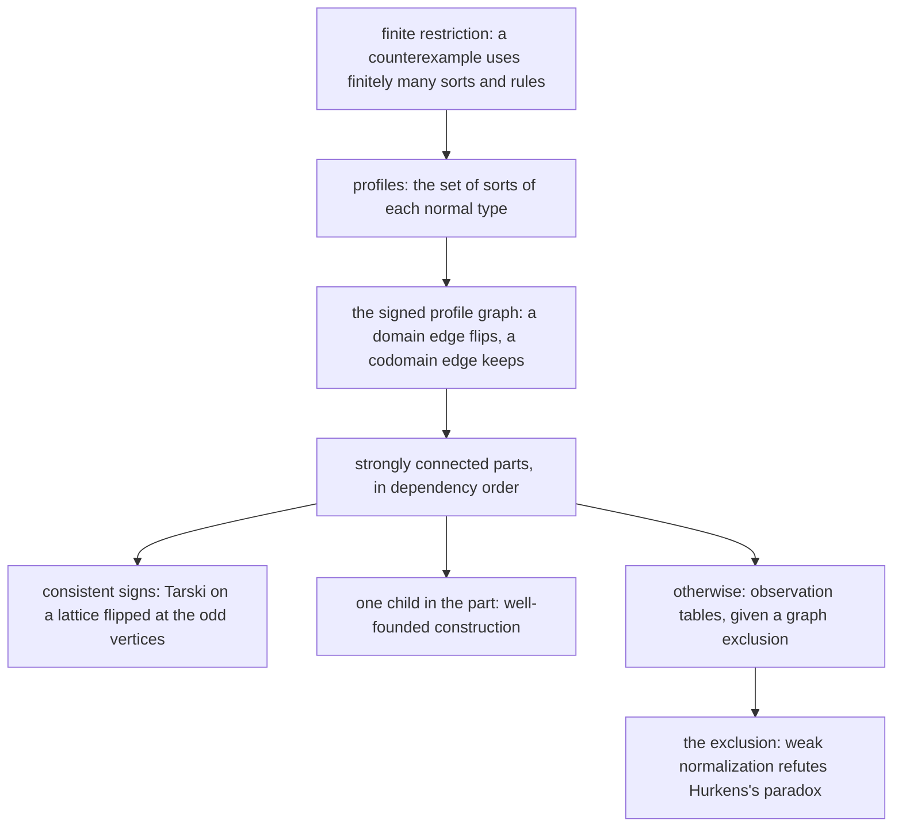

# What the OpenAI math release gives our type language (2026-10-10)

**The one thing.** The checker refuses a program that tsgo accepts, at the invariant answer of
`Ref.make`. The release's proof machinery predicted it, and the census below locates it. The
release's own theorem has no consumer here. Its machinery has four:
- a variance algebra with a bivariant point;
- a polarity law for instantiation;
- the exact hypothesis that `checker-monotone` lacks at rows;
- an odd-cycle test for recursive declarations (row 124).

Three probes back each point, and no source file changes. The landing brief is `brief.md`.

## 1. Source and scope

- The source is `https://github.com/openai/math`, cloned at `fd4aeeb2` (2026-10-07) into the
  session scratchpad. Its `lean/formalization.yaml` declares `review: status: unchecked`.
- Its Lean is a Mathlib library on Lean 4.34.1 that opens `Classical`. The axiom gate forbids
  both here, so nothing is imported. Each adaptation below is re-proved in core Lean.
- The survey covered the release's theoretical computer science, logic, algebra and category
  families: about forty directories under `lean/OAI/`. Section 7 lists what was dropped, and why.
- The owner asked for the type-system results first (2026-10-10, in session).

## 2. The type-system result

Family 245 proves the β-Barendregt–Geuvers–Klop conjecture. Weak normalization implies strong
normalization for every pure type system, with open contexts, annotations and non-functional
rules. The statement is `OAI.PureTypeSystem.weak_implies_strong`
(`lean/OAI/Computability/TypeSystem/Normalization.lean`), with no `sorry` in its 33 files.

The proof runs in five stages. The paper
(`preprints/Weak-and-strong-normalization-in-pure-type-systems-September-25-2026/`) names them
in its introduction.



Four files hold the parts that transfer:

- `SignedPath`, `parity_unique`, `PlainLayer`, `FreeLayer` (`lean/OAI/Computability/TypeSystem/Profiles.lean`);
- `IsCandidate`, `Meet`, `ProductTest`, `SignedCandidate` (`.../Candidates.lean`);
- `SignedInterpretation.step_monotone`, `fixed` (`.../Signed.lean`);
- `finite_counterexample` (`.../Restriction.lean`).

## 3. Why the theorem itself has no consumer

The theorem is about β-reduction of typed λ-terms with dependent products. Our language has
neither at any level:

- `Term` (`src/Effect4/Machine/Term.lean`) is first-order: atoms, records and a structural `fold`.
- `Ty` (`src/Effect4/Program/TyCore.lean`) has no arrow type (row 163) and no type-level reduction.
- A program parameter is second-class (row 340), and the meaning is budgeted: fuel is a frontier.

So no tree judgment has the form "some reduction terminates, hence every one does". Section 6
records the one reformulation that does have that form, on decision tapes.

## 4. What transfers: one algebra of polarity

### 4.1 The variance semiring

A variance is the set of parities of the signed paths that reach an occurrence. The set is a
subset of ℤ/2, so there are four variances: bivariant (no path), co, contra and inv. Join is
union, and composition adds parities. The structure is a commutative idempotent semiring.

The tree holds three partial copies of it today:

| Copy | What it is | What it lacks |
| --- | --- | --- |
| `Ty.Variance` (`src/Effect4/Program/TyVariance.lean`, generated) | rc.112's declared modifiers, read by `Ty.sub` at `app` | the bivariant point, and composition |
| `Bounds.comp` (`src/Effect4/Program/Bounds.lean`) | composition along the walk of `cands` | the bivariant point, and join |
| `Ty.valueVarsAlg` (`src/Effect4/Laws/Program/TypeAlgebra.lean`) | a two-bit fold: no parameter, or parameters under value formers only | invariant positions with agreeing bindings |

The probe `probes/Variance4.lean` defines `Var4` and proves its laws by cases. It checks
copies of the first two against it (`comp3_agrees`, `holds3_agrees`). The probe
`probes/RowPolarity.lean` checks the real `Bounds.comp` and `Ty.Variance.select` against it, by
`#guard` over all nine and all twelve cases.

The missing bivariant point matters. `Ty.argVariance` reads an undeclared argument as `.inv`.
A phantom parameter then blocks every subtyping step at its position. The probe's `no_bi`
records that no three-valued variance maps to `bi`.

### 4.2 Polarity is path parity

`polarity_pos_iff` and `polarity_neg_iff` (`probes/Variance4.lean`) prove the reading of §4.1.
The polarity fold has the even bit exactly when a path of even parity reaches the variable. It
has the odd bit exactly when a path of odd parity does. This is OAI's `SignedPath`, specialized
to the tree of a type.

`SignedPath.parity_unique` is OAI's lemma, re-proved by eight cases with no `simp_all`. In a
strongly connected part with no odd closed path, two paths between two vertices share a parity.

### 4.3 Instantiation respects polarity

`eval_respects` (`probes/Variance4.lean`) is the main law. Take a model: a preorder, and
constructors that respect their declared variance one argument at a time. If each variable's
two bindings are related at that variable's polarity, the two values are related. A bivariant
variable needs nothing. An invariant one needs both directions.

The premise reads one argument at a time (`Model.unary`). That is the form of Mal'cev's lemma
for congruences, which the release proves for finite-arity algebras
(`lean/OAI/Algebra/Universal/`). `Model.chain` changes the arguments one at a time and chains
the steps by transitivity.

Two tree theorems are cases of it:

- `fits_instantiate_widens` (`src/Effect4/Laws/Program/Typed/Membership.lean`) is the
  membership reading, under the two-bit premise `Ty.valueVars`. The law allows a parameter
  under `refOf` when its two bindings agree.
- `cata_admits_instantiate` (`src/Effect4/Laws/Program/Template.lean`) is the reading where
  every child is covariant.

The subtyping reading has no theorem in the tree yet. Its connector needs one unary lemma per
head of `Ty.sub` (`src/Effect4/Program/Ty.lean`). The heads read option, list, prod, record and
tuple covariantly, and refOf, deferredOf and a map's key invariantly. They read `app` at
`Ty.argVariance`.

### 4.4 The precision of the least solution

`Bounds.matchB` binds each parameter at the join of its lower bounds. Its guard checks the upper
bounds, so the least binding is a match whenever any binding is one. The least binding gives the
least answer only where the answer reads the parameter covariantly or not at all.
`least_solution_least_answer` (`probes/Variance4.lean`) proves that case.
`greatest_solution_least_answer` proves the contravariant case.

This is the case split of local type inference (Pierce and Turner, 2000, "Local Type
Inference"; from memory, not filed). It matters for HO-4, which brings contravariant positions
into templates. A parameter that the answer reads contravariantly then needs its greatest
binding. `Ty` has no meet, so the rule is: choose an upper bound below all the others, or
refuse with a request for the type argument. An invariant answer has no least binding at all.

### 4.5 `checker-monotone` at rows, and a refusal tsgo does not make

The proposed claim `checker-monotone` (`tools/ProofGraph/Registry.lean`) asks that a smaller
child or environment keep a program admitted. Section 4.4 gives its exact share at a row.
Smaller requests give smaller bindings (`Bounds.matchArgsB_monotone`). The answer follows only
at answer polarity co or bi. Seat GAP found the invariant failure at `never`
(`docs/research/2026-10-06-seat-GAP-study.md`, §4.2).

**The census** (`probes/RowPolarity.lean`, `rowTmpls` and `atomTmpls`) reads every built-in row
and every polymorphic atom scheme. It was evaluated on 2026-10-10 against the working tree's
build, at `a2b589de` and again at `41ec1e0c`, with the same output.

- Two rows read a parameter non-covariantly in their answer. `refMake` reads it co in the
  request and inv in the answer. `refSet` reads it inv in both.
- Every other row's answer reads its parameters at co or bi.
- Every polymorphic atom scheme reads its parameters at co in the answer, or at bi (`mapKeys`).

**The checker's verdicts** on `cell = Ref.make(x); Ref.set(cell, y)` (`pWrite`), by the types
of `x` and `y` in the environment:

| `x` | `y` | `Checker.check` at `nativeSignature` |
| --- | --- | --- |
| `number` | `number` | admitted, at `Ref<number>` |
| `nat` | `number` | refused at path `[1]` |
| `int` | `number` | refused at path `[1]` |
| `nat` | `int` | refused at path `[1]` |
| `int` | `nat` | admitted, at `Ref<int>` |
| `nat` | `nat` | admitted, at `Ref<nat>` |

The second line is pointwise below the first, since `nat` is below `number`. So the environment
half of `checker-monotone` fails at `refMake` at an ordinary type, not only at `never`. The
registry claim names the tests by equality and the loop with no cursor annotation as today's
failures. Seat GAP's plan excludes "invariant positions". The census names the two rows.

**The oracle.** The atoms-only program `cell = Ref.make(succ(4)); Ref.set(cell, minus(0, 1))`
(`pAtoms`) is refused at path `[1]`. The checker types `succ`'s answer at `nat` and `minus`'s at
`int`. The prelude declares both atoms at `number`. With those declarations the same program
type-checks under tsgo 7.0.0-dev.20260629.1 against effect 4.0.0-rc.112 (`probes/ts/refcell.ts`).
The red control writes a string to the cell, and tsgo refuses it (TS2345). So the checker
refuses a program that the oracle accepts. This is finite evidence on one program.

The cause is general: `nat` and `int` are finer than the printed `number`. A covariant position
absorbs the difference by subsumption, and an invariant answer position cannot. Three repairs
are open, for the owner (a question of meaning and representation):

1. Bind a parameter that the answer reads invariantly at the printed widening of its least
   candidate, `nat` and `int` to `number`. This extends the literal widening of DI-15 to the
   number tower. Its cost: a later read of the cell answers `number`, and atoms typed at `nat`
   then refuse it.
2. Ask for the type argument at such a row when the candidate is finer than its print.
3. Keep the refusal, and record the two rows outside `checker-monotone`.

### 4.6 Recursive declarations (row 124, parked by row 307)

Row 124 plans recursion through nominal Σ_app declarations. Two questions then arise, and the
same semiring answers both.

1. **Variance inference.** A declaration's variance is the least solution of its polarity
   equations. Kleene iteration from the bivariant table reaches it in at most two rounds per
   entry, since each entry climbs a lattice of height two. By §4.3, instantiation respects
   polarity under every solution. The least solution allows the most subtyping steps. It
   replaces the `.inv` default of `Ty.argVariance` for an application's own names.
2. **The odd-cycle test.** A declaration on an odd closed path of the declaration graph has
   no monotone set meaning, flipped or not. That path is OAI's `SignedPath E I I true`. Without
   one, OAI's `Signed.lean` gives the construction: flip the lattice at the odd vertices, and the
   operator is monotone (`step_monotone`). Kleene iteration replaces Tarski on our finite lattices.

The probe runs both on eight declarations (`ex` in `probes/Variance4.lean`), and its `#guard`s
pass. `Tree` is co, `Sink` contra, `Both` inv, `Phantom` bi. `Flip`, defined as
`Context<Flip<A>>`, is bivariant in `A` and lies on an odd cycle. `Odd` is inv and on an odd
cycle. `Even`, two `Context`s deep, is co and on none.

The proposed rule for row 124: admit a structural meaning only off odd cycles. A declaration on
one stays nominal, with opaque membership, as `app` is today.

### 4.7 A check of the CX note's §3.4

The CX note (`docs/research/2026-10-10-cx-lexical-scope.md`, §3.4) declines a semantic typing of
sites. The cycle there passes `PointTyped`, `TypedProg` and `BodyTyped`. The usual logical
relation puts the site assumption left of an implication, so the cycle has one negative edge. It
is odd, so §4.6's construction does not apply, and the note's syntactic choice stands. The
polarity is read from the note's prose, not from a definition, since none was written.

### 4.8 Profiles and the substitution lemma

The release replaces uniqueness of types by a profile: every sort of a normal type, tracked as it
grows under substitution. CX3's substitution at the declared bound has the same shape, with
`checker-monotone` as its premise. The registry claim `checker-monotone` already says so. This
is corroboration only.

## 5. Placement of the proposed claims

| Claim (proposed) | Concept | Serves | Reach | Does not establish | Unlocks |
| --- | --- | --- | --- | --- | --- |
| `variance-semiring` | `subtyping-algebra` | `Bounds.comp`, `Ty.Variance.holds`, `Ty.valueVars` as one fold | the four variances, any relation | any subtyping fact of `Ty` | one polarity fold for the three copies |
| `instantiate-respects-polarity` | `subtyping-algebra` | `checker-monotone`, HO-4's `invoke-typed` at instantiated rows | `Ty.sub` (raw), each head read at its variance | semantic variance; tsgo's inference | HO-4 (R10's usable generic `use`); R14 |
| `row-answer-polarity` | `subtyping-algebra` | `checker-monotone`'s share at a row | the built-in rows and atom schemes | anything at a definition block or a supplied row table | the claim's exact hypothesis |
| `declared-variance-inferred` | `subtyping-algebra` | row 124 | Σ_app declarations with bodies | inhabitance; codec admission | R3's recursive types, when unparked |

Each claim's statement and proof are in the probes, against copies or a core model. None is a
tree theorem until its connector lands.

## 6. Other threads, not probed

- **Weak and strong termination on decision tapes (R12).** The machine's question has the
  theorem's shape: if one fair tape finishes, does every fair tape finish? The release's proof
  does not transfer. A diamond property of independent decisions would answer it, with equal
  run lengths (van Oostrom, 2007, "Random descent"; from memory, not filed).
- **Witnessed symmetric choice (family 243).**
  `OAI.WitnessedChoice.first_stabilization_unique_length`
  (`lean/OAI/Computability/WitnessedChoice/Syntax.lean`) composes automorphisms along two choice
  prefixes. On our machine it reads as follows. If every decision's options form one orbit of
  history-fixing automorphisms, any two tapes give related runs. That is a third route to a
  determinism claim, beside a fixed tape and a fragment with no decision source. Its reach is
  narrow, since distinct fibers are rarely symmetric.
- **Loop cursors.** A loop with no cursor annotation is a fixed-point problem. The least fixed
  point of `c ↦ c0 ⊔ step c` is monotone in `c0`, but a budgeted iteration loses that at its
  bound. The annotation (`iterate`'s `cursorTy`) stays the repair.

## 7. Dropped, with the reason

| Family or directory | What it is | Why it has no consumer |
| --- | --- | --- |
| `Combinatorics/Automata` (`OneWayLiveness`) | Sakoda–Sipser state lower bounds | "liveness" names a language there, not R12's property |
| `Computability/FiniteCompiler` | machines compiled into group actions (Boone–Higman) | no program representation of ours is a group |
| `Computability/StarHeight` | generalized star height at most three | no regular expression stands in our protocols |
| `Computability/WeisfeilerLeman`, `WLIdentification`, `Combinatorics/VariableWL` | lower bounds for Weisfeiler–Leman refinement | our pieces are trees with canonical bytes; the bounds only warn against WL hashing of cyclic graphs |
| `Computability/Scheduling` | three machines, unit jobs, precedence | our jobs have no unit length |
| `Combinatorics/TreeEdit`, `EditDistance` | ℓ1 embeddings of edit distance | the view's motion is a keyed join, not an alignment |
| `Algebra/Universal` | congruences and unary translations | used in §4.3 as the form of a premise; nothing else |
| `ModelTheory/Choiceless` | counting logic without choice | §6's symmetric choice is the part that reads on us |

## 8. Proposed slices

`brief.md` holds the slices VAR-1 to VAR-5, each with its placement, files, connectors,
controls and commands.

## 9. Evidence

Every result here is a finite probe or a probe theorem, not a tree theorem.

| Command | Result |
| --- | --- |
| `lean probes/Variance4.lean` (toolchain v4.33.1, core Lean only) | exit 0, no messages: every theorem checks and all 14 `#guard`s pass |
| `#print axioms` on nine of its theorems, in a scratch copy | `mul_add` and `parity_unique`: none; `holds_mul`, `polarity_pos_iff`, `polarity_neg_iff`, `comp3_agrees`, `holds3_agrees`: `propext`; `eval_respects`, `least_solution_least_answer`: `propext`, `Quot.sound` |
| `LEAN_NUM_THREADS=3 lake env lean probes/RowPolarity.lean` | exit 0: both connector `#guard`s pass; the census and the verdicts of §4.5 |
| `tsgo -p tsconfig.json` in `probes/ts/` | tsgo 7.0.0-dev.20260629.1, effect 4.0.0-rc.112: exit 0, no diagnostics |
| `tsgo -p tsconfig.red.json` in `probes/ts/` | exit 1: `refcell_red.ts(11,24): error TS2345` |

The axiom output comes from `#print axioms`, since a core-only probe cannot import
`#axiom_audit`. A landed slice is audited with `#axiom_audit` as usual.

To rerun the TypeScript probe, link the pinned packages first:

```bash
cd docs/research/2026-10-10-openai-math-type-systems/probes/ts && ln -s ../../../../../ts/eff/node_modules node_modules && ./node_modules/.bin/tsgo -p tsconfig.json
```

Bounded or host-only evidence: the census is a finite evaluation over the built-in tables. The
checker verdicts are finite evaluations of `Checker.check` at `nativeSignature`. The tsgo result
covers one program and its red control.

## 10. Outcome (2026-10-10)

- **VAR-1 landed** (`044aa8f48`): `Var4` and `Ty.polarity` in `src/Effect4/Program/Polarity.lean`;
  the semiring laws and the two connectors in `src/Effect4/Laws/Program/Polarity.lean`.
- **VAR-3 landed** (`044aa8f48`): `Test/Program/RowPolarity.lean`, register line
  `E4-POL-CE-001`, decisions row 342 for the §4.5 repair (recommended: keep the refusal, and a
  type argument with HO-4).
- **VAR-2 proved**: `Ty.sub_instantiate_polarity`, over the generated view of `Ty.sub`
  (`Ty.sub_eq_args`): each head's polarity bounds each argument's share (`polarity_args`), and an
  odd path swaps the pair of substitutions (`PolarityRelated.swap`). Not written: the corollary
  in the normalized order with `Bounds.matchArgsB_monotone`, which needs a bridge through
  normalization; its consumer, `checker-monotone`, stays proposed.
- VAR-4 waits for HO-4, and VAR-5 for row 124.
