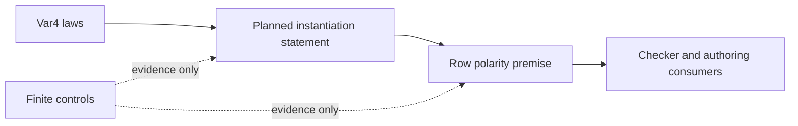

# Polarity and graph integration review

The review checks commit `044aa8f481a660d1d87d37f8475d4183cda384fc`.
The isolated worktree initially starts at merge `8a876482d0cb8600a4b186f1fdeee47f29607a24`.
Production files and owner rulings stay unchanged.

## Finishing criteria

- Reproduce the row battery and audit the two new polarity modules.
- Check finite instances of the planned instantiation statement without using that goal.
- Check the census domain and controls for its premises.
- Compare the merged graph files with the reviewed graph branch.
- Record the changed gate tables and their evidence limits.
- Save the commands, results, source hashes, findings, and checkpoint.

## Obligation placement

These probes add no theorem or planned goal.
They test the premises and finite instances of existing claims.

| Item | Concept and property | Question and consumer | Reach | Limit | Unlock |
| --- | --- | --- | --- | --- | --- |
| Instantiation controls | `subtyping-algebra`: substitution respects declared positions | `instantiate-respects-polarity`; `Ty.sub_instantiate_polarity` in `src/Effect4/Laws/Program/Polarity.lean`; HO-4 and checker row reasoning | Raw `Ty.sub`, two finite substitution lists, source-derived parameter indices | A finite evaluation does not prove the planned goal or TypeScript inference | R10; the row premise for R14 |
| Census domain | `subtyping-algebra`: answer polarity | `checker-monotone`; `answerAboveCo` in `Test/Program/RowPolarity.lean` | Built-in row and atom tables; synthetic parameter outside the fixed census | No supplied-table theorem or checker repair | Exact premises for the checker claim |
| Premise controls | `subtyping-algebra`: sufficient variance premises | `Ty.sub_instantiate_polarity`; the same source path | Invariant cells and a union with `unknown` | No characterization of all monotone templates | Prevent an unjustified necessity claim |
| Graph merge identity | Existing graph and snapshot agreement claims | Existing graph support packet | Six production files at the merge | File equality does not rerun runtime or rendering gates | Keep prior evidence attached to unchanged implementations |

## Dependency order

## Commands

Run one Lake process in this worktree with `LEAN_NUM_THREADS=3`.
Build the named modules and run the saved probes.
Audit the landing modules with `#axiom_audit`.
Do not run the full suite or change any compiler pin.

## Membership connector follow-up

The brief also requests an exact connector to `Ty.valueVars`.
The current landed slice contains no such connector.

| Concept and property | Question and consumer | Reach | Limit | Unlock |
| --- | --- | --- | --- | --- |
| `subtyping-algebra`; the proposed VAR-1 membership reading | Proposed exact connector in `docs/research/2026-10-10-openai-math-type-systems/brief.md`; consumer `fits_instantiate_widens` in `src/Effect4/Laws/Program/Typed/Membership.lean` | Four types using one parameter, one reference head and one cell head; all sixteen scalar readings of those two positions | A refusal of this scalar formulation does not refute the existing membership theorem or VAR-2 | Choose a sufficient summary before consolidating the existing membership fold |

## Normalized-binding bridge

| Concept and property | Question and consumer | Reach | Limit | Unlock |
| --- | --- | --- | --- | --- |
| `subtyping-algebra`; substitution and normalized order | Helpers of `instantiate-respects-polarity`; the proposed row corollary consumes both `Bounds.matchArgsB_monotone` and VAR-2 | Lookup after mapping binding values through `normalize`; retain indices, order, duplicates, and the default `never` | No converse from `subN` to raw `sub` on the original bindings | Connect existing bounds inference to answer typing under R10 and R14 |

## Follow-up at the new proof landing

Claude proves VAR-2 in `cd61d93378275c276a2c0206a8391b881b1f9864` during this review.
Rebuild the changed law and its row battery before reporting its new status.
Repeat the module audit and the finite controls against the changed dependency.
Keep the earlier logs as evidence of the initial state.
