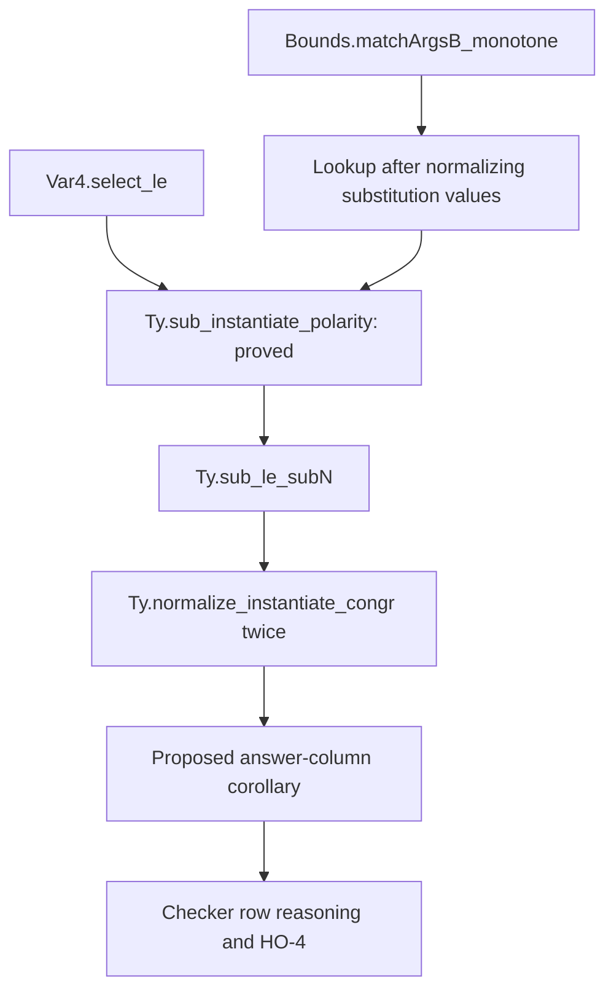
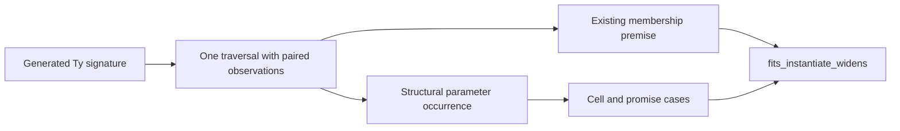

# Proof support for the polarity landing

Keep the subtyping theorem and membership theorem separate.
Share the generated traversal while retaining every fact their premises read.

## Existing declarations

| Declaration | Path | Status in this review |
| --- | --- | --- |
| `Var4.semiring_laws`, `Var4.select_le` | `src/Effect4/Laws/Program/Polarity.lean` | Audited proof bodies |
| `Ty.sub_instantiate_polarity` | `src/Effect4/Laws/Program/Polarity.lean` | Proved at `cd61d9337`; narrow build and module audit pass |
| `Bounds.matchArgsB_monotone` | `src/Effect4/Laws/Program/Bounds.lean` | Source-inspected existing theorem |
| `Ty.sub_le_subN`, `Ty.valueVarsAlg` | `src/Effect4/Laws/Program/TypeAlgebra.lean` | Source-inspected existing declarations |
| `Ty.normalize_instantiate_congr` | `src/Effect4/Laws/Program/Template.lean` | Source-inspected existing theorem |
| `fits_instantiate_widens` | `src/Effect4/Laws/Program/Typed/Membership.lean` | Source-inspected existing theorem |

## Bounds to answer typing

Let `normSubst` map each substitution value through `Ty.normalize`.
Retain indices, list order, and duplicate precedence.
The absent binding remains `never`.
This is a transformation of existing substitution data, not another program representation.

The first proposed helper states:

```lean
(normSubst σ).at i = (σ.at i).normalize
```

Use this helper to read the bounds theorem's `subN` result as raw subtyping between normalized bindings.
Do not infer raw subtyping between the original bindings.
The negative control in `NormalizeProbe.lean` separates those claims.

For an answer whose parameter polarities are at most co, `Var4.select_le` supplies the VAR-2 premises.
Apply VAR-2 to the normalized substitutions.
Use `Ty.sub_le_subN` on the instantiated result.
Use `Ty.normalize_instantiate_congr` twice to recover the original substitutions' normalized result types.

The proposed row corollary has this shape:

```text
matchArgsB ps rs = some σ
all ps satisfy TemplateOK
all rs' satisfy Normal
rs'.length = rs.length
pointwise subN rs' rs
all answer parameter polarities are at most co
    implies
some σ' matches ps against rs'
and subN (instantiate σ' answer) (instantiate σ answer)
```

This corollary concerns the answer column.
A whole-row consumer still carries binder-term checks, formation, and its error-column premises.
The census alone does not prove checker monotonicity.



## Membership summary

The brief's fixed scalar `HeadReading` cannot supply the full membership connector.
`MembershipProbe.lean` records the four witnesses and every relevant scalar reading.

The existing summary distinguishes these children:

| Child | No parameter occurs | Membership premise |
| --- | --- | --- |
| `app "Opaque" [var 0]` | false | true |
| `app "Opaque" [nat]` | true | true |

Both children have the same membership result.
A surrounding cell needs their different occurrence results.
A scalar summary that forgets occurrence cannot support that consumer.

**Recommended design:** retain the two observations as a product carrier.
Keep the current public premise `Ty.valueVars` as its projection.
A later consolidation can derive both summaries from one generated algebra.
Prove agreement with each existing projection before moving its consumers.
Do not change `Fits`, handle typing, or the existing theorem to force the scalar connector.



## Placement of proposed obligations

Every row below is a proposed helper with a named consumer.
No helper is stated as a Lean theorem in this packet.

| Helper | Concept and required property | Question and consumer | Reach | Does not establish | Requirement |
| --- | --- | --- | --- | --- | --- |
| Normalized substitution lookup | `subtyping-algebra`; substitution respects the observed order | Step of `instantiate-respects-polarity`; answer-column corollary | First lookup, duplicate keys, default `never`, normalized values | No checker or target result | R10, serving R14 |
| Answer-column corollary | `subtyping-algebra`; monotonicity under co/bi answer polarity | `checker-monotone` row share and HO-4 | `TemplateOK`, normalized smaller requests, arity equality, pointwise `subN`, answer polarity bound | No error, binder-term, or formation proof | R10 and R14 |
| Paired membership-summary agreement | `subtyping-algebra`; compatibility of membership premises | Proposed correction to VAR-1; `fits_instantiate_widens` | Every `Ty`, including opaque applications inside cells | No equality between subtyping and membership judgments | R10 support; preserve the existing membership consumer |
| Source-derived census indices | `subtyping-algebra`; coverage of the finite answer-polarity census | `row-answer-polarity` premise of `checker-monotone` | Current representatives and their actual free parameter indices | No theorem over supplied tables or all explicit type instances | R14 premise tracking |

The membership connector needs a revised design statement before proof work.
The normalized-binding helpers leave the existing VAR-2 statement unchanged.
The census change removes a maintenance obligation without changing program admission by the checker.
