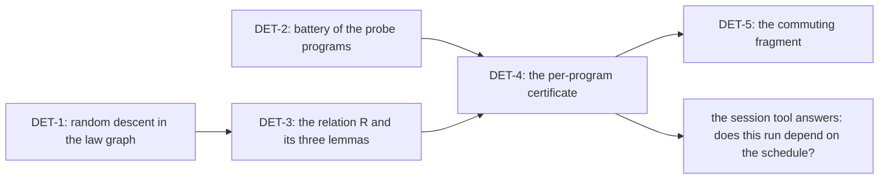

# Schedule independence: when the decision tape does not matter (2026-10-10)

## The one thing

Take the probed programs whose fibers touch disjoint cells or update one cell by commuting
functions. On them every order of `fire` decisions gives the same exits and reference heap.
Every maximal tape of those programs has the same length.
A general theorem turns that local fact into determinism with no tape fixed, and into a bound on
every tape. Three things differ between the two orders even then: the trace, the minted names
and the order of the armed queue. So the observation of a determinism claim is DB-03's `obs`
(exits and stores), read up to a renaming of minted names. The trace is never part of it.

## 1. The question and its sources

DB-03 (`docs/DESIGN-BASIS.md`) makes the meaning a relation over decision tapes. `AGENTS.md`
names two routes to a determinism claim: fix a compatible tape, or prove that a fragment
contains no decision source. R12 (`docs/core/system-map.md` §8) asks for liveness under
`FairTape`. Two claims of the concept `reactive-scheduling` have no evidence:
`scheduler-progress` and `fair-scheduling` (`generated/semantics.md`).

The previous note's §6 left one thread open
(`docs/research/2026-10-10-openai-math-type-systems/README.md`). The OpenAI release proves that
weak normalization gives strong normalization for every pure type system. Our machine asks the
same shape of question: if one tape finishes, does every tape finish, and at the same result?
That proof does not transfer. A diamond property of independent decisions answers the question
instead.

## 2. The theorem: random descent

`probes/RandomDescent.lean` is core Lean, with no import. A machine there is
`step : S → D → Option S`: one decision, one step, and `none` when the decision is not enabled.
`run` replays a tape. A state is terminal when no decision is enabled. A **maximal tape** is a
tape whose replay ends at a terminal state.

- **Premise `Bisim step R`.** `R` is a bisimulation of the unlabelled step relation.
- **Premise `Diamond step R`.** Two one-step successors of a state are `R`-related, or each closes
  in one step to an `R`-related pair. Any decision may close a side.
- **`RD.extends_all`.** Let a state have a maximal tape of length `n`. From any `R`-image of it,
  every tape extends to a maximal tape of length `n`, with an `R`-related end.
- **`RD.complete_unique`.** Every two maximal tapes from one state have the same length and
  `R`-related ends.
- **`RD.bounded`.** One maximal tape bounds the length of every tape. Weak termination gives
  strong termination.
- **Controls.** `RD.twoCounters_diamond` proves the premise for two independent counters.
  `RD.lastWrite` is the red control: two writes of one cell end at different cells.

The axioms are `[propext, Quot.sound]` for the three theorems and `[propext]` for the control
(`#print axioms`, scratch run, 2026-10-10). The premise is a disjunction, so no decision of `R`
is needed and the proof stays constructive.

This is van Oostrom's random descent (RTA 2007) at its simplest local criterion. The citation is
from memory and the paper is not filed. A peak closes by one step on each side.

## 3. The machine: what the probe measured

`probes/Tapes.lean` drives the real machine (`Api.load`, `stepDecisionState`,
`src/Effect4/Machine/Fibers.lean`). It starts the root with `Api.evaluate`. Then it explores
every tape of `fire` decisions, one per armed owner, to depth 12. A second exploration also lets
the tape set `yieldVerdict f true` at most twice: the host's preemption point. The output is
`probes/tapes.out` (`lake env lean`, exit 0, 2026-10-10).

### 3.1 Where the choices are

- **A fork alone makes no choice.** A child forked with `startImmediately` false starts from the
  root's dispatcher. One `fire` of the root drains it in order. So `pIndep`, `pRace`,
  `pCommute`, `pNoCommute`, `pKahn` and `pPoll` each have exactly one maximal fire tape.
- **A choice needs two armed dispatchers.** A child that yields arms its own dispatcher. Two
  yielding children give the first real choice of order.
- **The tape preempts only at a decision boundary.** `yieldVerdict` overrides the next
  injection check, and a fire runs a whole drain. So the tape cannot put the root's
  `Deferred.poll` after a child's `succeed` in `pPoll`: the poll reads `false` on every tape.

### 3.2 Observations of the maximal tapes

| Program | What the children do | Distinct observations (fire tapes) | Tape lengths | With preemption |
| --- | --- | --- | --- | --- |
| `pIndepY` | yield, then write their own cells | 1 | 3 | 1 |
| `pCommuteY` | yield, then `succ` one cell | 1 | 3 | 1 |
| `pKahnY` | yield, then succeed a promise the root awaits | 1 | 2 | 1 |
| `pForkInChild` | yield, fork a grandchild, join it | 1 | 5 | not run |
| `pRaceY` | yield, then write one cell | 2 | 3 | 2 |
| `pNoCommuteY` | yield, then `succ` and `mul 2` on one cell | 2 | 3 | 2 |
| `pRace`, `pNoCommute` | the same, with no yield | 1 | 1 | 2 |
| `pYield` | one writes twice around a yield, one copies | 1 | 2 | 3 |

An observation is the root's exit and the reference heap. `pRace` and `pNoCommute` show that
preemption alone exposes a race that the fire order hides.

### 3.3 The local diamond, component by component

At every reachable machine with two armed owners, the probe fires them in both orders and
compares the two machines.

| Program | Components that differ between the two orders |
| --- | --- |
| `pIndepY`, `pCommuteY` | `nextToken` (4 against 3), the trace's length (38 against 30 new events) |
| `pForkInChild` | the order of `armed`; the park tokens of fibers 1 and 2 swapped (3 and 4); later `nextToken` and the trace |
| `pRaceY`, `pNoCommuteY` | the stores, the exits and the fiber records as well |

So on the green programs the diamond holds exactly modulo three things:

1. **The trace.** One order logs eight more events: the root parks on the first join, wakes and
   parks again. No step reads the trace. Its only reader is `Api.Inspection.trace`
   (`src/Effect4/Api.lean`), and `emit` only appends.
2. **Minted names.** Park tokens, fiber ids and their supplies (`nextToken`, `nextId`) follow the
   order of minting. The two orders mint the same names in a permuted order.
3. **The order of the armed queue.** It records arming order. A `fire` decision may take any
   armed owner, so a fire tape reads `armed` as a set.

## 4. What this gives

### 4.1 Behaviour claims

- **`schedule-independent` (determinism, no tape fixed).** Let the diamond hold at every
  reachable machine of a program. Then every maximal fire tape gives the same exits and stores,
  up to a renaming of minted names. This is the third route to a determinism claim beside the two of
  `AGENTS.md`.
- **The canonical run is the meaning.** `RunDecision.flush` is the fire tape that always takes
  the head of `armed` (`flushAllState`, `src/Effect4/Machine/Fibers.lean`). So on such a program
  `Api.run` computes the one observation of every tape. `run_eq_ref`
  (`src/Effect4/Laws/Program/RuntimeR.lean`) relates the machine and the reference at every tape.
  With the diamond, that observation is also one value across every order of fires.

### 4.2 Liveness claims (R12)

- **`fire-tapes-bounded`.** On such a program, if one fire tape is maximal at `n` decisions, no
  fire tape is longer than `n` (`RD.bounded`). No fairness premise is needed.
- **Deadlock does not depend on the order.** Every maximal fire tape ends at the same machine up
  to `R` (`RD.complete_unique`). So the run finishes on every order, or deadlocks on every order.
  R12's `fair-scheduling` asks for liveness under `FairTape`. On such a program it holds with no
  fairness premise.
- **The number of host callbacks is invariant.** Every maximal fire tape has the same length, so
  a run's count of fires is a function of the program.

### 4.3 Observability

- **The trace is schedule-dependent.** A run's trace, and so the view's frames
  (`tools/Tools/View/`), differ between orders that agree on exits and stores. A comparison of
  two schedules compares `obs`, never the trace.
- **Minted names are schedule-dependent.** Fiber ids, tokens and scope keys follow the order of
  minting. Any observation that shows one compares up to renaming.
- **Preemption is a coarser choice than it looks.** The tape preempts only between decisions, so
  a fiber's synchronous start is atomic under every tape (`pPoll`). This bounds what the tape's
  relation says about rc.112's `maxOpsBeforeYield`.

### 4.4 Simplifications and consolidations

- **One theorem for three routes.** A fragment with no decision source is the case where at most
  one decision is enabled at every reachable machine. The diamond then holds trivially. A fixed
  tape is the case of one tape. Witnessed symmetric choice (previous note, §6) is the case where
  `R` relates machines by an automorphism. So `RD.complete_unique` states all three.
- **The trace is an output, not state.** It is write-only. A law that carries the trace through a
  step could read the step as a pair of a machine and its new events (a writer). The trace laws
  of `src/Effect4/Laws/Machine/Approximation.lean` (`emit_trace`, `fire_trace_extends`, …) would
  then follow from one law. This is a proposal: no such factorization is proved.
- **The armed queue is a set for fire tapes.** Only `flush` reads its order.

## 5. What the machine instance needs

`RD` needs a bisimulation `R` and the diamond at every reachable machine. For the fire alphabet
the probe points to one relation: equal machines after erasing the trace, reading `armed` as a
set, and renaming minted names. Three lemmas make it a bisimulation:

| Lemma (proposed) | Statement | Status |
| --- | --- | --- |
| `trace-write-only` | every machine component except the trace, after a decision, is the same function of the components before it except the trace | not stated; the grep of §3.3 is evidence only |
| `armed-order-irrelevant` | `fire o` on two machines that differ only in the order of `armed` gives machines that differ only in that order | not stated |
| `names-equivariant` | a step commutes with a permutation of minted fiber ids and tokens, applied to the machine and the decision | not stated; the largest of the three |

With the three lemmas, the diamond becomes a property of a program. Two ways to discharge it:

- **A certificate.** Explore the reachable fire machines of one program, modulo `R`, and check the
  diamond at each one. The theorem then gives the determinism claim for that program. The cost
  is the number of reachable classes, not the number of tapes.
- **A fragment.** Prove the diamond for a syntactic fragment. Its fibers write disjoint cells
  and update a shared cell only by commuting functions. They share a promise only by one
  `succeed` and by `await`. No `poll`, `isDone`, `raceAll`, interrupt or clock. This is the LVars result
  (Kuper and Newton 2013; from memory, not filed). It needs the store frame laws.

## 6. Placement of the proposed claims

| Claim (proposed) | Concept | Serves | Reach | Does not establish | Unlocks |
| --- | --- | --- | --- | --- | --- |
| `random-descent` | `reactive-scheduling` | `schedule-independent`, `fire-tapes-bounded` | any `step`, `R` and decision type | anything of the machine | the abstract half of all three determinism routes |
| `trace-write-only` | `reactive-scheduling` | the relation `R` | every decision of `stepDecisionState` | that the trace is schedule-independent: it is not | a writer reading of the trace laws |
| `names-equivariant` | `reactive-scheduling` | the relation `R` | fiber ids and park tokens | scope keys and memo ids, unless added | comparison up to renaming |
| `schedule-independent` | `reactive-scheduling` | DB-03's third route; R12 | the fire alphabet at the default yield policy, on a program with the diamond | anything with host answers, interrupts or clock decisions | the canonical run as the meaning |
| `fire-tapes-bounded` | `reactive-scheduling` | `fair-scheduling` (R12-c) on the fragment | fire tapes from the start | progress of one fiber's slice; host progress | R12's liveness with no fairness premise |

## 7. Where it goes

- **Cone.** `src/Effect4/Laws/Machine/` and `Test/Machine/Runtime/`. It touches no file of the HO
  and CX line (`src/Effect4/Program/`) or of the view. So it can be the second code seat.
- **Order against `docs/STATE.md`.** DET-1 and DET-2 cost hours and change no behaviour; they can
  land now. DET-3 and DET-4 follow. DET-5 waits for a design note, after the store frame laws are
  read for it.
- **Owner decisions.** Whether the third route enters `AGENTS.md` and DB-03, and whether the
  observation of a determinism claim is `obs` up to renaming of minted names.

`brief.md` holds the slices with their files, placement and commands.

## 8. What this note does not establish

- **The machine diamond is a finite probe.** Thirteen programs, the fire alphabet, depth 12. No
  theorem of the machine is stated.
- **The trace's write-only property is a grep.** `emit` only appends, and one reader exists. No
  lemma states it.
- **No external decision is covered.** `answerAsync`, `interruptFrom`, `advance` and
  `installMiddleware` are outside the alphabet. A host answer orders against fires, so a session
  is not covered.
- **The preemption result is about the tape, not rc.112.** It says what the tape can express, not
  what Effect's scheduler does.
- **`RD` needs a bisimulation.** Equality after erasing the trace is not yet one, because minted
  names differ (§3.3).

## 9. Evidence

| Item | Command | Result |
| --- | --- | --- |
| `probes/RandomDescent.lean` | `lean probes/RandomDescent.lean` | exit 0 (`probes/random-descent.out`) |
| axioms of `RD.extends_all`, `RD.complete_unique`, `RD.bounded` | `#print axioms` appended in a scratch copy | `[propext, Quot.sound]` |
| `probes/Tapes.lean` | `LEAN_NUM_THREADS=3 lake env lean probes/Tapes.lean` at HEAD `f6ee9ae59` | exit 0, `probes/tapes.out` |
| readers of the trace | `grep -rn "\.trace\b" src/Effect4`, outside `Laws/` | `Api.Inspection.trace` and `emit` only |
