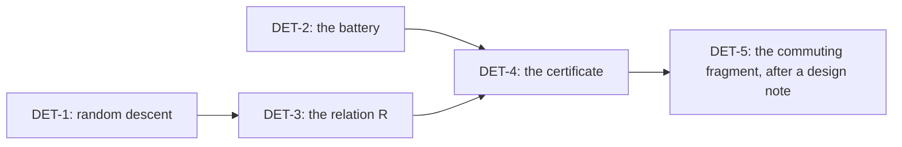

# Brief: schedule independence (slices DET-1 to DET-5)

**The one thing.** DET-1 and DET-2 land a proved general theorem and a battery, with no change of
behaviour. The machine's diamond is a finite probe until DET-3 states its relation.

The evidence is `README.md` and the probes in `probes/`, beside this brief. Start from the base
the coordinator names, in your own worktree. Commit by explicit paths. The cone is
`src/Effect4/Laws/Machine/` and `Test/Machine/Runtime/`: no file of the HO, CX or view lines.

## DET-1: random descent in the law graph

- **File.** `src/Effect4/Laws/Machine/Descent.lean`, from `probes/RandomDescent.lean`: `run`,
  `Terminal`, `Bisim`, `Diamond`, `extends_all`, `complete_unique`, `bounded`.
- **Connector.** `run` at `step := fun m d => …stepDecisionState…` is `replayEval` on a tape that
  is not cut by fuel. State it as one lemma beside `replayEval_append`
  (`src/Effect4/Laws/Machine/Approximation.lean`).
- **Placement.** Concept `reactive-scheduling`. A new claim `random-descent`, role groundwork,
  consumed by `schedule-independent` and `fire-tapes-bounded`. Reach: any step function,
  relation and decision type. It establishes nothing of the machine. It unlocks DET-3 and DET-4.
- **Proof style.** The probe's proofs use `omega`, `simp only` and `simpa`. Keep the premise a
  disjunction: a `by_cases` on `R` reaches `Classical.choice`. So does `by simp` on a list
  length; use `Nat.zero_ne_add_one`.

## DET-2: the battery of the probe programs

- **File.** `Test/Machine/Runtime/ScheduleIndependence.lean`, from `probes/Tapes.lean`.
- **Lines.**
  - Finite evaluations: one observation over every fire tape for `pIndepY`, `pCommuteY`,
    `pKahnY` and `pForkInChild`.
  - Red controls: two observations for `pRaceY` and `pNoCommuteY`.
  - A control for observability: the two orders of `pIndepY` differ in `nextToken` and in the
    trace's length, and agree on the stores and exits.
- **Propose, in your receipt.** A register line under `Test/Counterexamples/REGISTER.md` for the
  trace and the minted names: they are not schedule-independent.

## DET-3: the relation R and its three lemmas

- **Relation.** Equal machines after erasing the trace, reading `armed` as a set and renaming
  minted fiber ids and park tokens.
- **Lemmas, in order of cost.**
  1. `trace-write-only`: no decision reads the trace. Start from the `*_trace_extends` laws of
     `src/Effect4/Laws/Machine/Approximation.lean`.
  2. `armed-order-irrelevant`: `fire o` keeps a difference in the order of `armed` and nothing else.
  3. `names-equivariant`: a step commutes with a permutation of minted names, applied to the
     machine and the decision. Write a design paragraph first: it touches every name supply.
- **Placement.** Concept `reactive-scheduling`; each lemma serves `Bisim` for DET-4.

## DET-4: the certificate of one program

- **Content.** A Boolean check that explores the reachable fire machines of a program modulo `R`
  and tests the diamond at each. Its soundness theorem gives `schedule-independent` and
  `fire-tapes-bounded` for that program.
- **Consumer.** The session tool (`tools/Tools/Session.lean`) can answer whether a run depends on
  the schedule, with the law's name.
- **Placement.** Claims `schedule-independent` and `fire-tapes-bounded`, concept
  `reactive-scheduling`. Reach: the fire alphabet from `Api.evaluate`, at the default yield
  policy. No host answer, interrupt or clock decision. It serves R12 and DB-03's third route.

## DET-5: the commuting fragment (parked for a design note)

The diamond for a syntactic fragment: disjoint cells, commuting updates, and promises shared
only through one `succeed` and `await`. No `poll`, `isDone`, `raceAll`, interrupt or clock.
Read the store frame laws (`docs/research/2026-10-03-store-frame-laws`) first.

## Commands

1. Build the law module: `LEAN_NUM_THREADS=3 lake build Effect4.Laws.Machine.Descent`.
2. Run the battery: `lake env lean Test/Machine/Runtime/ScheduleIndependence.lean`.
3. Audit: `#axiom_audit Effect4.Laws.Machine.Descent`.
4. Add the law module to `src/Effect4/Laws.lean` beside `Effect4.Laws.Machine.Scheduling`.
5. Add the battery to `Test/All.lean` beside the other `Test.Machine.Runtime` batteries.

No behaviour gate is owed: no slice changes what the machine or the checker answers.

## Owner decisions

- Whether DB-03 and `AGENTS.md` gain the third route: decisions that close up to the observation.
- Whether a determinism claim's observation is `obs` up to a renaming of minted names.
