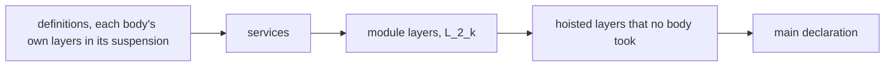

# 2026-10-10 seat 3B receipt: a body's own layers print to TypeScript and read back (decisions row 341, step 3b)

**The one thing to know before merging:** `readModule_printModule_defs` (claim
`module-defs-round-trip`) has restated premises, and the printer now admits a body's own layer.
So the claim's registry title, `docs/core/semantics.md` and `generated/semantics.md` describe the
old printer until you edit them; the texts stand in "Proposed text" below. The branch merges clean
on `de38da567`, and the three counted fixtures agree with rc.112 there.

## Base and head

- Branch `claude/step3b-body-layers`, worktree `.claude/worktrees/agent-a46cafe185b15fb2e`.
- Written at `ccda6d426`, then rebased onto slice 3a at `de38da567` (`refactor/phase1-phase3`).
  The rebase met no conflict: slice 3a touches no file of this cone.
- Commits on `de38da567`, oldest first:
  1. `aebb44316` codegen: a body's own layers print in its suspension and read back.
  2. `a4714000b` truth: a body's own layer, counted per call on rc.112.
  3. `cc69dc877` codegen: the checked reading admits a body's own layer.
  4. `a00077637` laws: `printModule_shape` names its simp lemma; its baseline entry goes.
  5. The head: the commit that adds this receipt.

## Changed files

- `src/Effect4/Codegen/Print.lean`: `Path.bodyIndex`, `printLocal` and `suspension` are new.
  `printDef` takes the body's hoisted layers. `printDefs` hands each body the layers whose paths
  stand in it and passes the others on. `printModule` refuses a block reference out of its scope
  (`Eff.inScope`) by its target. `Eff.layersAreModuleRefs` and the `defs:layer` refusal are gone.
- `src/Effect4/Codegen/Read.lean`: `readLocal` is new. `readDefBody` reads both forms of the
  suspension and answers the body's own layers. `readDefBodies` collects them, and `readModule`
  puts them back at their paths with the other hoisted layers.
- `src/Effect4/Laws/Codegen/Module.lean`: `printDef_plain`, `printDefs_plain`,
  `readDefHead_printDef`, `readDefs_printDefs`, `printModule_shape` and
  `readModule_printModule_defs` are restated. `bodyDeclOf`, `bodyDeclOf_mem`, `bodyDeclOf_none`
  and three private steps (`readLocal_printLocal`, `readLocals_mapM`,
  `readDefBody_suspension`) are new.
- `src/Effect4/Laws/Api/ModuleReadable.lean`: `layerSigOf` is new. `blockReadable` checks each
  body (it checked its suspension) and each hoisted layer at its scope's signature;
  `blockReadable_pieces` and `readModule_printModule_defs_readable` follow.
- `Test/Codegen/DefinitionsPrint.lean`: the battery of a body's own layers (below).
- `harness/truth/Truth.lean`: three counted fixtures, the corpus list and its names receipt.
- `Test/fixtures/target/selection.json`: the three fixtures, after `pDefsModuleLayer`.
- `harness/truth/corpus.json`, `harness/truth/result.json`, `harness/truth/result.md` and
  `harness/truth/generated/pDefsBodyLayer{Calls,Shared,Nested}.ts`: regenerated by the truth
  group's two producers.
- `Test/fixtures/proof-style/baseline.tsv`: the stale entry of `printModule_shape` is removed.
- `docs/research/2026-10-10-seat-3b-receipt.md`: this receipt.
- Not regenerated: `generated/semantics.md` (open obligation 1).

## The printed form

A block prints in this order. A body's hoisted layers now stand inside its definition.



The battery's block (`bodyLayered`, `Test/Codegen/DefinitionsPrint.lean`) prints as:

```ts
export const readBoth = (a0: number): Effect.Effect<number, never, never> => Effect.suspend(() => {
  let L_0_0_0 = Layer.succeed(Context.Service<"k5_4", number>("k5_4"), 3)
  return Effect.provide(Effect.provide(Effect.provide(…, L_0_0_0), L_2_0), L_0_0_0)
})
export const L_2_0 = Layer.succeed(Context.Service<"k4_4", number>("k4_4"), 7)
export const main: Effect.Effect<number, never, never> = readBoth(1)
```

- The constant is a `let`. The target fragment (`TypeScript.Stmt`, the lean4-typescript package)
  has no plain `const` statement, only `constYield` and `letInit`. Nothing reassigns the binding,
  so each run of the suspension holds one object per path.
- A body with no hoisted layer prints byte for byte as before (`suspension [] y`).
- The hoisted layers are the targets of references (`Eff.hoistAll`). A body's layer that nothing
  names prints in place inside the suspension, so each evaluation makes a new object.
- The layers print at the body's signature, so a layer may run the body's parameters.

## Commands and results

Each command ran in the worktree at the branch, after the rebase unless marked.

| Command | Result |
| --- | --- |
| `LEAN_NUM_THREADS=3 lake build Effect4.Codegen.Print`, then `Effect4.Codegen.Read`, `Effect4.Laws.Codegen.Module`, `Effect4.Laws.Api.ModuleReadable`, `Test.Codegen.DefinitionsPrint` | pass, at `ccda6d426` and again after the rebase |
| `LEAN_NUM_THREADS=3 lake build` of the 24 batteries that print or read a module (`Test.Api.ApiContract`, `Test.Codegen.{PayloadClasses,PrintContract,ReadContract,RecordEmission,ServicesPrint,SourceBindingsContract,TermRows}`, `Test.Dogfood.{P2HandlerLayers,Scenario.Faces,Stage}`, `Test.Program.{AuthoringModule,BranchAuthoring,FormationClosed,FormationContract,InvocationContract,MaskClaims,ModuleDefinitions,PartitionedSemaphoreFaces,Pull,QueueDefs,QueueFaces,RefFaces,SemaphoreFaces}`) | `Build completed successfully (1081 jobs)` at `ccda6d426` |
| `LEAN_NUM_THREADS=3 lake build Effect4 Effect4.Laws` with the same 24 batteries and `Test.Program.AuthoringContract` | `Build completed successfully (1327 jobs)` |
| `LEAN_NUM_THREADS=3 lake build Test.Program.LayerSharingContract` | pass |
| `lake env lean -M4096 --run harness/truth/Truth.lean harness/truth/corpus.json --tapes harness/truth/tapes` | `wrote 91 programs to harness/truth/corpus.json` |
| `bun run harness/truth/run-truth.ts --manifest harness/truth/corpus.json --out harness/truth --timeout 300 --tape-out harness/truth/tapes` | `PASS: 90 programs agree on exits, schedules and sync exits; 1 signed divergence(s)` |
| `make check-truth` | `PASS truth: pinned corpus, bounded differential and signed U-01 divergence checked; the regenerated modules type-check` |
| `make check-target` | `target conformance [effect@4.0.0-rc.112/adapter]: PASS; 102 expected, 102 attempted, 102 resolved, 0 mismatching, 0 refused` |
| `make check-ts-reader` | `files 499: matched 416, mismatched 0, refused with oracle 0, accepted without oracle 58, refused without oracle 25`; `bun test`: 761 pass, 0 fail |
| `make check-proof-style` | pass |

The truth group ran by its two recipe lines, not by `make gen-truth`. In a fresh worktree that
target's marker waits on `$(GEN)/readme`, which would regenerate the upstream groups first.

## Axiom output

- `#axiom_audit Effect4.Codegen.Print Effect4.Codegen.Read Effect4.Laws.Codegen.Module
  Effect4.Laws.Api.ModuleReadable`: `1166 declarations within [propext, Quot.sound], 0 of them
  modulo planned goals; 0 planned goals`.
- The same with `Test.Codegen.DefinitionsPrint`: `1209 declarations within [propext,
  Quot.sound], 0 of them modulo planned goals; 0 planned goals`.

## Evidence

- **proved**: `readModule_printModule_defs` (`src/Effect4/Laws/Codegen/Module.lean`),
  `readModule_printModule_defs_readable` and `Api.printModule_roundTrip`
  (`src/Effect4/Laws/Api/ModuleReadable.lean`), with a body's own layers in the domain. No planned
  goal stands under them.
- **tested**, host run on rc.112 under bun 1.4.2: after the rebase the three counted fixtures
  agree with the machine on exits, schedules and sync exits.

  | Fixture | Lean | rc.112 | Agree |
  | --- | --- | --- | --- |
  | `pDefsBodyLayerCalls`: two calls, one after the other | 2 builds | 2 builds | yes |
  | `pDefsBodyLayerShared`: one call provides its layer twice by reference | 1 build | 1 build | yes |
  | `pDefsBodyLayerNested`: a call nested in another through the program it passed | 2 builds | 2 builds | yes |

- **tested**, tsgo 7.0.0-dev.20260629.1: the three printed modules type-check
  (`make check-truth`) and their main types resolve (`make check-target`).
- **tested**, finite evaluations in Lean: the battery lines below.
- **reading**: within one call, two evaluations of one unnamed body layer never nest. So a new
  object per evaluation counts as the machine's one key per call. This is the note's §5.1
  argument, and no run checks it.
- **not run**: the truth lane at `ccda6d426`, before the rebase. That the key by path alone counts
  `pDefsBodyLayerNested` as 1 build is assumed from slice 3a's `nestedCall`
  (`Test/Program/LayerSharingContract.lean`).

The battery (`Test/Codegen/DefinitionsPrint.lean`), each line a finite evaluation or a control:

- `bodyLayered` types, runs to 10, prints its own layer as `L_0_0_0` in the suspension, is in
  `blockReadable`, and its module reads back.
- `ownLayerOnly` is admitted by `Api.admitModule` and reads to itself.
- Control: `ownAndModuleLayer`, which names a module layer from its body, stays refused as
  unbound, as at step 2.
- `layerInBody`, whose body layer nothing names, prints it in place and reads back.
- Controls: `otherBodyRef` names a body's layer from another body, and `mainBodyRef` from the
  main program. The printer refuses each with `layerRef [0, 0, 0]`. The checker refuses each at
  the site with `otherScope`.

## Landed theorems and their placement

`readModule_printModule_defs`, restated:

- Concept: `exact-codecs`; property: a module with a definition block reads back.
- Question: registry claim `module-defs-round-trip` (role compatibility); consumer:
  `readModule_printModule_defs_readable`, then `ModuleEmission.readModule` and
  `Api.printModule_roundTrip`.
- Reach: the structural equation `readModule (printModule root) = .ok root`, at a successful hoist
  and print. Each body and each of its own layers read back at the body's signature
  (`bodyDeclOf`). The main program, the module layers and the other hoisted layers read back at
  the block's signature. The layers' names decode. Decisions rows 328, 338, 339, 340 and 341.
- Premises restated: `bodiesReadable` is of each body (it was of its suspension).
  `layersReadable` splits into `localsReadable` (a body's own, at its signature) and
  `layersReadable` (the others, at the block's).
- Does not establish: that tsgo accepts the module, or how rc.112 runs it; those are the truth
  lane's finite checks. It does not establish `Api.admitModule` for a body that names a module
  layer; that stays refused. `ts/eff` has no reading of a definition block.
- Unlocks: R8 for a block whose bodies hold their own layers. With the counted fixtures, it gives
  finite checks of `translation-simulation` (R2, R3) for builds per call.

Its steps place themselves in their docstrings as steps of `readModule_printModule_defs`:

- `readDefs_printDefs`, `readDefHead_printDef`, `readDefBody_suspension`;
- `readLocals_mapM`, `readLocal_printLocal`, `bodyDeclOf_mem`, `bodyDeclOf_none`;
- `printDef_plain`, `printDefs_plain`;
- `printModule_shape`, whose statement is unchanged. Its consumers are `Laws/Codegen/Admit.lean`
  and `Laws/Codegen/Checked.lean`.

The counted fixtures: concept `translation-simulation`; finite checks for R2 and R3 (DI-71's
counted builds). They establish no equal-observation theorem, and they hold on the pinned host
only.

## Findings

1. **A callback's row escapes the printer's boundary** (tested). `Api.printModule` prints slice
   3a's `nestedCall`, and tsgo 7 refuses the module: `error TS2375: Type 'Effect<number, never,
   "k6_7">' is not assignable to type 'Effect<number, never, never>'`. The callback
   `(a1) => withL(2, …)` needs `kRef`, and the header closes the parameter's row as `never`.
   `invokeRequirementFault` (`src/Effect4/Codegen/CallbackRequirements.lean`) compares the
   invocation's row with the definition's declared row. Here `withL` declares `[kRef]`, which
   covers the row, so nothing is refused. Compare each passed program's row with `never`, or let
   the header carry the row. Not repaired here: HO-3's boundary (Codex's HO3-REQ-01). The counted
   fixtures avoid it: their counter is a module layer, so no header needs a service. The probe
   module and its `tsconfig.json` stand in the seat's scratchpad, not in the tree.
2. **`let` against `const`** (a decision, proposed below).

## Open obligations

1. Edit the claim's registry title (`tools/ProofGraph/Registry.lean`) and
   `docs/core/semantics.md`, then run `make gen-semantics`. The claim's printed statement changed
   with its premises.
2. Append step 3b to decisions row 341's status.
3. Update the line of `docs/STATE.md` that says the printer refuses a body's own layer.
4. Edit the layer-scopes note: §4.6, §5.2 and a new §5.4.
5. Finding 1, the callback's row.
6. Decide `let` against `const`.
7. `ts/eff` reads no definition block, so the truth lane's block modules are refused without an
   oracle there (as before this slice).

## Proposed text

Each proposal names its file and quotes the old text and the new text.

### `docs/core/semantics.md`, the property of `module-defs-round-trip`

Old:

> Each body's suspension reads back at the signature its parameters extend, through the
> spelling map its parameters' names extend (`paramsSpell`).

New:

> Each body reads back at the signature its parameters extend, through the spelling map its
> parameters' names extend (`paramsSpell`).
> A body's own hoisted layers print as constants at the top of its suspension, named by their
> paths (`printDefs`, `suspension`).
> So each run of the body makes its own layer objects, as rc.112 builds one object per
> evaluation of the body.
> They read back at the body's signature (`bodyDeclOf`; row 341, step 3b).

Old:

> The printer refuses an empty block and a definition body's own layer, by name (row 341,
> step 3).

New:

> The printer refuses an empty block, and a reference out of its scope by its target
> (`Eff.inScope`).

Add after the sentence on the truth lane (`make check-truth`):

> Three counted programs compare the builds of a body's own layer with rc.112.
> Two calls build twice, and one call that provides its layer twice by reference builds once.
> A call nested in another through the program it passed builds twice.

### `tools/ProofGraph/Registry.lean`, the title of `module-defs-round-trip`

Old:

> each body's suspension at the signature and spelling map its parameters extend
> (LawfulSpelling.withParams)

New:

> each body and each of its own layers at the signature and spelling map its parameters extend
> (LawfulSpelling.withParams; a body's own hoisted layers print as constants at the top of its
> suspension, row 341, step 3b)

Old:

> the printer refuses an empty block and a definition body's own layer (row 341, step 3)

New:

> the printer refuses an empty block and a reference out of its scope (Eff.inScope)

### `docs/research/2026-10-10-layer-scopes.md`

§4.6, **Print**. Old:

> A body may hold references into the module (`Eff.layersAreModuleRefs`); its own layer stays
> refused until step 3.

New:

> A body may hold references into the module, and its own layers since step 3b (§5.4).

§5.2, last paragraph. Old: `(a0) => Effect.suspend(() => { const L = …; return body })`. New:
`(a0) => Effect.suspend(() => { let L_<path> = …; return body })`.

New §5.4:

> ### 5.4 As landed: step 3b
>
> - **Print** (`printDefs`, `printLocal`, `suspension`, `src/Effect4/Codegen/Print.lean`): the
>   hoisted layers whose paths stand in body `k` (`Path.bodyIndex`) print as
>   `let L_<path> = …` at the top of its suspension. They stand in declaration order, at the
>   body's signature. A body with none prints as before.
> - The constant is a `let`, since the target fragment has no plain `const` statement. Nothing
>   reassigns it.
> - A body's layer that nothing names prints in place, inside the suspension.
> - A block whose reference stands out of its scope (`Eff.inScope`) is refused by its target.
> - **Read** (`readDefBody`, `readLocal`, `src/Effect4/Codegen/Read.lean`): the constants before
>   the `return` come back at their paths, with the other hoisted layers.
> - **The round trip** (`readModule_printModule_defs`): restated. Each body reads back itself,
>   and each hoisted layer at the signature of its scope (`bodyDeclOf`).
> - **Evidence.** The truth lane runs `pDefsBodyLayerCalls` (2 builds), `pDefsBodyLayerShared`
>   (1) and `pDefsBodyLayerNested` (2) on rc.112 and agrees after step 3a. tsgo 7 admits their
>   prints (`make check-target`).
> - **Not established.** `Api.admitModule` still refuses a body that names a module layer
>   (§4.6). It admits a body's own layers alone.

### `docs/STATE.md`

Old:

> The printer refuses a body's own layer until step 3b.

New:

> A body's own layers print as constants at the top of its suspension and read back (step 3b).
> Three counted programs agree with rc.112.

## Proposed decisions rows (proposals only)

Row 341, status column. Append:

> **Step 3b landed** (the note's §5.4): a body's own hoisted layers print as `let` constants at
> the top of its suspension and read back (`readModule_printModule_defs` restated). The three
> counted fixtures agree with rc.112.

New row, **a body's constant as `const`**. The target fragment (`TypeScript.Stmt`) has no plain
`const` statement, so a body's layers print as `let`. Options:

- (a) keep `let`;
- (b) add a `const` statement in a lean4-typescript release, then switch `printLocal` and
  `readLocal`.

Recommendation: (a), until a consumer needs `const`.

New row, **a callback's row against the printed parameter type** (finding 1). Options:

- (a) refuse an invocation whose passed program's row is not empty;
- (b) bind a requirement variable on the header.

Recommendation: (a) now, since it is the printer's boundary of HO3-REQ-01.
