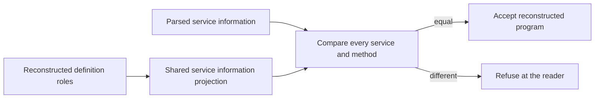

# Service repair overwatch: retained controls and exported methods

The earlier service repairs reject their retained counterexamples at `ec08fe86`.
The checked reader still accepts an exported method that reconstruction discards.
The Semaphore implementation passes a stronger client, but the landed client misses broken state sharing.

## Scope and ownership

Implementation base and reviewed head: `ec08fe863bb336f8d77c2287c811266886ef718e`.
Review branch base: `a7c848fcdce16f6e7aa1db043fa6f9e1fa6c10b8`.
Primary head observed at receipt creation: `52faff49324e4ef3e14d246f4460b30c44c51abe`.
`checkpoint.json` records the measured time, owned changes, and outstanding findings.

The read-only session inspection precedes assessment.
The bounded tail identifies Claude's repository and its move into program parameters.
The owner rules that design in decisions row 340.
The working tree contains its implementation in progress.
This review changes no production file, owner ruling, or Claude session.
It runs no full sweep, merge, or push.

This packet changes only this research directory.
`git diff --cached --check` flags one blank context line in `dependency-work-in-progress.patch`.
That retained patch keeps its exact bytes.
No authored source or receipt has a whitespace finding.
It retains probes, source snapshots, execution results, and the checkpoint.
The earlier packet remains at `docs/research/2026-10-10-service-client-overwatch/README.md`.

## The retained service repairs

`Controls.lean` exercises `Api.emitModule`, `Api.readModule`, and `Api.admitModule` from `src/Effect4/Api.lean`.
Its independent service initializes a number and exposes a method that returns that number.

| Retained control | Positive control | Negative control | Observed result |
| --- | --- | --- | --- |
| CO6B-READ | Method passes its captured state | Replace that argument with `99` | Raw reading and checked admission refuse |
| CO6B-NAMES | Services `S` and `T` | Services `S` and `SLayer` | Module emission refuses the collision |
| CO6B-KEYS | Method `get` | Methods `bad-name` and `__proto__` | Module emission refuses both keys |
| Argument order | Two arguments in declared order | Swap the arguments | `isMethodRequest` rejects the swap |

The retained defects resolve on these inputs.
These checks establish no general exactness theorem for every accepted service.

## CO6B-ALIASES: accepted method disappears

Evidence status: checked Lean controls and finite host execution.
Observation: the exported service's method names and a method's answer.
Fragment: one data-only service, one initializer, and one method definition.

`addAlias` in `Controls.lean` adds `alias` to the service shape and its layer object.
Both `get` and `alias` call the same definition with the captured state.
The TypeScript compiler accepts the added method.
Actual rc.112 execution returns `1` from `alias()`.

Both public readers accept the module.
The admitted program equals the original program, whose only method is `get`.
Emitting that admitted program discards `alias`.
Both original and modified main programs still return `1`.

`roleOf` in `src/Effect4/Codegen/Read.lean` selects the first method for a definition.
`readModule` does not check whether reconstruction retains every parsed service method.
A client can therefore lose a callable exported method after successful checked module admission.

The smallest repair checks all service information before accepting reconstruction.
The existing pure projection is `serviceInfo` in `src/Effect4/Laws/Codegen/Services.lean`.
Move that projection into core code and share it between the reader and laws.
Compare parsed service information against the projection from reconstructed definitions.
The local candidate `rolesCoverServiceInfo` accepts the original service and two distinct services.
It rejects the alias mutation.



This repair needs no second service representation and no additional author declaration.
Refusal fits decisions row 339's one-role representation.
Annotation erasure remains an explicit part of the reader's existing contract.
The probe does not challenge the printer-image round-trip theorem.

Proof placement for the proposed repair:

| Dimension | Proposed placement |
| --- | --- |
| Concept and property | `exact-codecs`, R5: accepted service information survives reconstruction |
| Claim and consumer | A reader-coverage claim consumed by checked module admission; propose it before adding a theorem |
| Relation to existing claim | `module-defs-round-trip` proves print-then-read on its domain; this additional obligation covers accepted service information |
| Reach | Existing service reader profile and annotation erasure; every parsed service initializer and method tuple |
| Limits | No claim about general TypeScript observations, host simulation, resource lifetime, or progress |
| Requirement served | R5's representation connection; no enlargement of `Eff` |

No theorem or planned goal is added by this packet.
The metadata comparison is a tested repair candidate, not a production change.

## CO6B-SEMAPHORE-CAPTURE: the client misses separate state

Evidence status: checked Lean evaluations and finite host comparison.
Observation: the sequential client's final exit.
Fragment: one two-permit semaphore and three completed method calls.

`Semaphore.serviceDefs` in `src/Effect4/Library/Semaphore/Defs.lean` initializes state once.
Its generated methods close over that state and reuse the existing operations.
The review finds no implementation defect in these tested calls.

The landed client calls `take(1)`, `takeIfAvailable(5)`, and `release(1)`.
It expects `[1,false,2]`.
Replacing every method's state with a fresh semaphore gives the same result.
The landed comparison therefore accepts this broken implementation.

Use the same API with `take(2)`, `takeIfAvailable(1)`, and `release(1)`.
The expected answer is `[2,false,1]`.
`Controls.lean` independently evaluates this exit through `Api.run` and `Api.runSync`.
The public TypeScript printer generates the stronger module.

The actual implementation returns that answer on rc.112.
Fresh state in any individual method changes the answer.
The comparison rejects each changed implementation and accepts the restored implementation.

The smallest production change strengthens `semaphoreProgram` in `Test/Codegen/ServicesPrint.lean`.
Change `semaphoreServiceClient` in `harness/truth/Truth.lean` to the same calls.
Regenerate their existing artifacts and retain the fresh-state negative controls.
No new API, theorem, or program constructor is necessary for this fixture repair.

The stronger manifest retains the original schedule and diagnostic fields.
Only the named exit observations have an independently evaluated stronger Lean fixture.
This packet makes no new schedule, cancellation, fairness, lifetime, or whole-machine simulation claim.

## Reproduction and measured results

`freeze.py` records the reviewed source hashes and dependency artifact origins in `pins.json`.
It copies only the dependency closure and selected source snapshots.
The review does not copy the repository's research tree.
`compile.py` checks the changed source modules in dependency order.
Every Lean invocation uses `LEAN_NUM_THREADS=3` and warnings as errors.
Only one Lake process runs at a time in the review worktree.

The primary checkout contains an unrelated edit to `Effect4.Laws.Program.TyView`.
`check-dependency.py` checks its committed source and replaces the captured dependency artifact.
The final controls and `#axiom_audit` use that replacement.
`checks/dependency-source.json` records the exact command, source hash, and replacement hash.
Other dependencies use the captured builder artifacts.
This is a narrow source check, not a full clean build.

Run these commands sequentially from the review worktree:

```sh
python3 docs/research/2026-10-10-service-repair-overwatch/freeze.py
python3 docs/research/2026-10-10-service-repair-overwatch/compile.py
python3 docs/research/2026-10-10-service-repair-overwatch/check-dependency.py
python3 docs/research/2026-10-10-service-repair-overwatch/check-lean.py
python3 docs/research/2026-10-10-service-repair-overwatch/check-host.py
```

The scripts require the pinned local dependencies and the previous review's retained runtime sources.
`check-host.py` verifies every reused source against `ec08fe86` before execution.
`checks/host-results.json` holds those hashes, exact commands, compiler results, and observations.
The runner's client deadline is 100 milliseconds.

The following table comes from `checks/compile-results.json`:

| Lean module | Process exit |
| --- | --- |
| `Effect4.Codegen.Print` | 0 |
| `Effect4.Codegen.Read` | 0 |
| `Effect4.Library.Semaphore.Defs` | 0 |
| `Effect4.Laws.Codegen.Services` | 0 |
| `Effect4.Laws.Codegen.Module` | 0 |
| `Test.Codegen.ServicesPrint` | 0 |

`check-lean.py` finishes both the control file and the named-module `#axiom_audit` without an error.
The retained audit output is:

```text
#axiom_audit: 1149 declarations within [propext, Quot.sound], 0 of them modulo planned goals; 0 planned goals
```

Host versions from `checks/host-results.json`:

- Compiler: `Version 7.0.0-dev.20260629.1`.
- Effect runtime: `4.0.0-rc.112`.
- Bun: `1.4.2`.

All generated host cases and alias controls check under that compiler.
A negative comparison below returns process exit `1` as intended.
These are finite checks, not equal-observation theorems.

| Semaphore case | Observed client answer | Client agrees | Runner process exit |
| --- | --- | --- | --- |
| `landed` | `[1,false,2]` | `true` | 0 |
| `landed_fresh_each_method` | `[1,false,2]` | `true` | 0 |
| `stronger` | `[2,false,1]` | `true` | 0 |
| `stronger_fresh_take` | `[2,true,2]` | `false` | 1 |
| `stronger_fresh_release` | `[2,false,2]` | `false` | 1 |
| `stronger_fresh_takeIfAvailable` | `[2,true,1]` | `false` | 1 |
| `stronger_fresh_each_method` | `[2,true,2]` | `false` | 1 |
| `stronger_restored` | `[2,false,1]` | `true` | 0 |

## Checkpoint and next action

`CO6B-READ`, `CO6B-NAMES`, and `CO6B-KEYS` close for their retained counterexamples at `ec08fe86`.
`CO6B-ALIASES` and `CO6B-SEMAPHORE-CAPTURE` remain actionable at the reviewed commit.
The labels in this packet are review labels, not additions to the counterexample register.

Earlier `BUILD-PINS`, `CO6B-CLIENT`, `CLOSURE-POP`, and `CLOSURE-ERASURE` findings remain unchanged by this review.
Their previous receipts retain their scope and evidence.
Do not report these unchanged findings as new defects.

The next useful review follows the metadata check, the stronger Semaphore fixture, or a committed program-parameter slice.
Keep row 340's active implementation owned by Claude.
The service projection and fixture changes can accompany that work without extending its representation.
