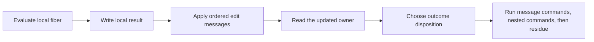

# R2 edit messages: design and finite evidence

The message list must run after local write-back and before the parked disposition.
The countdown observer has a separate stale waiter write-back outside iteration.
Repairing `Iter` alone does not repair that command case.

Base: `4b6645156`.
Status: checked design probe; no core patch.
Evidence kind: compiling Lean cuts and finite rc.112 evaluations.

## Placement and contract

Concept: reactive-scheduling, invariants over execution traces; R4 and R11.
Question: the proposed `command-moves` structure retains native edits across the owner's write-back.
Reach: the existing join, countdown, scope-link, cancellation, and interruption producers.
The interpreter and the decision tape remain the semantic owners.
Limit: the probe establishes no complete runtime correspondence, liveness, or admitted-history preservation.
Consumer: the R2 machine repair, then shared interference, frame transport, and current-code ledger edits.
Keep `FiberCore`, `FiberEvaluator`, `Completion`, and the explicit command residue.

## Representations

| Carrier | Owner and role | Retained data | Excluded data |
| --- | --- | --- | --- |
| `Prim` and names | existing program syntax | programs and continuations | host closures |
| `Iter` | existing evaluation result | local result, state changes, outcome, nested commands | proposed messages are not a second program |
| proposed `FiberEdit` | machine runtime data | target, observer, cancellation token, cause delta | interpreter functions and arbitrary predicates |
| `List FiberEdit` | ordered edits | evaluation order | no overwrite snapshots |
| `FiberCore` | existing interpreter parameter | frame operations | no new frame representation |

The syntax signature is:

- `observe(target : FiberId, observer : Observer)`;
- `dropToken(token : Nat)`;
- `interrupt(target : FiberId, cause : Cause ε δ ι α)`.

Each payload is existing first-order data.
`dropToken` names the exact native predicate for resume and countdown observers.
It stores neither that predicate nor a Lean function.
`interrupt` holds the newly constructed cause, not the accumulated target cause.
The application combines it with the target's current recorded cause.
This avoids capturing an interpreter inside a runtime message.

## Arrows and order

`causeOf : RunInterp → caller → annotations → target → Cause` reads the existing annotation policy.
`record : Cause → RunFiber → RunFiber × Bool` uses the existing generic `FiberCore` operations.
`applyEdit : FiberEdit → RunMachine → RunMachine × List Cmd` performs the addressed edit.
`applyAll : List FiberEdit → RunMachine → RunMachine × List Cmd` applies messages in list order.
These are interpreter operations, not stored syntax.
The returned commands run idle interrupted targets before the caller's continuation.

The parked branch reads the updated deferred flag.
A self-interrupt observes the owner's running phase before the parked branch clears it.
The updated owner retains its observer list, interrupt cause, and deferred flag.
Do not apply messages after today's complete `settle`.
That order treats an interrupted parked owner as idle and produces an extra `evaluate` command.

The probe reuses today's `settle` after installing and reading the updated owner.
Its `getD` fallback is only a raw-state prototype convenience.
The implementation must state selected-owner retention explicitly.
Do not hide an absent-owner assumption in that fallback.

## Checked discriminating cuts

| Actual producer | Current machine cut | Message prototype | Pin rc.112 |
| --- | --- | --- | --- |
| self join | settlement erases the observer | observer retained | one observer, parked frontier |
| self countdown | settlement erases the observer | observer retained | one observer, parked frontier |
| open self scope link | registration remains; observer disappears | both remain | one observer, parked frontier |
| closed self scope link | recorded deferred cause disappears | cause retained | interrupted failure |
| self interrupt | recorded deferred cause disappears | cause retained | interrupted failure |
| owner token removal | settlement resurrects the canceled observer | observer remains removed | exact native splice policy |
| countdown callback then self | stale waiter update erases its new observer | applying after waiter update retains it | one observer, parked frontier |

The nonalias join prototype equals today's complete settled result by `rfl`.
`record_source` equals the existing generic `interruptRecord` by `rfl`.
The parked interruption control distinguishes deferred `loop` from a too-late idle `evaluate`.

The retained `E4-RUN-CE-046` admitted program still reaches a machine frontier at budget 20000.
The ordinary other-fiber interruption control still exits interrupted.
On the pin, the retained program returns child `Failure`, an `Interrupt` reason, and log zero.
These are finite checks, not general simulations.

## Exact migration scope

1. Factor cause construction from `interruptRecord`; retain its existing name and meaning.
2. Add the three-tag message data beside the existing runtime records.
3. Extend `Iter` with ordered messages; ordinary results carry none.
4. Migrate native join and the generic `FiberAction.join` together.
5. Migrate `countdownPark`, open and closed `linkScope`, `interruptAs`, and token removal.
6. Preserve eager store changes, allocated rows, counters, traces, and source finalizer identities.
7. Install the local result, apply messages, and inspect the updated owner before disposition.
8. Preserve the exact nested-command order and command-budget residue.
9. Repair the countdown `fireObserver` waiter update at the same ordered-edit seam.
10. Reuse the generic helper changes in `Laws/Program/EvaluateR.lean`.
11. Rebuild shared `Interference`, `Moves`, `Footprint`, `Guard`, `StatePreservation`, and `Ledger` consumers.
12. Keep old theorem statements as projections where their observation remains valid.

Root owns the labelled moves and footprint changes.
The R2 seat owns the generic message interpretation and executable fiber producer changes.
Do not add a parallel native evaluator or command census.
The countdown callback repair must preserve prior interruptions and not recreate canceled pending guards.
Its exact raw-state law remains an implementation obligation.

## Rejected shortcuts and remaining obligations

Merging entire stored and local records is not an edit semantics.
It can overwrite newer fields with an old snapshot.
Special-casing only self-interrupt leaves self observers and token removal broken.
A message applied after complete settlement has the wrong running phase.
Queued `interruptTarget` alone can fix the interruption example, but does not supply the other edit semantics.
Using only queued commands also exposes a new command-budget cut before the parked disposition.
The proposed ordered message phase stays inside that disposition cut.

Required connections remain:

- cause-delta application equals the old interrupt operation;
- nonalias results retain the old observations;
- the generic core and term evaluator keep their shared helper identities;
- the labelled move word accounts for message events and their changed owner fields;
- actual native source, guard, and ledger consumers survive the new order;
- the repair closes the CE046 regression at the machine and pin observations.

The implementation changes executable code.
Regenerate the reached machine/compiler outputs.
Run `check-truth` and `check-compiler` at the coordinated behaviour sweep.
Amend the seeded attack guard only after the repaired machine run is checked.
No original scenario statement is weakened.
