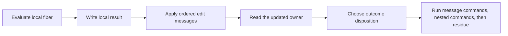

# R2 edit messages: design and finite evidence

The message list must run after local write-back and before the parked disposition.
The countdown observer has a separate stale waiter write-back outside iteration.
Repairing `Iter` alone does not repair that command case.

Base: `4b6645156`.
Status: checked design probe; no core patch.
Evidence kind: compiling Lean cuts and finite rc.112 evaluations.

## Placement and contract

Concept: reactive-scheduling, invariants over execution traces; R4 and R11.
Question: the proposed `command-moves` structure retains native edits across the owner's write-back.
Reach: the existing join, countdown, scope-link, cancellation, and interruption producers.
The interpreter and the decision tape remain the semantic owners.
Limit: the probe establishes no complete runtime correspondence, liveness, or admitted-history preservation.
Consumer: the R2 machine repair, then shared interference, frame transport, and current-code ledger edits.
Keep `FiberCore`, `FiberEvaluator`, `Completion`, and the explicit command residue.

## Representations

| Carrier | Owner and role | Retained data | Excluded data |
| --- | --- | --- | --- |
| `Prim` and names | existing program syntax | programs and continuations | host closures |
| `Iter` | existing evaluation result | local result, state changes, outcome, nested commands | proposed messages are not a second program |
| proposed `FiberEdit` | machine runtime data | target, observer, cancellation token, cause delta | interpreter functions and arbitrary predicates |
| `List FiberEdit` | ordered edits | evaluation order | no overwrite snapshots |
| `FiberCore` | existing interpreter parameter | frame operations | no new frame representation |

The syntax signature is:

- `observe(target : FiberId, observer : Observer)`;
- `dropToken(token : Nat)`;
- `interrupt(target : FiberId, cause : Cause ε δ ι α)`.

Each payload is existing first-order data.
`dropToken` names the exact native predicate for resume and countdown observers.
It stores neither that predicate nor a Lean function.
`interrupt` holds the newly constructed cause, not the accumulated target cause.
The application combines it with the target's current recorded cause.
This avoids capturing an interpreter inside a runtime message.

## Arrows and order

`causeOf : RunInterp → caller → annotations → target → Cause` reads the existing annotation policy.
`record : Cause → RunFiber → RunFiber × Bool` uses the existing generic `FiberCore` operations.
`applyEdit : FiberEdit → RunMachine → RunMachine × List Cmd` performs the addressed edit.
`applyAll : List FiberEdit → RunMachine → RunMachine × List Cmd` applies messages in list order.
These are interpreter operations, not stored syntax.
The returned commands run idle interrupted targets before the caller's continuation.

The parked branch reads the updated deferred flag.
A self-interrupt observes the owner's running phase before the parked branch clears it.
The updated owner retains its observer list, interrupt cause, and deferred flag.
Do not apply messages after today's complete `settle`.
That order treats an interrupted parked owner as idle and produces an extra `evaluate` command.

The probe reuses today's `settle` after installing and reading the updated owner.
Its `getD` fallback is only a raw-state prototype convenience.
The implementation must state selected-owner retention explicitly.
Do not hide an absent-owner assumption in that fallback.

## Checked discriminating cuts

| Actual producer | Current machine cut | Message prototype | Pin rc.112 |
| --- | --- | --- | --- |
| self join | settlement erases the observer | observer retained | one observer, parked frontier |
| self countdown | settlement erases the observer | observer retained | one observer, parked frontier |
| open self scope link | registration remains; observer disappears | both remain | one observer, parked frontier |
| closed self scope link | recorded deferred cause disappears | cause retained | interrupted failure |
| self interrupt | recorded deferred cause disappears | cause retained | interrupted failure |
| owner token removal | settlement resurrects the canceled observer | observer remains removed | exact native splice policy |
| countdown callback then self | stale waiter update erases its new observer | applying after waiter update retains it | one observer, parked frontier |

The nonalias join prototype equals today's complete settled result by `rfl`.
`record_source` equals the existing generic `interruptRecord` by `rfl`.
The parked interruption control distinguishes deferred `loop` from a too-late idle `evaluate`.

The retained `E4-RUN-CE-046` admitted program still reaches a machine frontier at budget 20000.
The ordinary other-fiber interruption control still exits interrupted.
On the pin, the retained program returns child `Failure`, an `Interrupt` reason, and log zero.
These are finite checks, not general simulations.

## Exact migration scope

1. Factor cause construction from `interruptRecord`; retain its existing name and meaning.
2. Add the three-tag message data beside the existing runtime records.
3. Extend `Iter` with ordered messages; ordinary results carry none.
4. Migrate native join and the generic `FiberAction.join` together.
5. Migrate `countdownPark`, open and closed `linkScope`, `interruptAs`, and token removal.
6. Preserve eager store changes, allocated rows, counters, traces, and source finalizer identities.
7. Install the local result, apply messages, and inspect the updated owner before disposition.
8. Preserve the exact nested-command order and command-budget residue.
9. Repair the countdown `fireObserver` waiter update at the same ordered-edit seam.
10. Reuse the generic helper changes in `Laws/Program/EvaluateR.lean`.
11. Rebuild shared `Interference`, `Moves`, `Footprint`, `Guard`, `StatePreservation`, and `Ledger` consumers.
12. Keep old theorem statements as projections where their observation remains valid.

Root owns the labelled moves and footprint changes.
The R2 seat owns the generic message interpretation and executable fiber producer changes.
Do not add a parallel native evaluator or command census.
The countdown callback repair must preserve prior interruptions and not recreate canceled pending guards.
Its exact raw-state law remains an implementation obligation.

## Rejected shortcuts and remaining obligations

Merging entire stored and local records is not an edit semantics.
It can overwrite newer fields with an old snapshot.
Special-casing only self-interrupt leaves self observers and token removal broken.
A message applied after complete settlement has the wrong running phase.
Queued `interruptTarget` alone can fix the interruption example, but does not supply the other edit semantics.
Using only queued commands also exposes a new command-budget cut before the parked disposition.
The proposed ordered message phase stays inside that disposition cut.

Required connections remain:

- cause-delta application equals the old interrupt operation;
- nonalias results retain the old observations;
- the generic core and term evaluator keep their shared helper identities;
- the labelled move word accounts for message events and their changed owner fields;
- actual native source, guard, and ledger consumers survive the new order;
- the repair closes the CE046 regression at the machine and pin observations.

The implementation changes executable code.
Regenerate the reached machine/compiler outputs.
Run `check-truth` and `check-compiler` at the coordinated behaviour sweep.
Amend the seeded attack guard only after the repaired machine run is checked.
No original scenario statement is weakened.

## Structural proof migration

Concept: reactive-scheduling, R11. Claim: command-moves, role structure.
Consumer: command transport and its stack, mask, and release-custody instances.

The existing interference relation records the fresh cause consumed by `interruptWithCause`.
Its old interpreter-based constructor remains a proved adapter.
The same change applies to frame and live transport.
The three message tags then inherit one machine transport law.
This law covers arbitrary causes because its observation contains only structural fields.
It establishes no cause provenance, guard reservation, progress, or host agreement.
The existing evaluator census still classifies local updates and allocation.
Settlement composes its local installation, message word, selected-owner lookup, and outcome disposition.

The typed-state position table assigns an interrupt message's cause to its target fiber.
This row names the expected cause judgment; it proves no message typing invariant.
The existing position gate checks that the new value-bearing position has an explicit source.
The host-call agreement proof retains its statement and records its empty message word.

## Simulation message obligation

Concept: program-meaning, R4; consumer: the existing `run_eq_ref` simulation.
The native and reference iteration relation must equate their new message lists.
Their message alphabets contain the same first-order data.
Settlement then applies equal messages to related current records before interpreting the outcome.
The relation keeps the existing machine, fiber, outcome, and command clauses.
This strengthens the internal iteration relation; it changes no equal-observation endpoint or host premise.
The shared interruption relation consumes an arbitrary equal fresh cause on both sides.
The producer still proves that its fresh cause comes from the interpreter.

## Shared settlement accounting obligation

Concept: reactive-scheduling and scope-lifetime-finalization; R11.
Question: settlement retains the accounting bound after deferred messages apply to current records.
Consumers: `WriterWeights.settle_bound` and `ReleaseCustody.settle_funded`.
Reach: distinct fiber identities, observer-neutral weights, and nonincreasing interruption weights.
The shared `FiberSum` table bound consumes the existing actual-prefix edit path.
It adds no second message fold or machine representation.
Settlement leaves the store, race table, and trace unchanged.
Its added scheduler commands have zero release credit.
The writer instance derives interruption's bound from its existing model premise.
The release instance reuses its existing failure bound.
Their original endpoint statements remain unchanged.
These accounting laws establish no evaluator debit, release progress, or runtime correspondence.
The original scenario goals remain open until their producers compose.

## Queue control observation

Concept: reactive-scheduling, R11; consumer: the reachable Guard queue claim.
The queue reads current code only on running, unparked fibers.
It reads an exited fiber's exit without requiring the local owner to remain running.
The old `ControlsAway` additionally froze idle, unparked fibers' current code.
An interrupt message may change that code before scheduling its evaluation.
The internal relation now restricts its premise to running-unparked or exited fibers.
The existing `OtherEdits` relation supplies this observation once.
Queue settlement composes local installation, messages, and current-owner disposition.
The public queue endpoints keep their statements.

A raw iteration may lack its selected owner.
Nonempty-message settlement then halts and drops its command tail.
The raw precise tail equation therefore requires owner retention.
A general disjunction covers both halting and prefix-plus-tail outcomes.
Actual queue proofs use that disjunction and acquire no retention premise.
Neither change establishes source admission, progress, or host behaviour.

## Source budget and reference heap transport

Concept: scope-lifetime-finalization, R11; store-typing, R4.
Consumers: source-use history and `HeapSites.heap_sites_keep`.
The existing evaluator debit measures its returned machine and acting frame before settlement.
`FiberSum.settle_le` accounts for the deferred messages after the acting frame is installed.
The native countdown and scope-link consumers read their canonical plans.
Their eager helper statements remain adapters through the shared message bound.
`outside_edits_le` instantiates that bound with the existing omitted-owner weight.
The reference-heap consumers use `StatePreservation` for countdown and settlement.
These facts establish neither progress nor agreement with an external implementation.
The behavior gates remain deferred to the coordinated sweep.

### Native release-accounting consumers

Concept: scope-lifetime-finalization, R11, through `ReleaseCustody.Execution.history`.
`NativeActionDebit` reads canonical countdown and scope-link plans before message installation.
`FiberSum.fiberEdits_le` supplies its eager adapters and keeps actual lookup prefixes.
Each message preserves the scope and race terms; interruption only spends fiber credit.
The original eager helper statements remain adapters with their current premises.
These bounds establish neither progress nor the open application history goals.

## Observer and queue consumers

Concept: scope-lifetime-finalization and reactive-scheduling, R11.
Consumers: `ReleaseCustody.Execution.history` and its administrative queue and saved-frame conditions.
`observer_producer_path` supplies one actual-prefix edit path and the provenance of generated commands.
Each update retains the current record's frame, dispatcher, and parked state.
The cost and predicate projections serve the existing custody and queue assertions.
`observer_commands` exposes the predicate projection without a machine invariant.
No new command census or decision source is introduced.

Settlement's queue proof reads the actual owner after the message word.
Its saved-stack transport uses `Moves.OtherEdits` and the existing outcome disposition.
The nested command owner needs the retained race table, not the cached fiber's current code.
The original endpoint statements remain unchanged.
These facts establish no application history or outside-runtime agreement by themselves.
