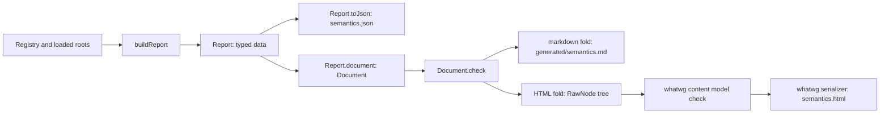

# Generated documents: the docgen probe reviewed and landed

One typed report gives the semantics JSON. One document of that report gives both the committed
Markdown and an HTML page. No generated page is committed.

## The probe

Codex's probe is commit `fa309511d` on branch `codex/schedule-independence-review-20261010`,
folder `docs/research/2026-10-10-semantics-docgen-probe/`. Its design is right in its main move:

- a document is first-order data;
- each output format is a fold of that data;
- the producer should build typed report data once.

The review found these faults:

| Area | Probe | Landed |
| --- | --- | --- |
| Committed bytes | 38 files, 160,975 lines: retained inputs, 2.3 MB HTML, 3.6 MB document JSON, 1.9 MB Markdown, seven receipt JSON files | No generated page committed; the page is a build artifact under `.lake/gen/semantics-report/` |
| Schemas | A second schema: a 139-line JSON decoder back into a `ReportView` | One `Report` value; `Report.toJson` writes the schema-six JSON byte for byte |
| Document signature | `heading` with a free depth beside `group`; depth checked at run time | One `part`; a heading's level is its nesting |
| Labelled values | Paragraphs of "Label: `value`" | A `fields` block, an HTML `dl` |
| Anchors | Names hex-encoded byte by byte (`node-4566…`) | The key itself (`claim:fits-mono`), percent-encoded only in a link |
| Code language | A "Language: lean" paragraph above each block | `class="language-lean"` on `code`, the HTML Standard's convention |
| Folds | Hand algebras over non-recursive records (`ReportAlgebra` with a nine-argument field) | One fold, over the one recursive type (`Block`); the report maps to a document directly |
| Example page | A hard-coded claim and figure | Not landed: nothing consumes it |
| Markdown escaping | Every `.`, `-`, `(` and `)` escaped | Only what CommonMark reads as markup; an escaped pipe inside a code span only in a table |

The probe's finding about the old renderer holds and is repaired. `renderMarkdown` dropped claim
titles, applicability reasons and assumption sources. The document keeps all three, with each
witness's module and each register record a claim cites.

## What landed

- `tools/Tools/Document.lean`: the signature (`Inline`, `Block`, `Document`), its fold, the
  checks (part keys unique, references resolve, table widths agree) and the Markdown fold.
- `tools/Tools/Document/Html.lean`: the HTML fold over `lean4-whatwg`'s `RawNode`. The HTML
  Standard's content model checks the whole page before the standard's fragment serializer writes
  it, and a refusal names its path of elements.
- `tools/Tools/Semantics.lean`: `buildReport` returns a `Report`; `Report.toJson` is its JSON.
- `tools/Tools/SemanticsDocument.lean`: `Report.document`, and the plan section's name helpers
  that the refusal controls test.
- `lean4-whatwg` is pinned at branch `html-h7` (`2c6e3bc`). Only the `Tools` library imports it,
  and only `Whatwg.Html.*`, whose import closure is Lean alone.

The page is one file. Its stylesheet is inline, and it loads no script and no remote resource. It
has a header with a contents navigation, and one section per part with its key as `id`. It follows
the reader's light or dark preference. A wide table scrolls inside a focusable region labelled by
its columns.

## Evidence

| Check | Result |
| --- | --- |
| `Report.toJson` against the JSON before the change | byte-identical (`cmp`, 2,690,111 bytes) |
| HTML content model (`Whatwg.Html.Content.validIn`) | accepts the whole page |
| `make check-semantics` | passes: 35 report refusals, 18 register controls, 4 traversal controls, 9 name controls |
| `#closure_audit` with the new modules imported | passes |
| Browser pane, 375 px, light and dark | no page-wide horizontal scroll, no console message |
| Sizes | Markdown 728 KB (was 658 KB, with the restored evidence); HTML 1.16 MB |

The report's `inputs` now name the three document modules, so the JSON's `inputs` field changes
after the byte-identity check above. No theorem is stated: a document is presentation. The
probe's four proposed obligations stay proposals.

## Open

- Mermaid blocks print as code on the page: rendering them needs a script or a Lean layout.
- `lean4-whatwg`'s `main` lacks the HTML package. Branch `html-h7` must merge with `main`'s
  37 newer commits (it renamed `Gates` and `bin`).
- The architecture map writes HTML by hand (`Tools.Architecture.esc`). It can become a document.
- Design language in documents (owner, 2026-10-11): the view's motion is data, so CSS keyframes
  and custom properties can carry it. That needs a grill session before it is planned.
