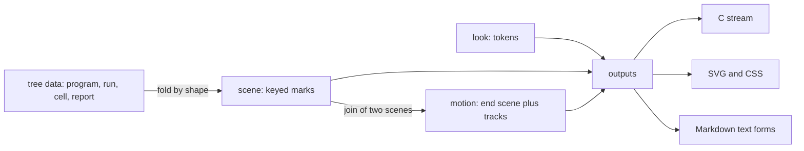

# The design language in documents: findings and recommendations for the grill

The owner, 2026-10-11, by voice: clean up across the board; take a mathematical modelling approach,
the minimal structures that become APIs; carry the design language for all the machine structures
into the documents, motion included, perhaps as CSS; make it pretty and appealing for agents and
for humans. This note is the exploration before the grill. The grill's rulings go to
`docs/core/decisions.md`.

## 1. What the exploration read

Six readers worked in parallel, and I read the central files myself:

- the design language of 2026-09-08 (`docs/design/design-language.md`, its studies, the
  string-diagram notes) and the algebra sweep's three design documents;
- the view and its motion (`tools/Tools/View/`, `tools/Drivers/View.lean`, `tools/view/`);
- the view rounds of 2026-10-06 to 2026-10-11 and decisions rows 281, 307, 308, 334, 336, 337
  and 353;
- the machine's structures (`src/Effect4/Machine/`, `Library/`, `Api/`, `docs/core/machine-state.md`);
- the HTML side (`Tools.Document`, lean4-whatwg at `2c6e3bc`, the architecture map, the proof-graph
  view);
- current practice outside: CSS motion, the design-token format, diagram systems, the research on
  animation, documents that agents read. Browser support is from MDN's compatibility data 8.1.5
  (2026-10-08).

A probe turned pFork's top-down build into one CSS-animated SVG per step (`probe/`, section 6).

## 2. Findings

**F1. The tree already has a web-standard style layer, and no document uses it.**

- `Tools.View.Look` holds every style choice. `Tools.View.Tokens` writes it as a W3C design-token
  file (format 2025.10) and as CSS custom properties `--e4-*`. `Ease.css` writes each easing as
  CSS `linear()`. `Output.svg` writes classes `e4-fill-<role>` and a `data-key` on every mark.
- Three pages ignore it, each with its own palette:
  - the semantics page (`Tools/Document/Html.lean`, mine, row 353);
  - the architecture map (`Tools/Architecture.lean`, IBM Plex from Google Fonts);
  - the proof-graph view (`ProofGraphView.js`, d3 from a CDN).

**F2. Each page breaks the rule that a hue names an agent.**

- The design language's rule is "Hue is for agents": machine ink, host amber, failure madder,
  resource verdigris. Row 308 holds it for the proof graph's open parts ("A mark has no hue").
- The breaches:
  - the semantics page colours evidence status green, amber and red, so amber means "modulo"
    there and "host" in the language;
  - the proof-graph view gives each of ten concepts a hue;
  - the architecture map gives each layer a hue.

**F3. The design language is tracked but holds no authority.**

- `docs/design/design-language.md` is not in the authority map of `AGENTS.md`, and no core document
  cites it.
- Part of it is ruled over:
  - its motion rule ("Only a replay step may animate … arrows do not grow") yields to row
    337(5);
  - its palette and the studies' paths are stale;
  - its inventory lacks the stores, the journal, the session ledger and every library cell.
- Its strongest parts still stand:
  - every mark is a function of a named object;
  - Bertin's assignments: position for order and containment, value for state order, shape and
    hollow/filled for a promise and its keeping, numerals for identity;
  - the notation triple: sexp, spoken, glyph;
  - the causal rule: nothing relates two concurrent events.

**F4. The view draws two of the machine's eight shapes.**

- The census groups the structures by algebraic shape:
  - trees (`Eff`, `Ty`, `Term`, `Representation`, `Store.Val`);
  - pointers into trees (`Point`, frames, sites);
  - graphs (fibers, flow, memo forest, handles);
  - sequences (trace, decision tape, `List Command`, ledgers);
  - tables and arenas (heap, deferreds, scopes, context);
  - queues (dispatcher, wake lists, library waiters);
  - automata (fiber lifecycle, `ScopeState`, `RaceAllState`, `HostProtocol`, library models);
  - timelines (clock, scope lifetimes, masks).
- The landed view draws the tree (program lines) and the graph (flow, fiber graph).
- The hand studies draw a score, a scope enclosure and a cursor, but the corpus export lacks most
  of what they need.

**F5. Motion is a flipbook.**

- `writeFrames` samples each step 19 times (`Tools.View.sample`) and writes each moment as a whole
  SVG. The player swaps `` sources by script.
- pFork's build is 109 pictures and 2.4 MB of SVG. The motion tokens reach CSS, and nothing reads
  them.

**F6. The motion model already sits on CSS's own terms.**

- `Transition.at` is CSS's animation timing with `fill-mode: both`.
- `settle` and `spring` are tables read linearly between twenty-one stops (`tableAt`). That is
  exactly CSS `linear()` with the same stops.
- The cubic easings are `cubic-bezier(1/3, y1, 2/3, y2)` curves, exact in CSS.
- A kept element's move is a translation, and `lowerAll_move` already proves that lowering
  commutes with it.
- Two parts are not exact:
  - a box's growth re-lays the box at a fixed stroke;
  - a route's reveal cuts its cubic by parameter, not by length, and an organic route grows with a
    tapering tip.

**F7. The HTML checker refuses inline SVG.**

- `Whatwg.Html.Content.validIn` refuses `svg`: lean4-whatwg defers SVG (ruling HP-9), and
  `Whatwg/Html/Svg.lean` is a stub.
- `` passes today.
- A seat on the owner's PC now takes the SVG work (`svg-seat-brief.md`, 2026-10-11).

**F8. What the outside says.**

- CSS can carry the whole motion system with no script:
  - `@keyframes` that animate into the static state;
  - per-mark custom properties;
  - `linear()`, `pathLength` with a dash for line drawing, `offset-path` for a token along an edge;
  - a registered `@property` as a figure's clock, stepped by `
` or `:target`.
- Two gaps:
  - Safari ignores the CSS `d` property, so a path morph needs SMIL or must be avoided;
  - the token format has no animation type (issue 429 proposes springs).
- The research agrees:
  - animation helps a reader track an object and see one change, and is worse than small multiples
    for analysis (Robertson et al. 2008);
  - keep marks keyed, stage the change, ease in and out, give the reader control (Heer and
    Robertson 2007; Tversky et al. 2002);
  - anything that loops longer than five seconds needs a pause (WCAG 2.2.2).
- Agents read the accessibility tree first (Lighthouse's "Agentic browsing" audit). That means:
  - semantic HTML;
  - the WAI-ARIA graphics roles, with `<title>` and `<desc>`;
  - the data embedded as JSON;
  - a Markdown twin of each page.

## 3. The model: three free objects and their folds

A mathematical reading of the whole request names three structures. Everything else is a fold.

- **The scene.** A list of keyed calls is the free monoid on calls (`lowerAll_append`). Moves act
  on it (`lowerAll_move`). A figure is a scene with its text forms.
- **The motion.** A step's motion is the data join of two scenes by key (`Tools.View.join`): enter,
  update, exit. A first-order value carries it:
  - the end scene;
  - for each key, a track: one primitive from a small group that acts on calls, and a
    `Transition`.
  - Its two folds are `at t`, a scene for the C player and the video, and `css`, keyframes for the
    page. Each primitive gets a lowering law like `lowerCall_move`, so `at` and `css` agree by
    construction.
- **The look.** One token document. Its folds are the stream's look rows, CSS custom properties and
  the class rules. It is the only source of a colour, a face or a duration in any output.

The primitives CSS states exactly: translation, scaling about a point, a clip inset, and opacity.
The laws to state:

- **rest:** with its animations removed, the CSS figure is the end frame (from `sample_end`);
- **move:** a translation track lowers to `sample`'s calls at every moment (from `lowerAll_move`);
- **easing:** `Ease.at e p = linearAt (Ease.points e) p` for `linear`, `settle` and `spring` at every
  `p`; for the cubics it holds at every stop, and `Ease.bezier` is exact;
- **keys:** the key-to-identifier encoding is injective. Key uniqueness is the open premise that
  Codex's layout review named.

These are tool laws (row 334(3)): a document is presentation, and no registry claim moves.

## 4. Recommendations

1. **One token source.** Every generated page takes its CSS from the look through `Tokens.css`: the
   semantics page, the architecture map, the view's pages and the design studies. Remove the three
   page palettes, Google Fonts and the per-layer hues.
2. **Hue for agents only; status by shape.** An evidence status is a mark of the promise-and-keeping
   family:
   - proved: filled;
   - modulo, resting on goals: half filled;
   - planned goal: hollow;
   - open: an outline of dashes;
   - refuted: the failure cross.

   A planned goal is literally a promise, so the language's hollow/filled rule fits it exactly.
   Concepts and layers take position and a name, never a hue. A look with the hue on may add the
   agent hues, as row 337(4) allows for token classes.
3. **Promote the design language.** Reconcile it into one authority that `AGENTS.md` maps:
   - rows 308, 336, 337 and this grill's rulings;
   - one visual form per algebraic shape;
   - the status marks;
   - the notation triple.

   The look remains the data, and the authority names the meanings.
4. **A figure is data.** `Tools.Document.Block` gains a figure: a key, a scene, a caption and its
   text forms, the notation triple (sexp, spoken, glyph).
   - The Markdown fold writes the spoken and sexp forms.
   - The HTML fold writes the glyph form as SVG, plus:
     - `role="graphics-document"`, with `<title>` and `<desc>` from the spoken form;
     - `data-key` on every mark;
     - the sexp form as `<script type="application/json">`;
     - a `
` step list as the static equivalent.
   - The figure enters as an `` with a data URL until the whatwg seam lands, then inline.
5. **Motion as a value with two folds** (section 3). Restate growth as scaling about the centre and
   reveal as a clip that opens along the route's direction, so native, video and web share one
   meaning. The organic tip stays a native-only ornament, or goes.
6. **Motion tells a step and nothing else.** Every motion is the image of one element of a monoid
   action: an edit of the journal, or a decision of a run. This reconciles the language's "only a
   replay step moves" with row 337's choreography.
   - Nothing moves between concurrent events, and nothing loops.
   - A page plays a step on demand. The reader steps with `
`, or by link with
     `:target`, and sees the frames as a strip of small multiples beside it.
   - Under `prefers-reduced-motion` the figure is its end frame.
7. **One form per shape, in this order:**
   - automata first: `HostProtocol` is already transition data, and the library models'
     `Op`/`step` and `ScopeState` follow, so every state machine a document owes gets a drawing;
   - then sequences: the score of the journal and the trace, on the equal-step index axis;
   - then tables: the stores as ledgers, the locking table for scopes;
   - a module's motion (Queue offer and take) then comes free as the join of two cell values.
8. **Mermaid read, not run.** A reader for the Mermaid subset that controlled English uses
   (flowchart, state diagram) gives graph data. The view's proved layered layout draws it in the
   look. The Markdown keeps the Mermaid text, which GitHub draws. No script, one design language.
9. **Agent-readable by construction.** The notation triple per mark; the data beside the picture; a
   Markdown twin per page, linked by `<link rel="alternate" type="text/markdown">`; motion only on
   `transform`, `opacity` and `clip-path`, so no layout shifts.
10. **Type from the look.**
    - The data face is monospace with tabular figures and a slashed zero.
    - Names and prose are set in a serif with lining figures. Charter before Georgia: Georgia's
      old-style zero reads as a letter o.
    - The page's 16 px prose sits on the view's 8 px grid.

## 5. The rulings

The owner ruled in three rounds on 2026-10-11, and decisions row 354 records them:

| Question | Ruling |
| --- | --- |
| G1 authority | one core authority in `docs/core/`, mapped in `AGENTS.md`; the look stays the only data |
| G2 status | by shape, no hue: proved filled, modulo half filled, goal hollow, open dashed, refuted the cross |
| G3 scheme | the dark look as the base; paper for a light preference and for print |
| G4 motion | one value in CSS's primitives, with two folds that laws make agree |
| G5 playback | on demand per step, the frames beside it as a strip; nothing loops |
| G6 route | inline SVG now, written after the content-model check, until the whatwg seam lands (not the `` recommended) |
| G7 coverage | automata, then sequences, then tables |
| G8 Mermaid | read in Lean and drawn by the view's layout |
| G9 organic | the forms that mean something stay; noise is zero by default |
| G10 width | width carries share; depth moves to tone and haloed gaps (amends row 337(2)) |

## 6. The probe

`probe/css_motion.py` reads two of the view's frames at rest (`tools/view/out/pFork-build`, written
2026-10-10) and joins their marks by `data-key`:

- a run of marks with one key is one object;
- a kept object that moved by one vector translates from its old place on `move`'s transition;
- any other kept object fades in;
- a new line of the tree opens by a clip, staggered;
- in the graph, level by level from the top, a new route wipes downward on `draw` and a new box
  grows on `expand`'s spring;
- an old object fades on `leave`.

Six steps give six SVG files, each with its own `<style>`. They are built to
`.lake/gen/design-probe/index.html` and served at `http://localhost:8781/design-probe/`.

| Step | move | fade | write | wipe | grow | gone | bytes |
| --- | --- | --- | --- | --- | --- | --- | --- |
| 002 | 0 | 2 | 6 | 1 | 2 | 1 | 19,317 |
| 003 | 3 | 3 | 6 | 3 | 2 | 2 | 28,310 |
| 004 | 3 | 4 | 6 | 2 | 2 | 2 | 35,659 |
| 005 | 3 | 5 | 0 | 0 | 0 | 0 | 28,654 |
| 006 | 3 | 5 | 0 | 0 | 0 | 0 | 27,380 |
| 007 | 4 | 5 | 0 | 4 | 1 | 2 | 33,838 |

The six steps total 173,158 bytes. The flipbook of the same build is 2.4 MB of SVG.

**Checked in the browser pane:** 82 animations, every kind present. Paused at 0, 330 and 2,000 ms,
the figure for step 004 shows:

- at 0 ms, the old frame;
- at 330 ms, the new lines written part way, a kept line moved and the old box gone;
- at 2,000 ms, the new frame.

A first build broke because keyframe names and clip ids are global to a page that inlines several
SVGs. The probe now prefixes both by step.

**What the probe does not establish:**

- It joins the SVG's text, not the view's data. An object here is a run of marks, not a node, so a
  kept box whose shape changes fades in.
- Its schedule copies `sampleLaid`'s level staging approximately, and no law relates it to
  `sample`.
- It writes SVG as text, outside the whatwg check, and the page inlines the SVG directly.
- It is a probe for the grill, not the landing. The landing is recommendation 5, in Lean.

## 7. The landing, in slices

Each slice lands by explicit paths after a narrow build, with `#axiom_audit` over its modules.

1. **D1, the authority.**
   - Write the design language for documents into `docs/core/`, in controlled English, and map it
     in `AGENTS.md`.
   - Its contents: the rules that survive; one form per shape; the status marks; the notation
     triple; motion; the scheme.
   - The 2026-09-08 document moves to `docs/research/history/`. Its studies stay.
2. **D2, one token source for pages.**
   - `Tools.Document.Html` takes its stylesheet from the dark and paper looks.
   - A status prints its shape mark beside its word, in the text, so an agent reads it too.
   - The look's default noise goes to zero.
3. **D3, the figure and the motion value.**
   - `Block.figure` with the notation triple.
   - The motion value and its two folds, with the rest, move and easing laws.
   - The view's frames read `at`, and its browser page plays CSS instead of the flipbook.
   - Inline SVG is spliced after the content-model check (G6).
4. **D4, automata.** A state-diagram figure from transition data, `HostProtocol` first, drawn by
   the layered layout.
5. **D5, Mermaid.** The subset reader, and every Mermaid block on a page becomes a figure.
6. **D6, the architecture map** becomes a document in the look.
