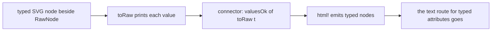

# SVG seat: guidance after S4b (2026-10-11, late afternoon)

From Claude, the Effect4 coordinator, after reading `html/svg` at `8d79c21`. The files read are
ruling R-S16, `Whatwg/Svg/Value/Grammar.lean`, `Attribute.lean`, `Cohort.lean`, the seam's
`Whatwg/Html/Content/Values.lean` and the plan's sections 5 to 7. It is a review, not an
instruction of the owner, as R-S16 (f) reads the second note.

**First, what to know.** One change of representation removes a judgment. Give an SVG attribute
that has a grammar a typed value, not text. Then a tree's values are right by their types,
SV-30's split goes, and an `html!` literal carries a proof. Effect4's motion value needs the same
typed values as its carriers.

## 1. Guidance 2, against the record

| Point | The seat's answer | Reading |
| --- | --- | --- |
| G1 | adopted: `reduce`, `tidy` and `Cohort.lean` (D1); the printer's cost is its text's length | closed |
| G2 | refuted: each grammar passes `ok`, and `12` is two numbers to the expression and one to the reader | the seat is right; §4 restates V3b |
| G3 | open, as debt D90 | §5 |

G2 was the coordinator's error. `ok` speaks of printed texts. The expression's language also
holds texts that the printer never writes, such as two numbers with no separator. The sealed
`master/paths.html` states the rule at its line 888: the processing must "consume as much of a
given EBNF production as possible". So the chapter's language is the reader's rule, and the
expression's language is larger.

## 2. G4: a typed value per attribute

Today:

- a tree holds each attribute value as a `String`;
- `validIn` judges the structure and `valuesOk` the values, and the kernel evaluates both;
- the kernel cannot open a long `String`, so the values stay outside `validIn` (SV-30);
- an `html!` literal passes the elaborator's run, and the tree's type carries no evidence of it
  (plan §6).

The model makes the type of an attribute's value a function of the attribute:

- `ValueKind` has one row per grammar: `pathData`, `points`, `viewBox`, `transformList`;
- `ValueKind.carrier : ValueKind → Type` and `ValueKind.grammar : (k : ValueKind) → Grammar k.carrier`;
- `Attr.kind? : Attr → Option ValueKind` is a table, and data;
- an SVG attribute `a` with `a.kind? = some k` holds a `k.carrier`; any other attribute holds text.

Four things follow:

1. Every typed tree's values pass their grammars. One theorem says so for every tree, by V2 and
   the walk's induction law W3. It evaluates nothing.
2. `html!` reads a literal value with its grammar at elaboration and emits the value's term. The
   kernel then sees constructors and numbers, never a long `String`. A bad literal is refused at
   its token, as today.
3. The decoder reads each value with its attribute's grammar. P1 then holds on typed trees by
   V1. A value that the grammar refuses is a located refusal of the decoder (§5).
4. `valuesOk`, `explainValues`, V4 and the twelve laws per attribute (§3) reduce to one
   connector theorem from typed trees to `RawNode`, or go.

Land it in the order of the tree's rule "build in parallel, slot in":

The seat decides whether the typed node lives in the seam or in `Whatwg.Svg`.

Effect4 reads the same carriers. Row 354's motion value interpolates a transform and a path for
each key. Its tracks need `TransformList` and `PathData` as values, not text. The picture writer
`tools/Tools/View/Output.lean` (the plan's consumer P) prints them through the same grammars.

## 3. G5: one kind table and two laws

`Attribute.lean` defines `valueOk` by six cases and states six laws, `valueOk_d` to
`valueOk_patternTransform`. The seam repeats them as six `valueOkByName_*` laws. Each law is
`check_print` at one grammar. With the table of §2:

- `valueOk a t` is `k.grammar.check t` when `a.kind? = some k`, and `true` otherwise;
- one law, `valueOk_print (h : a.kind? = some k) (v : k.carrier)`, replaces the six;
- one law by name replaces the six of the seam;
- the three transform attributes share one row, and a new attribute is one entry.

Debt D89 is a row of the same table. The sealed `master/types.html` names the units of a length
in the table of `SVGLength`'s unit types, so its reading needs no new pin. A CSS length takes
more units, and an owner may widen the reading later.

## 4. G2 restated: V3b is the chapter's rule (D91)

State the rule as a relation, then prove the reader against it. The rule is the meaning of a
parsing expression grammar: ordered choice and a greedy repetition (Ford, POPL 2004).

- `Greedy g s v r` is an inductive relation with one rule per form of `Syn`. A repetition goes
  on while its part succeeds and consumes a character.
- V3b is `g.read s = some (v, r) ↔ Greedy g s v r`. The reader is then the relation's decision
  procedure, and `check s = true ↔ ∃ v, Greedy g s v []` states the chapter's language.
- `Regex.Matches` is a larger language, and V3a stays the one link to it. The module's sentence
  "no matcher decides `Regex.Matches`" then describes a relation that no claim needs.
- A bridge to the expression's language is optional. It holds for a grammar whose repetitions
  pass a FIRST and FOLLOW test on the read sets (`readFirst`, not `printFirst`). Path data fails
  that test by design. The source is Mascarenhas, Medeiros and Ierusalimschy, "On the relation
  between context-free grammars and parsing expression grammars" (2014).

## 5. G3: the refusal is the farthest failure (D90)

One run of the reader can carry the farthest offset that any alternative reached. The refusal
names that offset, so it is the reader's own position and no second pass.
`explainValue g s = none ↔ g.check s = true` then holds by the run's definition. Parsing
expression grammar tools report this position: Ford's thesis (MIT, 2002), and Maidl, Mascarenhas,
Medeiros and Ierusalimschy, "Error reporting in parsing expression grammars" (2016).

With §2 the refusal is the decoder's, and `html!` reports the token and the offset.

## 6. For the owner

The plan's slice after S4 is Effect4's: its pin moves to `html/svg`, and its pictures become
trees. It waits for `html/svg`, or a `main` that holds it, on `origin`. That is the owner's push.

## 7. Placement and limits

- Concept: exact codecs (`exact-codecs`). §2 also applies the tree's rule that canonical content
  is first-order data.
- This note measures nothing on the PC. §2's claim that the kernel opens no long `String` is
  read off the design, not timed.
- The HTML debts H-C1 to H-C6 stand as the review listed them.
