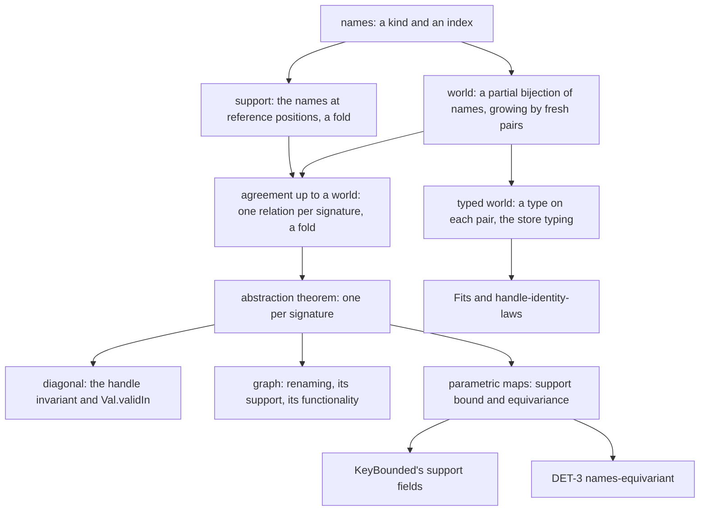
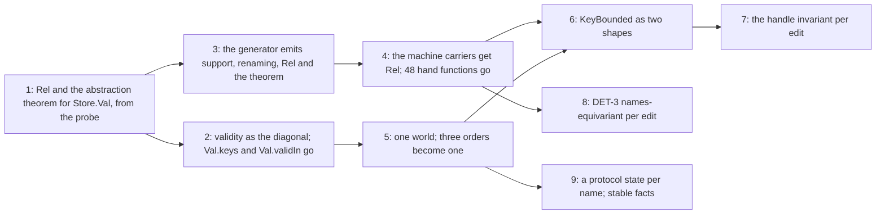

# Handles: names, worlds and one relation (2026-10-11)

The owner, 2026-10-11: think hard about the representation. Ask where a theorem removes a whole
class of functions. Handles are abstractions that must be clean and powerful.

**First, what to know.** A handle is a name. The tree spells names twice, and validity three
times. It has three worlds and 48 hand support traversals, and no renaming. The minimal
representation has four parts:

- one name sort;
- one world, a partial bijection of names that only grows, with a type on each pair when typed;
- one agreement relation per free object, which is a fold;
- one abstraction theorem per free object, generated beside `hom_eq_cata_val`.

The probe proves the core on the real value carrier `Store.Val`. From one theorem it derives:

- the handle invariant, as the diagonal;
- the support bound of `KeyBounded`;
- the equivariance that the schedule-independence plan needs and has not stated.

## 1. The census

Measured at `codex/last-planned-goals` `b4dcef4f1`.

| Structure | Copies in the tree | Size |
| --- | --- | --- |
| a name | `Machine.Handle` (six constructors) and the code `UInt8 × Nat` that `Val.handle` stores, joined by the exact embedding `Handle.code`, `Handle.ofCode` | two spellings |
| the support of a carrier | 48 hand functions in `src/Effect4/Laws/Machine/Handles.lean`, from `Val.keys` to `stepKeys`; `Store.Val.handles` in the core beside `Val.keys`, joined by `Val.keys_eq_handles` | 146 theorems named `keys` in `Handles` |
| validity | `Handle.existsIn`, `Ok`, `MintedIn`, `MintedAt` (`Handles`); `Stores.handleValid`, `Val.validIn` (`StoresLaws`, 16 `validIn` theorems); `Fits` (`Program/Typed/Membership.lean`, typed) | three predicates |
| the world and its order | `Machine.World` with `World.le` (`Handles`); `Stores.le` (`StoresLaws`); `Program.Typed.World` with four ghost tables, `TableExtends`, `CellCompatible` and `World.le` (`Program/Typed/World.lean`) | three orders |
| the hooks' contract | `KeyBounded`, 46 fields: 34 support bounds, nine store steps of one shape, three membership facts | proved in `Program/Handles/` (2,986 lines, 123 theorems) and by `stores_keyBounded` |
| the machine invariant | `MintedAt` through every driver helper | `Handles`: 6,613 lines, 337 theorems, 102 named `minted` |
| renaming | none | `names-equivariant` is "not stated; the largest of the three" (`../2026-10-10-schedule-independence/README.md` §5) |

The driver compares handles only by equality. A search of `Machine/Fibers.lean`,
`Machine/Stores.lean` and `Machine/Scope.lean` finds no order comparison on a handle's index outside
proofs. This matters for §2.6.

## 2. The model

### 2.1 Names

A handle is a name: a kind and an index. `Val.handle k n` already stores exactly this. Every
identity that the machine mints is a name. The machine mints fiber ids, Ref and Deferred cells,
scope keys, finalizer keys, memo-map ids, external resources, park tokens and race ids. The source is Pitts,
*Nominal Sets* (2013): a name is an atom, and a carrier is a set with an action of renamings.

### 2.2 Support

The support of a value is the list of names at its reference positions. It is a fold of the
carrier's signature: `Val.handles` is the support fold of `Store.Val` (`handles_eq_cata` in the
probe). A position that only carries provenance, such as the interruptor in a cause, is not a
reference position. The machine is generic in the interruptor's type `ι`, so the type parameter
already keeps that position inert. `Handles`' prose list of excluded positions should become types.

### 2.3 Worlds

A world relates the names of a left run to the names of a right run. It is a partial bijection:
each name has at most one partner on either side. A world grows: minting a fresh name on each side
adds one pair (`World.PBij.extend`). Three readings of one structure:

- **Unary.** One run against itself is the diagonal of its allocation (`World.diag`).
- **Renaming.** An injective renaming is its graph (`World.graph`).
- **Two schedules.** Two runs that minted in different orders are related by the bijection of
  their minted names. This is the relation `R` of DET-3.

**Two schedules relate tables as finite maps.** Two schedules append fibers in different orders.
So the machine's relation must read the fiber table as a finite map from names to fibers: two
related names have related fibers. The driver reads the list in four ways (census of 13:45). A
lookup by id, a `map` and an `all` ignore the order. `RunMachine.completedExits` returns an
association list in allocation order, so DET-3 must check that its consumers only look it up.
The same holds for the races. The armed list is the one table whose order `flush` reads.

A typed world puts a type on each related pair. The diagonal of a typed world is a store typing:
the ghost tables `Γ`, `Π`, `Ρ` and `Θ` of `Program.Typed.World`, keyed by one name sort. The sources
are Pierce, *Types and Programming Languages* (2002), the chapter on references, and Ahmed's
step-indexed worlds (2004; `Ahmed2004` in the registry). The binary worlds over partial bijections
are those of Pitts and Stark (1993).

### 2.4 Agreement up to a world

`Rel w v v'` holds when `v` and `v'` have one shape and `w` relates their names position by
position. It is a fold: `relAlg w` is a `ValAlgebra` into `Val → Prop`. So it adds no hand
traversal to the census.

### 2.5 The abstraction theorem

Two algebras **respect a world** when each constructor maps related arguments to related results.
At a name leaf, the results are related exactly when the world relates the names. The abstraction theorem
says: folds by algebras that respect a world map values that agree up to the world to related
results (`cata_val_related`). The source is Reynolds, "Types, abstraction and parametric
polymorphism" (1983), and Wadler, "Theorems for free!" (1989). It is proved once for the signature.
The generator can emit it beside `hom_eq_cata_val` for every signature.

### 2.6 Parametric maps

A map is **parametric** when it keeps agreement up to every partial bijection. Two consequences,
each one line in the probe:

- **Support bound.** A parametric map names only names its input names (`Parametric.support`).
  This is the shape of 34 `KeyBounded` fields.
- **Equivariance.** A parametric map commutes with every injective renaming
  (`Parametric.equivariant`). This is the shape of DET-3's `names-equivariant`.

Parametric maps compose. Every fold whose algebra respects every partial bijection is parametric,
by the abstraction theorem. An equality test on names gives the same answer on both sides of a
partial bijection (`World.PBij.eq_iff`). So lookups by handle are parametric. An order test is
not, and the driver has none (§1). This is why worlds are partial bijections, not arbitrary
relations.

### 2.7 Store steps

A store step is monotone in the world. Its input agrees up to `w`. Its output agrees up to some
`w'` that extends `w` by the names the step minted. Nine `KeyBounded` fields state this one shape,
each written out: `syncState`, `registerAsync`, `prepareAnswer`, `dueResumes`, `wakeList`,
`clockStep`, `scopeLinkFiber`, `dropFinalizer` and `closeScope`. One definition with a composition
law replaces them. Poulsen, Rouvoet, Tolmach, Krebbers and Visser (POPL 2018) build the same
monotone state discipline into an interpreter's types.

### 2.8 The machine invariant, per edit

`../2026-10-11-tokens-in-places/machine-edits.md` makes each driver helper a word of primitive
edits. The handle invariant then owes one fact per edit:

- the edits that write no names keep it by the frame rule;
- `dropToken` shrinks the support;
- the edits that write a payload owe that payload's agreement in the new world.

### 2.9 Protocols: a state per name

A handle has a life as well as an allocation. A Deferred cell is pending, then completed with one
effect forever. A scope is empty, then open, then closed with one exit (`ScopeState`,
`Machine/Scope.lean`). A fiber runs, then exits. A park token is minted, then dropped. Each life
is a small protocol with a forward order.

So a world gives each name a protocol state, and a world grows in two ways: new names, and states
that move forward. A fact that the forward order keeps is **stable**. "Allocated" is the trivial
protocol's stable fact; "completed with `e`" and "closed with `e`" are stable facts too. One
theorem per operation, "it moves forward", then keeps every stable fact through every run. This
is monotonic state: Pilkiewicz and Pottier, "The essence of monotonic state" (TLDI 2011), and
Ahman and others, "Recalling a witness" (POPL 2018). Dreyer, Neis and Birkedal (ICFP 2010) use
such worlds, with a state transition system per name, for relational reasoning.

`probes/Protocols.lean` checks this at the real Deferred store:

- `make_le`, `register_le`, `cancel_le`, `complete_le`, `wakeBatch_le` and `drainDue_le`: every
  operation moves forward;
- `allocated_stable` and `completedWith_stable`: two stable facts, one theorem each;
- `stable_run`: a run of forward operations keeps every stable fact;
- a control: an operation that clears a completion is not forward.

This also places the open sum types R4 (a fiber's life) and R5 (the interrupt state) of
`../2026-10-11-tokens-in-places/model-first.md`. Each is a protocol of this kind, and its forward
order is what its stable facts need.

## 3. The probes

There are two finite probes, each on a real carrier. §2.9 describes `probes/Protocols.lean`.
`probes/protocols.out` keeps its audit: 20 declarations within `[propext, Quot.sound]`.

`probes/Names.lean` is a finite probe on the real value carrier. It compiles with
`LEAN_NUM_THREADS=3 lake env lean -DwarningAsError=true docs/research/2026-10-11-handles/probes/Names.lean`,
and its last command walks its own declarations with the axiom gate's walk. `probes/names.out`
keeps the result: 99 declarations within `[propext, Quot.sound]`.

| Declaration | What it proves |
| --- | --- |
| `relAlg`, `Rel` | agreement up to a world, as a `ValAlgebra` |
| `cata_val_related` | the abstraction theorem of `Store.Val`'s generated fold |
| `handles_eq_cata`, `Rel.handles` | `Val.handles` is the support fold; agreement transports the support |
| `rename`, `rename_handles`, `Rel.graph_eq` | renaming is a fold; its support is the renamed support; a graph relates a value only to its renaming |
| `Rel.diag_eq`, `Rel.diag_iff` | the diagonal relates a value only to itself; agreement with itself on the diagonal is "every handle is allocated" |
| `validIn_iff_diag` | the real `Machine.Val.validIn` is the diagonal at the stores' allocation |
| `Rel.mono` | Kripke monotonicity: agreement survives the world's growth |
| `World.PBij.extend`, `World.PBij.eq_iff` | fresh pairs keep a partial bijection; equality tests respect one |
| `Parametric.support`, `Parametric.equivariant`, `Parametric.comp` | the support bound and equivariance of every parametric map |
| two `example`s | a real map that is parametric; a control: a map that invents a handle is not |

All but the first two rows are corollaries of `cata_val_related` or are short facts about worlds.

## 4. What each theorem removes

| Class of code | Removed by | When |
| --- | --- | --- |
| 48 hand support functions and their per-constructor lemmas | the generated support fold of each signature | after the generator emits it |
| `Val.keys` beside `Val.handles`, `Val.validIn` beside `Ok` | `handles_eq_cata`, `validIn_iff_diag`: validity is the diagonal | at once; the connectors exist in the probe |
| `Handle.existsIn`, `Stores.handleValid`, `MintedIn` | one allocation per world, read by kind | with the one name sort |
| three world orders and their monotonicity lemmas | `Rel.mono`, Kripke monotonicity of the one relation | with the one world |
| the support-bound fields of `KeyBounded` and their proofs | `Parametric.support`: each hook's parametricity, from its algebra's constructors | per hook family |
| the nine store-step fields | one monotone store-step definition with composition | with the one world |
| per-helper preservation in `Handles` (43 helper theorems, 26 `withFiber` arms) | the per-edit invariant | after item 10's words |
| DET-3 `names-equivariant`, not stated | `Parametric.equivariant`, applied per edit | after the machine's carriers have `Rel` |
| the monotonicity lemmas: 131 named `mono`, of which a signature search finds 76 with an order premise | `Rel.mono` for the typing judgments; stability for the protocol facts | with the one world and its protocol states |

The probe shows the mechanism on one carrier. The counts are of today's tree. No count above is a
prediction of lines removed.

## 5. Representation recommendations

- **R-H1. One name sort.** `Handle` becomes a kind and an index. The kind is `HandleKind`, extended
  with tokens and race ids if their names enter a world. The six-arm `existsIn` becomes one table
  read.
- **R-H2. Reference and provenance by type.** A position that the machine dereferences holds a
  handle. A position that only identifies holds an inert id. The support is then the generated
  traversal over handle-typed positions, with no prose exclusions. rc.112 draws the same line
  between a `Fiber` and a `FiberId`.
- **R-H3. Support generated, one per signature.** The census rule already demands it
  (`docs/core/traversal-census.md`). `fold_of` proves today that `Val.keys` is a fold. The
  generator should emit the support fold, the renaming fold, `Rel`, and the abstraction theorem.
- **R-H4. Validity is the diagonal.** `Ok`, `MintedIn`, `Val.validIn` and the untyped half of
  `Fits` become `Rel` at the diagonal of the allocation.
- **R-H5. One world.** A partial bijection of names, with an optional type on each pair. The
  typed world's four ghost tables become one table keyed by name. `TableExtends` and `tableInsert`
  become `World.le` and `World.extend`.
- **R-H6. Two hook shapes.** A pure hook is parametric. A store hook is a monotone store step.
  `KeyBounded` becomes these two definitions applied to each field.
- **R-H7. One fact per edit.** The handle invariant follows the machine-edit alphabet.
- **R-H8. A protocol state per name.** Each kind declares its protocol and forward order. Each
  store operation proves once that it moves forward. Each stable fact proves once that the order
  keeps it.

## 6. The API reading: handles as capabilities

- **Typed handles.** `Ref A`, `Deferred A E`, `Fiber A E` and `Scope` are names with a type in the
  world. A handle used at the wrong type is a pair the typed world does not relate.
- **Identity.** `sameHandle` is equality of names. Every world respects it (`World.PBij.eq_iff`).
  This is the abstract half of `handle-identity-laws`.
- **Confinement.** A parametric step creates no reference except a minted one. A capability
  therefore travels only along data flow. Miller's "only connectivity begets connectivity" is
  `Parametric.support` (Miller, *Robust Composition*, 2006). The support function is also the
  census of a reference's holders. This answers the confinement gap of
  `../2026-10-11-tokens-in-places/model-first.md`.
- **Regions: a language gap.** A handle allocated inside a scope must not be used after the
  scope closes. With protocol states, that use is a step that the forward order forbids. A static
  form keeps a region's handles out of the region's result. The support of the result then names
  no handle the region minted. rc.112 checks none of this statically. The sources are Launchbury
  and Peyton Jones (PLDI 1994), Tofte and Talpin (1997), and Fluet and Morrisett (2006).
- **Fresh names.** Every counter is a name supply, and minting extends the world by a fresh pair.
  This is the model for L4 to L6.

## 7. The order for Codex

Codex's item 11 in `../2026-10-11-machine-models/CODEX-PROMPT.md` carries this order. It starts
after R2 and the alphabet of item 10.

## 8. Placement

- **Concept.** `store-typing` for the world and validity; `initial-algebras-folds` for the
  generated abstraction theorem; `reactive-scheduling` for DET-3 (`docs/core/semantics.md`).
- **Question.** The existing claims `handle-identity-laws` and the handle invariant `handles_minted`
  (C13). Two proposed claims: `names-parametric`, the abstraction theorem per signature; and DET-3's
  `names-equivariant`.
- **Reach.** The probe covers `Store.Val` and its fold. Worlds are partial bijections of names.
  Parametric means "for every partial bijection".
- **Limits.** Lean has no internal parametricity, so each map's parametricity is a theorem. The
  protocol probe covers the Deferred store only. The
  abstraction theorem moves that work from each map and property to each algebra constructor; it
  does not remove it. A store step's monotonicity stays an obligation of each kernel. The probe
  proves nothing about the machine's carriers yet. No count in §4 is a measured removal.
- **Unlocks.** DET-3 and so the third determinism route (DB-03); the handle invariant's
  consolidation; confinement as a census law; typed handles at the API.

## 9. Reading list

These are named from memory and are not filed. A research partner should file them with this
note, with locators.

- A. M. Pitts, *Nominal Sets: Names and Symmetry in Computer Science*, Cambridge, 2013.
- M. J. Gabbay and A. M. Pitts, "A new approach to abstract syntax with variable binding", *Formal
  Aspects of Computing*, 2002.
- A. M. Pitts and I. D. B. Stark, "Observable properties of higher order functions that dynamically
  create local names, or: What's new?", MFCS 1993.
- J. C. Reynolds, "Types, abstraction and parametric polymorphism", IFIP 1983.
- P. Wadler, "Theorems for free!", FPCA 1989.
- J. C. Mitchell and E. Moggi, "Kripke-style models for typed lambda calculus", *Annals of Pure
  and Applied Logic*, 1991.
- A. Ahmed, D. Dreyer and A. Rossberg, "State-dependent representation independence", POPL 2009.
- C. Bach Poulsen, A. Rouvoet, A. Tolmach, R. Krebbers and E. Visser, "Intrinsically-typed
  definitional interpreters for imperative languages", POPL 2018.
- Allais, Atkey, Chapman, McBride and McKinna, "A type and scope safe universe of syntaxes with
  binding: their semantics and proofs", ICFP 2018.
- M. S. Miller, *Robust Composition*, PhD thesis, Johns Hopkins University, 2006.
- A. Pilkiewicz and F. Pottier, "The essence of monotonic state", TLDI 2011.
- D. Ahman and others, "Recalling a witness: foundations and applications of monotonic state",
  POPL 2018.
- D. Dreyer, G. Neis and L. Birkedal, "The impact of higher-order state and control effects on
  local relational reasoning", ICFP 2010.
- J. Launchbury and S. Peyton Jones, "Lazy functional state threads", PLDI 1994.
- M. Tofte and J.-P. Talpin, "Region-based memory management", *Information and Computation*, 1997.
- M. Fluet and G. Morrisett, "Monadic regions", *Journal of Functional Programming*, 2006.
