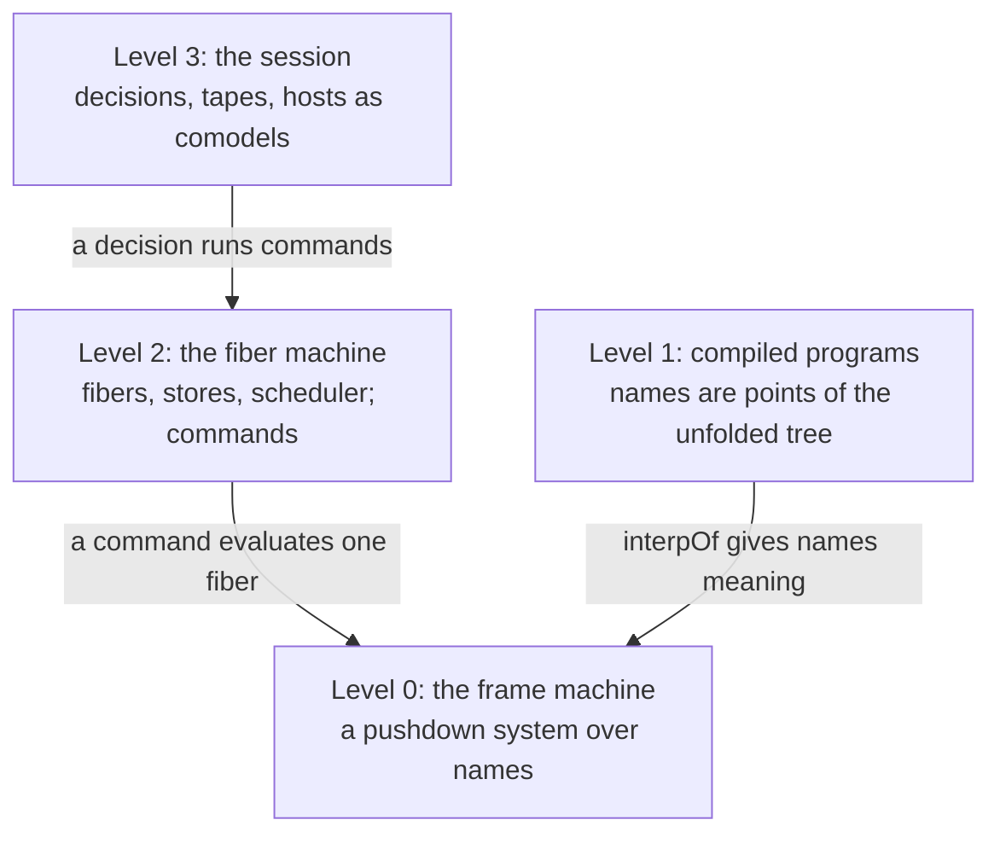
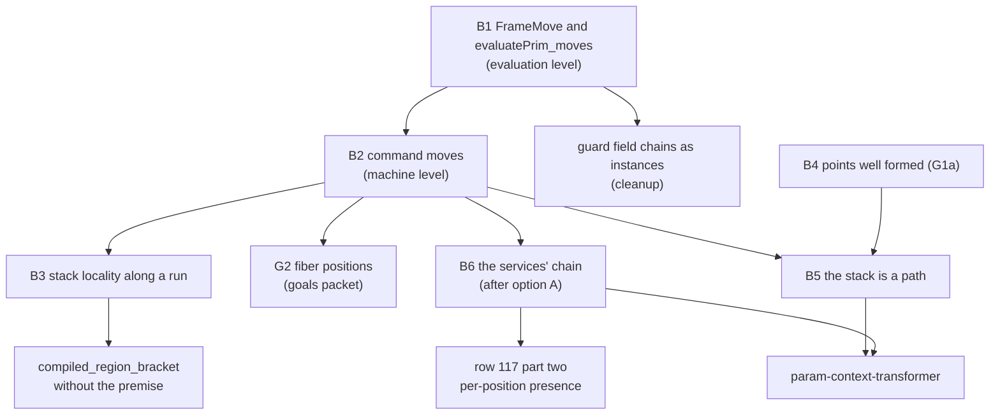

# The machine from its base

Research note, 2026-10-11, base `734368d17` (branch `refactor/phase1-phase3`). The owner asked for
a formal description of the whole machine, starting from the frame stack and its continuations, to
find structure that can solidify the proofs and clean up the implementation. This note gives that
description in four levels, measures how the existing proofs use it, and plans the base laws. The
dynamic context and its transformers are in the companion note,
[context-transformers.md](context-transformers.md). The [prompt for Codex](CODEX-PROMPT.md) hands
the base lane over.

Literature names are from memory and carry no locator. Every count below comes from a command
listed in §8.

## 1. The one thing to know first

**About ten invariants of the fiber machine each re-prove their preservation by their own case
analysis over the same evaluator arms and commands.** None shares a classification of how one
evaluation can change a fiber. The guard bundle alone holds 14,321 lines in 38 files
(`src/Effect4/Laws/Program/Guard/`). Within it, each of 17 fiber fields gets its own chain of about
ten lemmas through the evaluator's levels (`getCont`, `resumeValue`, `resumeCause`, the frame step,
`frameExitState`, `stepFrame`, `finalizerOr`, `withFiber`, `evaluatePrim`, `exitScoped`,
`evaluateNative`, `iteration`). Two of those chains are byte-identical apart from two
abbreviations (`Guard/DeferredCause.lean` and `Guard/Interruption.lean`).

The structure the description finds is small. One evaluation changes a fiber's frame part by a
short word over about ten **moves**: answer, push, step, finish, pop, mask, unmask, and the
interrupt edits. A command changes the machine by those moves on one fiber, a spawn, a context
write, a store write, a park, or an edit of another fiber's record. Proving that classification once
turns every field chain into about ten one-line facts, one per move. It also turns the three large
open laws into instances:

- stack locality at the fiber machine, which discharges `compiled_region_bracket`'s open premise;
- the goals packet's G2, "a fiber's position in its own code";
- the services' chain of the companion note, which row 117's part two needs.

**Landed the same night** (§9): the classification at one evaluation, for the frame part
(`Laws/Program/Moves.lean`) and for the run fiber's footprint (`Laws/Program/Footprint.lean`).
Connectors re-derive five guard chains and the evaluation half of `MaskRuns` from it
(`Laws/Program/MovesConnect.lean`, `Laws/Program/Footprint.lean`). The old chains stay; their
replacement is Codex's lane C1 ([the prompt](CODEX-PROMPT.md)).

The second thing to know is in the companion note. The checker admits a program whose requirement
row is closed, and it dies with `missingService` through the raw `setContext` action (proposed
`E4-CTX-CE-001`).

## 2. Method and sources

- Three read-only searches of the tree: the compile from programs to frames, the dynamic context,
  and the stack and scope laws. A fourth measured the case analysis of every invariant over the
  fiber machine.
- One compiled probe, `probes/CtxProbe.lean` (`probes/ctxprobe.out`), six programs on the frame
  machine at budget 400.
- The topology note's probe of stacks as paths
  (`../2026-10-11-topology-graphs/probes/StackPaths.lean`).
- The goals packet's plans (`../2026-10-10-goals-packet/`), and Codex's branch
  `codex/machine-structure` at `e7a205fb5`, read for overlap.

## 3. The machine in four levels



### 3.1 Level 0: the frame machine is a pushdown system over names

A fiber of the frame machine has five fields (`FrameFiber`, `src/Effect4/Machine/Frames.lean`):
the current code, the stack, the mask flag, the recorded interrupt and the deferred bit. The code
alphabet `Prim` has eighteen constructors, and ten of them are frames: they declare an arm
(`Prim.arms`). A frame stores names and subterms, never a closure. What a name does is a parameter,
`PrimInterp`. So the frame machine is one machine for every interpretation of its names. It is
Reynolds' defunctionalized continuation-passing machine, with the apply function made a parameter.

Each step is one of four kinds:

| Kind | What it does | Where |
| --- | --- | --- |
| push | a frame code moves onto the stack, and its body becomes current | `step`'s arms for `onSuccess`, `onFailure`, `onSuccessAndFailure`, `exitFrame`, `onExit`, `whileLoop`, `iterator` |
| pop | a value or a cause demands an arm; frames come off until one answers | `getCont`, `popFrom`, `resumeValue`, `resumeCause` |
| pass | a frame that does not answer runs its hook | `Prim.ensure`: the mask frame restores the flag, `onExit` masks, `asyncFinalizer` masks and pushes |
| internal | the code changes, and the stack does not | `sync`, `suspend`, `withFiber`, `yieldableError` |

A pop can pass many frames, and a pass can push (`popFrom_asyncFinalizer_pops_its_push`). Read as
a word over frames, a step still touches only the top: that is the frame rule `step_under`
(`src/Effect4/Laws/Machine/MaskBracket.lean`). So the frame machine is a pushdown system with
internal moves, and a visibly pushdown one: each code says whether it pushes, pops or moves
internally (Alur and Madhusudan).

Laws held at this level:

- `step_under`: a step that goes on keeps the frames under the region (frame rule);
- `MaskChain`, `MaskChain.flag_eq`: the flag is determined by the stack and the base;
- `regionEnd_stack`, `regionEnd_flag`: a pop that passes a region's own frames ends at the entry;
- `popLive_eq_popFrom` (`LiveStack.lean`): the live pop equals the detached one.

### 3.2 Level 1: compiled programs, where names are points

The compile (`src/Effect4/Program/Compile.lean`) instantiates the names with `EffName` and the
meaning with `interpOf root table`. A name that continues the program carries a `Point`:

```lean
structure Point where
  path : List Nat; env : List Val; fuel : Nat; tape : List Bool
  completed : List (FiberId × ExitV) := []; root : Nat := 0
  params : List (List ArgSite) := []; call : CallId := []
```

A name stores the point of a node, and its meaning compiles one child of that node:
`.cont p` resolves child 1 of the `bind` at `p.path`, with the answer appended to the environment.
The table of names is the program tree. Three consequences:

- **The stack is a path.** Inside one call string, each frame's node is a proper prefix of the node
  of the frame above it (the topology note's probe, four programs).
- **Calls are segments.** `invoke` and `perform (.call k)` redirect the point to the body and push
  the call site onto `call`. Recursion makes the call strings unbounded: the pushdown's growth.
- **Parameters are links.** A parameter's run redirects the point to the call site: the caller's
  path, environment, parameter stack and call string. So a passed program runs at its own site on
  top of the body's frames. A stack whose entries link to older entries is the store of a
  collapsible pushdown automaton of order two (Hague, Murawski, Ong and Serre).

Laws held at this level: the compile equations (`src/Effect4/Laws/Program/Agreement.lean`), the
typed point (`PointTyped`, `Typed/Admission.lean`: a point's path addresses a checked node), and
`invoke_arm` and `param_arm`. No law ties a stack's names to one another. The goals packet's G1a
("every point in a reachable machine has the environment its path's binders give") is the first
such law, and "the stack is a path" is the second.

### 3.3 Level 2: the fiber machine

The fiber machine is generic over its fiber core and its evaluator (`FiberCore`, `FiberEvaluator`,
`src/Effect4/Machine/Fibers.lean`). It has two instances: the frame machine's and the reference
term machine's (`evaluateR`, `src/Effect4/Laws/Program/EvaluateR.lean`). The book relates them field
by field (`BookMeans`, `replay_rel`, `src/Effect4/Laws/Machine/Book.lean`).

A machine (`RunMachine`) holds:

- `fibers`: each a `RunFiber`: an id, the frame part, the scheduling fields (`running`, `parked`,
  `pending`, `dispatcher`, the op budget), the exit and its observers, the children, and the
  dynamic `context`;
- `state`: the stores (`Stores`, `src/Effect4/Machine/Stores.lean`): references, deferreds, scopes,
  memo maps, timers, external handles, and a name counter;
- `races`, `armed`, `forks`, the id and token counters, the trace and `stuck`.

A command (`Cmd`) is one of sixteen: `evaluate`, `loop`, `deliver`, `finish`, `resume`, `launch`,
`enrollRace`, `registrationDone`, `interruptTarget`, `afterInterrupt`, `raceCancel`, `trackChild`,
`observe`, `exitDone`, `closeParAwait`, `link`. `driveStep` runs one. The arms of one evaluation
(`evaluatePrim`, the native `evaluateNative`, the loop's `iteration`) fall into ten kinds:

| Kind | Arms |
| --- | --- |
| touch only the current code | a refused park; a join on an exited target; `getId`, `getContext`, `snapshotChildren`; the interrupt actions; `sync` without state |
| push | an async park with a controller or cancel; a live join; `closeParAwait` |
| pop | an exit through `finalizerOr`; `deliver`; the native `exitScoped`; `finishFrame` |
| frame step | `stepFrame`, the default arm |
| spawn | `fork`, `forkIn`, `forkScoped`; the parallel close; `launch` |
| context write | `setContext`; `enterScoped`, `exitScoped`; `exitDone` clears |
| store write | async registration; a stateful `sync`; `closeScope`; `runIn` and `link`; the due drain |
| park | `yieldNowWith`; the async park; a live join; the countdown parks; `raceAll` |
| another fiber's record | join observers on the target; interrupt records; `resume`; `trackChild`; `enrollRace` |
| exit | `finish`, `exitDone`, `observe` |

Fibers interact only through the stores, the observers and the interrupt records. Laws held at this
level: the three lifts (`Lift.lean`: the command loop, decisions, replay), the edit facts
(`Keeps.lean`), the book, the scheduling facts (`flush_fair`, `fairTape_unarmed`), and the
invariants of §4.

### 3.4 Level 3: the session

A decision (`RunDecision`) is one of the environment's moves: fire a dispatcher, flush, evaluate,
override a yield, answer an async, interrupt, install the middleware, advance the clock. A tape is a
list of decisions. A host is a comodel of the row signature, and the reply tape is one host
(`Effects.Comodel`). Laws held here: `run_eq_meaning`, `session_eq_ref`, `denoteRows_eq_session`,
`drive_seg`, `runWith_denotes`. Full meaning is relational over decisions. Determinism holds only
under a tape that answers every decision.

## 4. What the proofs repeat

Each invariant below is proved over the native evaluator or the machine, with its own case
analysis. Line ranges are those of the named lemma groups, measured by `wc` and by the ranges the
search reported (§8).

| Invariant | Module | One fiber or global | Its own case analysis |
| --- | --- | --- | --- |
| `MaskRuns` | `Laws/Machine/MaskRuns.lean` (2,265 lines) | one fiber | `evaluatePrim_keepsMask`, `withFiber_keepsMask`, `driveStep_maskRuns`, with `MaskAged` |
| `MintedAt` | `Laws/Machine/Handles.lean` (6,558 lines) | global | 25 `withFiber_*_minted`, 18 `driveStep_*_minted`, its own decision lift |
| trace prefix (`Extends`) | `Laws/Machine/Approximation.lean` | global | `trace_leaf` tactics; its own decision lift |
| armed queue | `Laws/Machine/Scheduling.lean` | global | `queue_leaf` tactics |
| fork ledger | `ForkLedgerInvariant.lean`, `Guard/ForkLedger.lean` | global | edit lemmas and the aesop bank `StepInv` |
| memo ids | `Guard/MemoIds.lean` | stores | projections and aesop |
| no `continueWith` park | `Simulation/Pending.lean`, `Book.lean` | one fiber | `withFiber_pendingOk`, `evaluatePrim_pendingOk` |
| the guard bundle | `Guard/*.lean` (14,321 lines, 38 files, 1,033 theorems) | one fiber and the queues | six families over 18 commands, and 17 per-field chains through the evaluator |
| one guard held | `Guard/Single.lean` | global | quiet commands only |
| typed state | `Typed/Commands/**` (17,316 lines) | both | 18 preservation lemmas and 41 clauses over the term machine's `FiberOp` |

Three more axes repeat too: the store operations (about ten separate case analyses over `SyncOp` in
`StoresLaws.lean`, and more in `Handles.lean`), the frame step (re-proved in `MaskRuns.lean`,
`Handles.lean`, `Guard/FrameOwned.lean` and `Guard/Interruption.lean`), and `settle`'s six outcomes
with the eight machine edits, which every invariant handles.

The per-field chains use `repeat' first | … | split` and `simp_all`, the forms the proof-style
ratchet refuses in new code (`Test/Audit/ProofStyle.lean`).

## 5. The structure that removes the repetition

### 5.1 Moves of one fiber

Let a **move** be one of the edits an evaluation makes to a fiber's frame part:

```text
inductive FrameMove (interp) : FrameFiber → FrameFiber → Prop
  | answer  (c)          : FrameMove f { f with current := c }
  | push    (p)          : FrameMove f { f with stack := p :: f.stack }
  | step                 : f.step interp = (.running g, _)  → FrameMove f g
  | finish               : f.step interp = (.finished _, _) → FrameMove f (frameExitState f)
  | pop     (d s c)      : FrameMove f (f.getCont d s c).fiber
  | mask                 : FrameMove f f.uninterruptible
  | unmask               : FrameMove f f.interruptibleRegion.1
  | pendingFailure       : FrameMove f { f with deferredInterrupt := false, current := failure f.pendingCause }
```

The interrupt edits (`recordCause`, `setDeferred`) are moves of the commands that interrupt, not of
an evaluation.

The landed form (`src/Effect4/Laws/Program/Moves.lean`) differs from this sketch in two places,
both found by compiling it. A step and a finish carry the interpreter they ran with, because the
arms of one evaluation read different interpreters (`exitScoped` reads its own); so a word of moves
names none. And `push` pushes only an `AsyncFinalizer`: no evaluation pushes any other frame outside
the frame machine's own step, which is what lets the mask chain go through as an instance. The
first base law classifies an evaluation:

```text
evaluatePrim_moves : ReflTransGen (FrameMove interp) f.frame (evaluatePrim interp m f y).fiber.frame
```

with the same statement for `evaluateNative` and `iteration`. Its proof is the case analysis that
every invariant repeats today, done once, arm by arm (24 `withFiber` actions, the parks, the pops,
the frame step). aesop does not apply the move constructors through the record projections; a
plain `exact` does. Then a field that every move keeps is kept by every
evaluation, by induction on the word. For the 17 guard fields each instance is a handful of
one-line facts, most of them `rfl`.

### 5.2 Moves of the machine

The second base law classifies a command. Each fiber of the machine after `driveStep` is one of
three things:

- the same fiber, with its frame part moved by a word of moves, its context written or kept, and
  its scheduling fields edited;
- a fiber spawned by this command, whose frame starts from a compiled program and whose context
  is its parent's;
- unchanged, except for an edit of its record by another fiber: an observer added, an interrupt
  recorded, a child tracked.

The stores change only by the store operations the command names. `MaskAged` and `MaskLater`
(`MaskRuns.lean`) are this law for the mask's fields: each fiber of the new machine is a later
state of an old one, or newly born. The general law states it once with the moves of §5.1. It is
Owicki and Gries's discipline made a theorem: one fiber's step keeps every other fiber's assertion
unless it edits that fiber's record, and the edits are listed.

### 5.3 What becomes an instance

| Law | Today | As an instance |
| --- | --- | --- |
| the 17 guard field chains | about ten lemmas each, `repeat' first` style | each move keeps the field; most are `rfl` |
| `MaskRuns` | its own command analysis | `MaskChain` kept by each move (already proved at level 0) |
| stack locality at the fiber machine | open; three docstrings say so | each move but a pop that reaches below keeps the suffix (`step_under`, `getCont_under_answered`) |
| `compiled_region_bracket`'s premise `inside` | a premise | stack locality along a run, through the lifts |
| G2, a fiber's position in its own code | not stated (goals packet, 40 to 70 hours) | the word of moves is G2's `LocalStep` closure, and the stack is a path |
| the services' chain (`CtxChain`) | none | each move keeps it; a context write keeps it only through a region (the companion note, option A) |
| Codex's credits (`ReleaseCustody.Control`) | a hand fold over code shapes | a weight per move |

### 5.4 Two more base laws at level 1

- **The points are well formed** (the goals packet's G1a). Every point that occurs in a reachable
  machine has the environment its path's binders give. Points are made only by `Point.child`,
  `childWith`, `childWith2`, `childBind`, `layerBuild` and `redirect`, each of which follows the
  binder table.
- **The stack is a path.** In each call segment the frames' nodes are a chain of proper prefixes; a
  segment opens at a call site; a parameter's frames hang off its call site. With data abstracted,
  the stacks of a program form a regular set (Büchi), so this law is also what makes the stack a
  tool for an agent: which handlers can catch here, which finalizers stand above this call.

## 6. The proof plan



Placement of each base law:

| Item | Concept, property | Question (proposed claim, role) | Reach | Does not establish | Serves |
| --- | --- | --- | --- | --- | --- |
| B1 `iteration_moves` (landed) | `reactive-scheduling`; invariants over execution traces | `evaluation-moves`, role structure: an evaluation's frame edit is a word of moves | every native evaluation and iteration, at every machine, fiber, interpreter, row table and latch | which word; progress; the machine | every per-fiber invariant; the guard chains |
| B1' `iteration_footprint` (landed) | the same | `evaluation-moves`, the run fiber's half | the same | the outcome; the machine; the other fibers | the guard's run-fiber chains |
| B2 `driveStep_moves` | `reactive-scheduling`; the same | `command-moves`, role structure: a command's effect on each fiber and on the stores | every command and machine | anything about the stores' contents | B3, B5, B6, G2; `MaskRuns` |
| B3 stack locality | `scope-lifetime-finalization`; the region bracket | `stack-local`, role invariant | live fibers of a run, through `Machine.Lift` | cleanup counts; liveness | `saved-mask-region-bracket` without its premise; R11 consumers (Semaphore's protected permit, Pool's `use`) |
| B4 points well formed | `residual-program-typing`; typed points | the goals packet's G1a | every point of a control history | the values' types | `heap_sites_keep` (G1); B5 |
| B5 the stack is a path | `reactive-scheduling`; the topology note's `stack-ancestor-chain` | `stack-ancestor-chain`, role invariant | every fiber of a compiled program | typing; liveness | G2; the view; agents' stack queries |
| B6 `CtxChain` | `context-requirements`; the companion note §3.2 | `ctx-chain`, role invariant | programs without raw context writes | presence at a position | row 117 part two; `param-context-transformer` |

Order: B1, then B2, then B3 and the guard cleanup in parallel. B4 is independent. B5 needs B2 and
B4. B6 waits for the owner's ruling on the companion note's option A.

Each item enters as a `proof_goal` placed with `@[semantics …]` and is proved in place, compile
first. The guard cleanup replaces each chain by its instance in the same module, keeping the names
and statements its consumers use, so no consumer moves. It rebuilds the law graph above the guard,
so it lands at a sweep, not between other landings.

## 7. Overlap with the goals lane

Codex's branch `codex/machine-structure` chose per-program assertions at every command boundary,
with arbitrary-fiber command equations (`ControlSteps.lean`) and credits over code shapes
(`ReleaseCustody/Control.lean`). It recommends building the program assertions before a generic
control-linearity law. B1 and B2 are that generic law's base. They do not block the goals lane, and
they shrink each program's assertions to facts per move once they land. The prompt asks Codex to
run them as a second lane, not to reorder the goals lane.

## 8. What this note does not establish

- B1 and its footprint are proved (§9). B2 to B6 are proposals with placements. The connectors
  restate laws already proved; they remove nothing until the cleanup replaces the old chains.
- The line counts of §4 are sizes of modules and of named lemma groups. They measure where the
  case analysis lives, not how much of it an instance would remove.
- The probe of §1's second point is a finite run on the frame machine at one budget.

## 9. Evidence

| Fact | Command or file |
| --- | --- |
| guard bundle size | `cat src/Effect4/Laws/Program/Guard/*.lean \| wc -l` gives 14,321; `ls … \| wc -l` gives 38 |
| guard theorem count | `grep -c "^theorem\|^private theorem" src/Effect4/Laws/Program/Guard/*.lean` summed gives 1,033 |
| typed command laws size | `find src/Effect4/Laws/Program/Typed/Commands -name '*.lean' \| xargs cat \| wc -l` gives 17,316 |
| `Handles.lean`, `MaskRuns.lean` | `wc -l`: 6,558 and 2,265 |
| the duplicate chain | `diff <(sed -n 23,75p Guard/DeferredCause.lean) <(sed -n 8,63p Guard/Interruption.lean)`: only two abbreviations differ |
| the 17 per-field chains | `grep -n theorem src/Effect4/Laws/Program/Guard/Interruption.lean` and its siblings |
| the context probe | `LEAN_NUM_THREADS=3 lake env lean --run probes/CtxProbe.lean` gives `probes/ctxprobe.out` |
| stacks as paths | `../2026-10-11-topology-graphs/probes/StackPaths.lean`, `stackpaths.out` |
| B1 and connectors | commit `aa9ae5067`; `lake build Effect4.Laws.Program.Moves Effect4.Laws.Program.MovesConnect Effect4.Laws` |
| the footprint and connectors | commit `c4d0728e8`; `lake build Effect4.Laws.Program.Footprint Effect4.Laws` |
| the audit | `lake env lean probes/AuditMoves.lean`: 307 declarations within `[propext, Quot.sound]`, none modulo planned goals |
| the two counterexamples | commit `05254399c`; `lake env lean` on each battery; `Test/Counterexamples/REGISTER.md` |
| the first compiled probe of B1 | `probes/FrameMoves.lean` (probe style; the landing restyled it) |
