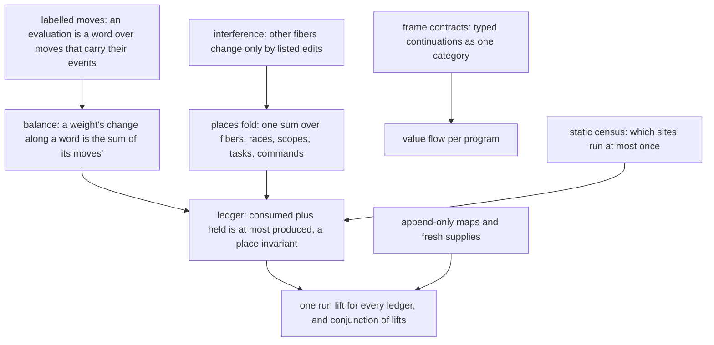

# The machine's models, second pass: accounting, ownership and the representation

Research note, 2026-10-11, base `ffe9e97f4`. The owner asked whether Codex's Timeout work fits the
machine's base laws (`../2026-10-11-machine-from-the-base/README.md`), and for the next round of
fundamental modelling, so that the abstractions stay minimal and the goals lane consolidates on
them. Three read-only censuses and one probe ground it. Counts come from `wc`, `grep` and `git log`
at the base.

## 1. The one thing to know first

**The goals lane re-builds the same few structures per weight and per scenario.**

- The lane added about 23,300 lines of laws and 21,000 lines of scenario proofs in two days. Most
  of that landed on 2026-10-11.
- Four "at most once" ledgers each re-prove three things:
  - a per-arm debit lemma for every evaluator arm and command;
  - transport of a summed weight through about fifteen machine edits;
  - a hand-built `Lift.DecisionLift` (thirteen fields).
- The four ledgers are `ReleaseCustody.Control.Funded`, `FinalizerCredits.Funded`, the source
  opportunity budget and Atomic's `WriterPhase`.
- The base laws of the morning are almost unused there. `FrameMove`, `Moves` and
  `driveStep_framesFollow` have no goals-lane consumer, and `Interferes` has four.

The Timeout work is aligned in its meaning:

- `timeoutForm` is row 352's `raceAllFirst`;
- `retries_declared` reads the completed form's outcome, as row 351 rules;
- the reply-based statement stays refuted (`E4-HOST-CE-009`).

It is not aligned in its structure:

- 36 files and about 9,200 lines use none of the base laws;
- `command_state` re-does all 18 commands, and `evaluate_native_state` every evaluator arm;
- the open numeric producer that both open goals need would be a third such pass.

**A probe found a real divergence from rc.112** (`E4-RUN-CE-046`). A fiber that interrupts itself
through its own handle exits interrupted on the pin. On the machine it runs to a frontier:

- `interruptAs` records the interrupt on the stored record of the target;
- when the target is the running fiber, `settle` writes the running copy back over it.

The fault is the representation: an iteration holds the machine and a local copy of its fiber.

## 2. The structures, named by their mathematics

| Structure | Mathematics | Re-built today in | Shared base |
| --- | --- | --- | --- |
| Ledger | a Petri net's place invariant: `consumed(trace) + held(machine) ≤ produced(trace) + cap` | `ReleaseCustody.Control`, `FinalizerCredits`, `SourceOpportunityHistory`, Atomic `WriterPhase`; at observations: Timeout `Numbers`, QueueWorkers `Ledger`, Atomic `StagesFit` | none |
| Balance | a monoid map from the free monoid of labelled moves | about 20 copies of the pop chain (`passPushed`, `popFrom`, `getCont`, `resumeValue`) | `FrameWeights` (one pop, additive), `ControlWeights` (keyed sums) |
| Places fold | the frame rule of a finite map: `machine = owner ∗ rest` | about 179 edit lemmas; the "outside" row three times | none |
| Frame contracts | a category of typed continuation arrows (Kripke-closed) | `HostTimeoutFlow`/`HostTimeoutFrames`; `Typed/Contracts` | `Machine/AnswerFlow` |
| Fresh supply | an append-only map with a counter | fiber ids, scope keys (`ScopeIdentity`), tokens (Timeout `token_*`, `Journal.activeBelow`, `Handles.MintedAt`), registration keys | none |
| Static census | a usage analysis: does a site run at most once | `OncePlaced`, `ClearFinalizers`, `ClearLoops`, `SequentialSource`, `RaceFreeSource`, Atomic's site predicates; 29 census uses | none |
| Interference | Owicki and Gries's non-interference | `NativeStacks`, `CommandStacks` (about 717 lines) | `Interferes`, `FramesFollow` |

Three reasons the base laws do not yet fit accounting:

- `FrameMove` carries its events only inside the `step` and `finish` constructors, and has no
  label.
- `Moves.keeps` gives invariance, not a balance.
- `answer` accepts any code, with no record of where it came from.

The next base laws remove these three reasons.

## 3. The representation

The machine's control state is flags and lists. Invariants then forbid what the types admit. Of
`GuardState`'s fifteen fields, nine exist only to rule out such states.

| Finding | Evidence | Repair |
| --- | --- | --- |
| a local fiber copy and the machine | `Iter` holds both; edits of the running fiber through the machine are lost (`E4-RUN-CE-046`) | R2: an edit of another fiber's record is a message applied after the write-back, so `Interferes` holds by definition |
| a fiber's life as flags | `running`, `parked`, `pending`, `finalizing`, `exit`: about six legal states in many combinations; `PendingShape`, `parkedIdle`, `exited` | R4: one sum type `Life` |
| an interrupt state as two fields | `deferredInterrupt` without `interruptedCause` is representable; `Guard/DeferredCause.lean` and its twin chain | R5: `none \| recorded c \| deferred c` (needs the frames contract amended) |
| dead data | `Resume.continueWith`, `Dispatcher.armed`, `Pending.waitingOn`, five `RaceAllState` fields, `Race.settled`, `finalizing`'s exit | R1: cut |
| the budget stored three times | `RunFiber.maxOpsBeforeYield`/`preventYield`, `Ctx`'s cache, `budgetOf` | R3: read `budgetOf` |
| ids that are positions | fibers and races only ever append | R6: dense arenas; drop `nextId`, `nextRace` and their freshness invariants |
| the scheduled wake branch unused | no program constructs `Task.wake` or `WakeMode.scheduled` (`E4-RUN-CE-040` already notes it) | R7: cut, or keep as an extension point |

Already minimal; keep:

- `Cause` as a flat list, and `Exit`;
- `ScopeState` as a sum;
- `Arm`, and the first-order `Prim` with `PrimInterp` as a parameter;
- the `FiberCore` and `FiberEvaluator` seam, and the decision tape as the oracle;
- `Completion`, `Observer`, and the single token counter;
- the arenas of references and deferreds, and `ForkRecord`.

## 4. The plan

Speed rules this round (owner, 2026-10-11). The base lands beside the old proofs, with connectors,
and the consolidations replace the old chains, keeping names and statements. Each slice owes a
narrow build and `#axiom_audit`. Behaviour gates wait until the major proof work lands, except
where a slice changes executable code.

| Slice | Who | What | Removes |
| --- | --- | --- | --- |
| L1 ledger | Claude, now | `Laws/Machine/Ledger.lean`: `Ledger`, `Funded`, the edit laws once, the frame rule under unique ids, the connector of `FinalizerCredits.Funded` | the four ledgers' edit transport and lifts |
| L2 labelled moves | Codex | label each move by the events it emits; `Moves.balance`; one pop law `getCont_spec` | about 20 pop-chain copies; per-arm debit files |
| L3 code weights | Codex | one generated fold over native code (`PrimAlgebra`), a weight as a table of leaf weights | about 25 hand folds (`stackCredits`, `below`, `WriterPhase.name`, …) |
| L4 frame contracts | Codex | `HostTimeoutFlow` and `HostTimeoutFrames` onto `AnswerFlow`; its world order is `WorldOrder` | about 600 to 800 lines |
| L5 fresh supply | Codex | `AppendOnly` and `FreshSupply` | about 300 to 500 lines |
| L6 census | Codex | `Census` and `Linear`; the 36 paired lemmas of `Scenario/SourceOpportunity.lean` | about 400 lines |
| R2 messages | Codex | edits to other fibers as messages; repairs `E4-RUN-CE-046` | the aliasing case analyses |
| R1, R3, R7 | Codex | dead data, the budget copy, the unused wake branch | `PendingOk` and the matching clauses |
| Timeout redirect | Codex | write the numeric producer over `Interferes`, `FramesFollow`, `StackRegion` and the ledger; `NativeStacks` as a corollary of `Interferes` | a third command and evaluator pass |

R4 to R6 (the sum types and the arenas) are larger. They wait until L1 to L3 have moved the
invariants that they would delete.

## 5. What this note does not establish

- The line estimates of section 4 are guesses from reading pairs of modules: `FinalizerCredits`
  against `FrameWeights`, `WriterPhase` against `SourceOpportunities`, `CommandDebit` against
  `SourceOpportunityCommands`, `CommandStacks` against `Interference`, and `HostTimeoutFlow` and
  `AnswerFlow` against `Typed/Contracts`. No consolidation was compiled.
- `E4-RUN-CE-046` is one finite run on the machine and one on the pin. The other aliasing arms
  (the join park, `countdownPark` and `linkScope` on the running fiber) are not probed.
- R1's list of dead data is from `grep` over `src/`. Each cut needs its consumers checked.

## 6. Evidence

| Fact | Command or file |
| --- | --- |
| the self-interrupt divergence | `probes/SelfInterrupt.lean` (`lake env lean`); the pin under bun in `harness/truth`; battery `Test/Counterexamples/Machine/Semantics/SelfInterrupt.lean` |
| base-law uses in the goals lane | `grep -lw` of `FrameMove`, `Moves`, `iteration_moves`, `Interferes`, `driveStep_framesFollow` |
| goals-lane sizes | `git log --diff-filter=A --since=2026-10-09` over `src/Effect4/Laws`, then `wc -l` |
| Timeout's case analysis | `grep -c` of `cases`, `driveStep`, `evaluateNative` over `Test/Dogfood/Proofs/HostTimeout*.lean` |
