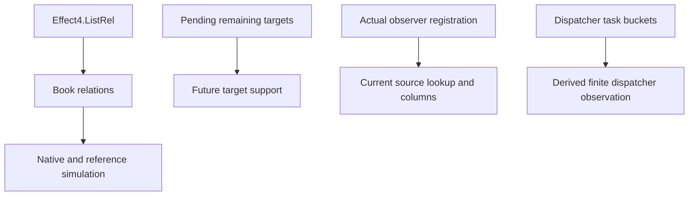

# Book and two unread fields

Source and proof acceptance passes.
The source removes only `Pending.waitingOn` and stored `Dispatcher.armed`.
The source base is `18cd908b9`, which merges the checked integration at `1591530e9`.
The profile core commit is `dde23d54a`.
The field and relation commit is `268b9051b`.
The whole law graph and selected readers pass 1,423 jobs.
The 40-module axiom gate passes 10,229 declarations without planned goals or dependence on them.

## Representation

`Pending` retains token, remaining targets, collected exits, continuation, and fail-fast mode.
The actual observer registration retains the watched target.
The runtime never reads the removed target field.
`Dispatcher` retains buckets, their priorities, and their task order.
The runtime never reads the removed Boolean.
`RunMachine.armed` retains the executable host schedule.

The cut changes raw record observations.
It does not assert agreement with arbitrary old records whose Boolean and buckets disagree.
No command order, interrupt guard, observer registration, or task order changes.
Each changed constructor retains every remaining runtime argument.

`Book` imports `Effect4.ListRel` directly.
The slice deletes its private relation and seven duplicate leaf proofs.
The shared relation retains append, emptiness, length, map, related map, reflexivity, and equality transport.
`Data.machineListRel_iff` retains its name as a reflexive connector.
`DispatcherMeans` relates buckets without the removed Boolean conjunct.
The native/reference simulation consumes the existing shared dispatcher connector.



## Observations and support

`Dispatcher.enqueue_arms` now states that enqueue leaves nonempty buckets.
`Dispatcher.drain_disarms` now states that the drained snapshot has empty buckets.
Both names and their census row identifiers remain.
The coordinator approves these exact record-observation amendments.

`Witnesses.armedOf` retains its name and `Option Bool` result.
It reads whether the actual owner's buckets are nonempty.
The three original witness conclusions remain unchanged in source.
Their actual runs pass in the full acceptance cascade.

`Handles.Pending.keys` drops only support of the removed field.
Typed countdown payloads range over remaining targets.
`StoredObserverOk.countdown` still supplies columns for the actual observer source.
`Evaluating.countdown_parks` retains the target membership returned by `countdownWalk_spec`.
Its observer installation consumes that membership separately from remaining-target support.
`observe_countdown` retains `nextMem` from the actual walk.
It obtains `nextCols` through the old payload and actual lookup before registering the next observer.
`Evaluating.join_parks` retains the watched target declaration and its actual lookup in observer installation.
The existing typed machine supplies bounds for each found current fiber.
No current target bound is inferred solely from the remaining list.

`EditMessages` retains the actual self-registration control.
Its obsolete target-field guard becomes guards on remaining targets and the collected exit.
The seven R2 cuts and their command-order controls remain.
The registration battery and scheduler contract retain their named conclusions over the amended record.

## Excluded cuts

`Resume.continueWith` remains.
The generic interpreter and its named clause still accept that raw constructor.
Native producer absence does not justify erasing its generic contract.

`Race.settled` remains.
The race callback reads it alongside accepted state before emitting settlement and resume.
Its replacement needs a checked relation to the race transition.
The pin's winner flag alone does not establish that relation.

`RaceAllState`, finalizing, budget, and scheduled wake remain unchanged.
Original scenario goal statements remain unchanged.
The slice adds no evaluator census, command census, or history relation.

## Placement

1. Concept: reactive-scheduling and translation-simulation; R11 and representation separation.
2. Question: one pointwise list relation and no unread stored scheduling fields.
   Existing Book, simulation, handle, typed scheduler, and observer laws consume the change.
3. Reach: exact retained runtime commands over the amended Pending and Dispatcher records.
   The amended raw observations are named above and in the retained header comparison.
4. Limit: finite controls establish no outside-runtime simulation or progress.
5. Unlock: the shared Names and handle consolidation consume one relation after one Book rebuild.

## Verification

The isolated runtime check passes 17 jobs.
The integrated Book, Clauses, PrimitiveProducer, Integers, and Term check passes 353 jobs.
The final acceptance command passes 1,423 jobs:

```sh
LEAN_NUM_THREADS=3 lake build Effect4.Laws \
  Test.Machine.EditMessages Test.Machine.EditFields \
  Test.Machine.Runtime.SchedulerCoreContract Test.Program.RegistrationColumn \
  Test.Dogfood.Proofs.HostTimeoutEvaluation Test.Dogfood.Proofs.HostTimeoutParkSteps \
  Test.Dogfood.Proofs.HostTimeoutRaceCommands \
  Test.Counterexamples.Machine.Semantics.MulOutsideProfile
```

The [final build log](MachineBookR1LawsFinal.log) retains the measured result.
The whole law graph passes before either source commit.
The original dispatcher observations and selected finite controls pass.

The [audit reader](MachineBookR1Audit.lean) checks all 40 touched modules:

```sh
LEAN_NUM_THREADS=3 lake env lean -DwarningAsError=true /private/tmp/MachineBookR1Audit.lean
```

The [audit output](MachineBookR1Audit.log) reports 10,229 declarations within `[propext, Quot.sound]`.
It reports zero planned goals and zero declarations depending on planned goals.
This audit covers the changed modules, rather than the whole library's claim status.

The source diff passes its whitespace check.
The receipt passes its strict language check.
The coordinator owns root imports, census anchors, target generation, and the outside-runtime sweep.
Those behavior comparisons remain outside this source receipt.

## Reached repairs

The first Book check finds a dispatcher proof diagnostic.
The integrated retry checks the repaired Clauses module.
The first full discovery finds a stale frame-rule message guard in `Typed.Frames`.
Its repair records 48 checked theorems, 70 reused clauses, and 35 explicit premises.
The generated `DispatcherOk.frame_armed` rule disappears with the field.
Three async leaves still split the removed support append.
Their repairs use the retained empty remaining-target list.

The selected scheduler fixture exposes nine earlier R2 constructors without the edit field.
Their adapters add explicit empty edit lists and retain all finite conclusions.
The selected Timeout park proof exposes one obsolete positional target argument.
Its adapter removes that argument and retains the actual observer registration.

The one-thread discovery ends after 821 completed modules.
The first three-thread retry checks the whole law graph and finds the two remaining test adapters.
The final retry checks those adapters and all selected readers.

## Statement inventory after integration

The current source comparison measures 2,766 existing named declaration headers.
It finds 2,725 unchanged texts, 33 amended texts, and eight removed private relation names.
These counts compare the 37 field-cut paths against `18cd908b9`.
They exclude the three separately committed multiplication-profile paths.
The inventory includes two class headers and five named instance headers.
It covers theorem, definition, abbreviation, inductive, structure, and planned-goal headers.
Unchanged text does not assert an unchanged raw record domain.
The textual inventory does not count generated declarations.
The generated field-rule amendment is recorded separately above.
[The prepared comparison](MachineBookR1Headers.json) lists each old and new header.

The record domains change at `Pending` and `Dispatcher` in `src/Effect4/Machine/Fibers.lean`.
The following existing definitions or fields also change their observations:

| Declaration | Source | Observation after the cut |
| --- | --- | --- |
| `DispatcherMeans` | `src/Effect4/Laws/Machine/Book.lean` | Related buckets |
| `Pending.keys` | `src/Effect4/Laws/Machine/Handles.lean` | Remaining targets, collected exits, continuation |
| `armedOf` | `src/Effect4/Laws/Machine/Witnesses.lean` | Nonempty buckets at the actual owner |
| `CountdownPayload.targets` | `src/Effect4/Laws/Program/Typed/Scheduler.lean` | Remaining targets |
| `SchedulerState.targetsBelow` | `src/Effect4/Laws/Program/Typed/Scheduler.lean` | Bounds for remaining targets |
| `FiberTyped.targetsBelow` | `src/Effect4/Laws/Program/Typed/Commands/Bookkeeping.lean` | Bounds for remaining targets |

The following declaration headers change by the approved record or support amendment:

| Declaration | Source |
| --- | --- |
| `historical_parked` | `Test/Program/RegistrationColumn.lean` |
| `parked` | `Test/Program/RegistrationColumn.lean` |
| `machineListRel_iff` | `src/Effect4/Laws/Data/ListRelConnectors.lean` |
| `Dispatcher.drain_disarms` | `src/Effect4/Laws/Machine/Clauses.lean` |
| `Dispatcher.enqueue_arms` | `src/Effect4/Laws/Machine/Clauses.lean` |
| `countdownPark_parks` | `src/Effect4/Laws/Machine/Clauses.lean` |
| `drive_registrationDone_parks` | `src/Effect4/Laws/Machine/Clauses.lean` |
| `evaluatePrim_async_parks` | `src/Effect4/Laws/Machine/Clauses.lean` |
| `evaluatePrim_join_live` | `src/Effect4/Laws/Machine/Clauses.lean` |
| `evaluatePrim_yieldNowWith_eq` | `src/Effect4/Laws/Machine/Clauses.lean` |
| `fireObserver_countdown_done` | `src/Effect4/Laws/Machine/Clauses.lean` |
| `fireObserver_countdown_next` | `src/Effect4/Laws/Machine/Clauses.lean` |
| `countdown_done_minted` | `src/Effect4/Laws/Machine/Handles.lean` |
| `countdown_next_minted` | `src/Effect4/Laws/Machine/Handles.lean` |
| `join_actual` | `src/Effect4/Laws/Program/Guard/NativeState.lean` |
| `guardQueue_park_internal` | `src/Effect4/Laws/Program/Guard/RegistrationDone.lean` |
| `guardState_park_internal` | `src/Effect4/Laws/Program/Guard/RegistrationDone.lean` |
| `interruptedAt_park_internal` | `src/Effect4/Laws/Program/Guard/RegistrationDone.lean` |
| `requestOf_park_internal` | `src/Effect4/Laws/Program/Guard/RegistrationDone.lean` |
| `FMeans.countdownEntry` | `src/Effect4/Laws/Program/Simulation/Drive.lean` |
| `pendingOk_countdownEntry` | `src/Effect4/Laws/Program/Simulation/Drive.lean` |
| `evaluatePrim_async_none` | `src/Effect4/Laws/Program/Simulation/Evaluate.lean` |
| `pendingOk_parkVoid` | `src/Effect4/Laws/Program/Simulation/Pending.lean` |
| `Evaluating.async_parks` | `src/Effect4/Laws/Program/Typed/Commands/Clauses/Async.lean` |
| `Evaluating.async_parks_request` | `src/Effect4/Laws/Program/Typed/Commands/Clauses/Async.lean` |
| `Evaluating.async_parks_store` | `src/Effect4/Laws/Program/Typed/Commands/Clauses/Async.lean` |
| `Evaluating.park_fresh_request` | `src/Effect4/Laws/Program/Typed/Commands/Clauses/Async.lean` |
| `Evaluating.countdown_parks` | `src/Effect4/Laws/Program/Typed/Commands/Clauses/Park.lean` |
| `Evaluating.park_fresh` | `src/Effect4/Laws/Program/Typed/Commands/Clauses/Park.lean` |
| `countdownAt_alloc` | `src/Effect4/Laws/Program/Typed/Commands/Launch.lean` |
| `countdownAt_advance` | `src/Effect4/Laws/Program/Typed/Commands/Observe.lean` |
| `countdownPayload_advance` | `src/Effect4/Laws/Program/Typed/Commands/Observe.lean` |
| `fiberTyped_repend` | `src/Effect4/Laws/Program/Typed/Commands/Observe.lean` |

The deleted local names are `Effect4.Machine.ListRel` and its seven leaf theorems.
They resolve to the shared `Effect4.ListRel` instead of a retained alias.
The shared leaf names are `append`, `isEmpty`, `length`, `map`, `of_map`, `refl`, and `of_eq`.
The original scenario statement files have no changes in this slice.
The new `PrimitiveProducer` constructors retain their exact bodies after the removed field disappears.

## Source size

The field and relation slice adds 169 lines and removes 240 across 37 source paths.
Its net change is minus 71 lines.
The separate profile patch adds 12 lines and removes seven across three paths.
