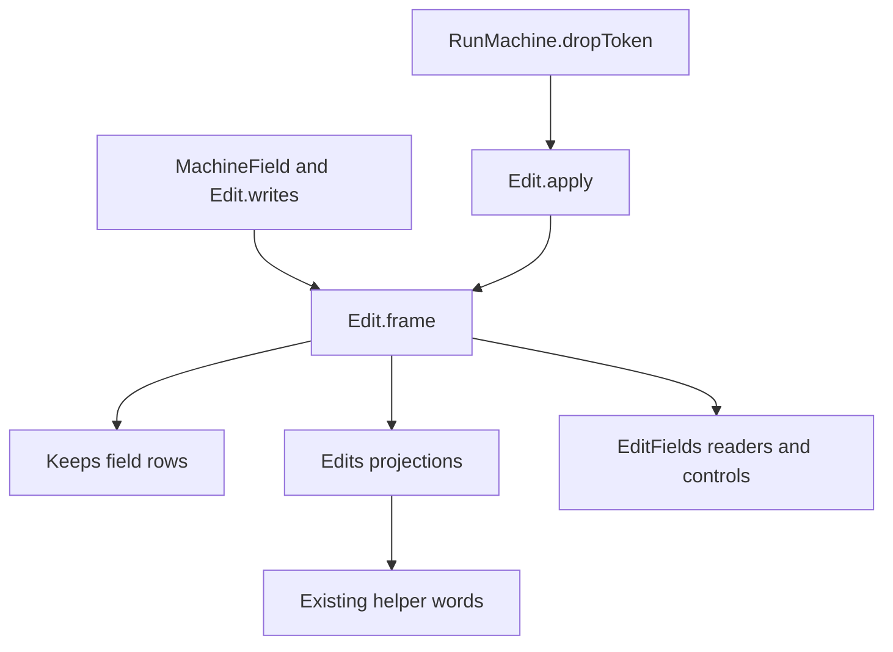

# Machine edit fields

The slice keeps every existing theorem statement.
The coordinator adds the battery anchor beside `Test.Machine.EditMessages`.

## Change

The slice starts at `68f3808d25e1c292e610f8f88864fd590ba480fd` on `codex/machine-fields`.
The source head is `f7c280dd3029690cf4c41f79b149fa579990ad88`.
`Effect4.Machine.Edit` moves from `src/Effect4/Laws/Machine/Edits.lean` to `src/Effect4/Laws/Machine/Edit.lean`.
The alphabet keeps its sixteen constructors and its existing interpretation.
`MachineField` names the eleven existing record fields.
`MachineField.Agrees` compares existing projections without another field-value carrier.
`Edit.writes` names the one field each primitive edit may write.
`Edit.frame` proves agreement at every other field.

The eighteen `Keeps` field rows read that law.
The existing fiber, state, and trace adapters read the same law.
`Edit.settlementWrite` retains its existing subalphabet.
`appendFiber` writes fibers but remains outside that subalphabet.

`RunMachine.dropToken` in `src/Effect4/Machine/Fibers.lean` holds the one executable observer filter.
Both `applyFiberEdit` and `Edit.apply` use it.
The filter retains observer order and removes both matching observer forms across every stored fiber.
The slice does not change settlement order or command order.

## Placement

1. Concept: reactive-scheduling, R11, the machine part of evaluation-moves.
2. Question: machine-edits field agreement supports existing machine invariant consumers.
   `Keeps` and `Edits` are the direct consumers.
3. Reach: every primitive edit at every generic machine, outside its declared write.
   Existing payload validity keeps its actual-prefix premises.
4. Limit: the field law proves no source admission, progress, or outside-runtime observation.
5. Unlock: helper words reuse one field classification instead of separate field rows.

## Files

- `src/Effect4/Machine/Fibers.lean`
- `src/Effect4/Laws/Machine/Edit.lean`
- `src/Effect4/Laws/Machine/Keeps.lean`
- `src/Effect4/Laws/Machine/Edits.lean`
- `src/Effect4/Laws/Machine/EditWords.lean`
- `src/Effect4/Laws/Machine/FiberSumMessages.lean`
- `src/Effect4/Laws/Machine/Ledger.lean`
- `Test/Machine/EditFields.lean`

The two helper-word footprint leaves now prove field inequality instead of the former constructor `True`.
The existing fiber-sum and ledger proofs unfold the canonical token filter.
Neither repair changes a theorem statement.

## Evidence

All Lake commands use `LEAN_NUM_THREADS=3`.

| Command | Result | Log |
| --- | --- | --- |
| `lake build Effect4.Laws.Machine.Edits` | PASS, 190 jobs | `/private/tmp/machine-fields-narrow.log` |
| `lake build Test.Machine.EditFields` | PASS, 200 jobs | `/private/tmp/machine-fields-battery.log` |
| `lake build Effect4.Laws Test.Machine.EditFields Test.Machine.EditMessages` | PASS, 1033 jobs | `/private/tmp/machine-fields-full-laws-pass.log` |
| `lake build ProofGraph.AxiomAudit` | PASS, 15 jobs | `/private/tmp/machine-fields-audit-tool.log` |
| `lake env lean -DwarningAsError=true /private/tmp/MachineFieldsAudit.lean` | PASS | `/private/tmp/machine-fields-audit.log` |
| `git diff --check` | PASS | no finding |

The retained audit reader is `MachineFieldsAudit.lean` beside this receipt.
Its output reports 2478 declarations within `[propext, Quot.sound]`, zero declarations modulo planned goals, and zero planned goals.
`EditMessages` imports the retained self-interruption regression.

The broad rebuild exposes two token-filter unfolding leaves, in `FiberSumMessages` and `Ledger`.
Both repairs add `RunMachine.dropToken` to an existing `simp only` list.
The accepted full run follows those repairs.
Earlier footprint proof repairs replace the old constructor `True` with the declared field inequality.

The retained measurement `MachineFieldsHeaders.json` checks 137 existing theorem statements in five touched law modules.
It finds no changed header.
The executable filter search finds one definition.
The battery checks real machine readers, token cleanup, changed-field controls, and the settlement subalphabet boundary.
The generated phase rules report eleven rules, twenty reused clauses, and two explicit premises.

## Size

| File | Before | After |
| --- | ---: | ---: |
| Fibers | 2385 | 2391 |
| Edit | 0 | 111 |
| Keeps | 239 | 244 |
| Edits | 329 | 276 |
| EditWords | 599 | 599 |
| FiberSumMessages | 205 | 205 |
| Ledger | 738 | 738 |
| EditFields | 0 | 63 |

Existing production files lose 42 lines.
The lower shared module adds 111 lines, giving a production increase of 69 lines.
The battery adds 63 lines.
These counts exclude this receipt.
The slice consolidates the field proofs; it does not claim a net line reduction.

## Remaining boundary

The coordinator owns the root battery anchor and integration gates.
This slice runs no outside-runtime comparison.
This slice adds no planned goal and changes no original scenario statement.
The finite token checks establish no outside-runtime simulation.
