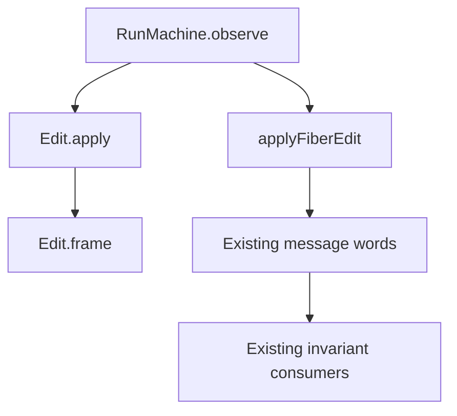

# Observer helper addendum

The slice consolidates observer attachment without changing lookup, append order, or settlement order.
The source base is `56ae92ee0` on `codex/machine-fields`.
The source head is `b0b577943`.
The parent integrates this addendum after the field slice.

## Change

`RunMachine.observe` in `src/Effect4/Machine/Fibers.lean` owns the current-record observer append.
Both `applyFiberEdit` and `Edit.apply` call that helper.
The helper leaves a missing target unchanged.
The slice adds no message, field, or command.

The field proof unfolds that helper.
The clause, shape, guard, and fiber-ledger proofs retain their existing statements and assumptions.
Their explicit unfold lists include the helper.
The battery reads both interpretations and checks append order and a missing target.



## Placement

1. Concept: reactive-scheduling, R11, the machine part of evaluation-moves.
2. Question: machine-edits has one observer attachment operation.
   The field, message-word, and existing invariant laws consume it.
3. Reach: the same current lookup and observer append at every generic machine.
   Actual-prefix payload premises remain unchanged.
4. Limit: finite controls establish no outside-runtime simulation or progress.
5. Unlock: both edit interpretations share the executable observer write.

## Evidence

The full law graph and both batteries pass:

```sh
LEAN_NUM_THREADS=3 lake build Effect4.Laws Test.Machine.EditFields Test.Machine.EditMessages
```

The command completes successfully with 1,033 jobs.
[The retained output](MachineObserveBuild.txt) records that run.

The narrow audit passes:

```sh
LEAN_NUM_THREADS=3 lake env lean -DwarningAsError=true /private/tmp/MachineObserveAudit.lean
```

The audit checks 6,481 declarations within `[propext, Quot.sound]`.
It reports no planned goals and no declarations modulo planned goals.
[The reader](MachineObserveAudit.lean) and [the output](MachineObserveAxioms.txt) retain the evidence.

`git diff --check` passes.
[The header comparison](MachineObserveHeaders.json) retains 1,619 measured named headers, including 1,321 theorem headers.
The only new named declaration is `RunMachine.observe`.
The source slice changes seventeen files, with 44 insertions and 28 deletions.
Production grows by six lines; the battery grows by ten lines.
Every adapter adds the helper to an explicit unfolding list.
The slice changes no existing statement or assumption.
The earlier diagnostic finds explicit unfold lists that retain the former inline expression.
Those repairs change no statement or assumption.
The coordinator owns the outside-runtime sweep and battery anchor.

## Changed files

- `Test/Machine/EditFields.lean`
- `src/Effect4/Laws/Machine/Clauses.lean`
- `src/Effect4/Laws/Machine/Edit.lean`
- `src/Effect4/Laws/Machine/FiberSumMessages.lean`
- `src/Effect4/Laws/Machine/Handles.lean`
- `src/Effect4/Laws/Machine/Keeps.lean`
- `src/Effect4/Laws/Machine/Ledger.lean`
- `src/Effect4/Laws/Program/Guard/Core.lean`
- `src/Effect4/Laws/Program/Guard/NativeState.lean`
- `src/Effect4/Laws/Program/Guard/Observer.lean`
- `src/Effect4/Laws/Program/Guard/ReturnFields.lean`
- `src/Effect4/Laws/Program/Guard/SettleQueue.lean`
- `src/Effect4/Laws/Program/Typed/Commands/Bookkeeping.lean`
- `src/Effect4/Machine/Fibers.lean`
- `src/Effect4/Laws/Program/Typed/Commands/Observe.lean`
- `src/Effect4/Laws/Program/Typed/Commands/Clauses/Command.lean`
- `src/Effect4/Laws/Program/Typed/Commands/Clauses/Park.lean`

## Remaining work

This slice leaves the original scenario statements unchanged.
It removes no field and adds no invariant traversal.
Book, the two unused fields, and the shared list relation remain a separate coordinated slice.
No outside-runtime comparison runs in this slice.
The owner assigns those behaviour gates to the sweep.
