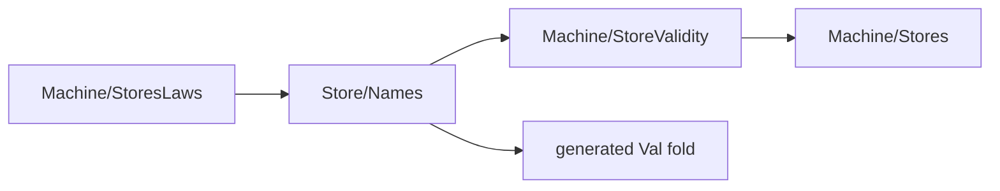

# Validity as the diagonal: plan

The slice retains the public definitions and theorem statements.
It removes the private value induction by the generated fold's abstraction law.

Base: `0b57d3562`.

## Placement

1. Concept: `store-typing`, requirement R4, and `initial-algebras-folds` for the shared name relation.
2. Question: this slice serves the proposed `names-parametric` claim recorded in `Laws/Store/Names.lean`.
   The existing `validIn_iff_diag` consumes the generated fold adapters.
   `Val.validIn_mono`, `syncOpStep_wf` and `syncOpStep_result_valid` consume the store validity facts.
3. Reach: the existing value carrier, actual store allocation predicate, and each theorem's original hypotheses.
   The store growth premise remains in every monotonicity theorem.
4. Limits: this slice supplies no schedule, progress or host result.
   It adds no world, allocation or validity representation.
5. Unlock: item 11 reads validity through the diagonal before machine carrier and world migrations.

## Dependency choice

Splitting the generic name relation moves most of its file for one connector.
Moving four existing declarations is smaller.
The definitions retain their exact bodies and namespaces.
The list theorem retains its statement and proof.

Moved declarations:

- `Stores.handleValid`
- `Val.validIn`
- `Val.validInList`
- `Val.validInList_eq_all`

`Names` stops importing `StoresLaws`.
Its private adapters use the existing generated `ValAlgebra` and `ValHom`.
The generated agreement removes the separate value induction.
`validIn_iff_diag` retains its name and statement.
`Val.validIn_eq_handles` stays in `StoresLaws` as a diagonal corollary.
The remaining value validity facts consume that same diagonal.
No private validity traversal lands.

## Evidence and acceptance

The private fold probe compiles with warnings treated as errors.
Its imported-module gate checks 33 declarations within `[propext, Quot.sound]`, with zero planned goals or dependence on goals.

Check `StoreValidity`, `Names`, `StoresLaws` and the original stores-law reader.
Compare the combined public declaration headers and the four moved bodies.
Record exact lines, audit output and all reached repairs before committing explicit paths.
