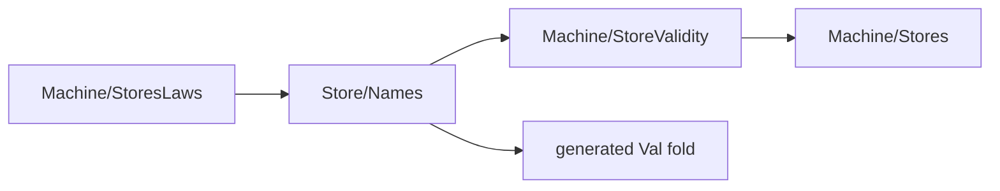

# Store validity through the shared names relation

The slice retains all existing public declaration statements and namespaces.
It changes the import direction to remove the cycle before deriving the validity laws.
No runtime definition changes.

Base: `0b57d3562`.
Source head: `bcff96f07`.

## Placement

Proof role: shared instances and generated-fold adapters.
Evidence status: checked reader build and axiom gate.
Scope: the existing value carrier, store allocation predicate and original theorem hypotheses.

The [plan](MachineValidityPlan.md) records the five-part placement before source changes.
The slice serves `store-typing`, requirement R4, and the proposed `names-parametric` claim.
`syncOpStep_wf` and `syncOpStep_result_valid` consume the validity laws.
The store growth premise remains in `Val.validIn_mono`.

## Changed files and dependency

- `src/Effect4/Laws/Machine/StoreValidity.lean`
- `src/Effect4/Laws/Store/Names.lean`
- `src/Effect4/Laws/Machine/StoresLaws.lean`



Four existing declarations move unchanged into `StoreValidity`:
`Stores.handleValid`, `Val.validIn`, `Val.validInList` and `Val.validInList_eq_all`.
The comparison checks their bodies byte for byte.
The shared list theorem retains its original proof.

Two private homomorphisms use the existing generated value algebra.
`hom_eq_cata_val` identifies validity with the handle-support fold.
`Names.validIn_iff_diag` keeps its name and statement.
The old public `Val.validIn_eq_handles` becomes its diagonal corollary.
The value, growth and frame-closure facts consume that connector.
The conditional list bridge retains its hypothesis and uses the shared list laws.
Its separate induction goes.
The old value induction goes.
No additional recursive validity proof lands.

## Statement and size comparison

The combined inventory measures 150 existing public named declarations.
All 150 retain their exact header text.
The four moved declarations retain their bodies.
No observation or theorem hypothesis changes.

The three files contain 2,862 lines before the slice and 2,945 after it.
The source diff adds 170 lines and removes 87, for 83 additional lines.
The private generated-fold adapters and lower dependency module account for this cost.
The slice removes two proof inductions and introduces no new validity representation.

## Checks

```text
LEAN_NUM_THREADS=3 lake build Effect4.Laws.Machine.StoreValidity Effect4.Laws.Store.Names Effect4.Laws.Machine.StoresLaws Test.Machine.Runtime.StoresLawsContract
LEAN_NUM_THREADS=3 lake env lean -DwarningAsError=true docs/research/2026-10-11-machine-models/codex/MachineValidityAudit.lean
python3 docs/research/2026-10-11-machine-models/codex/MachineValidityHeaderCompare.py bcff96f07
python3 scripts/check-language.py --strict docs/research/2026-10-11-machine-models/codex/MachineValidityPlan.md docs/research/2026-10-11-machine-models/codex/MachineValidityReceipt.md
```

The final narrow build passes 264 jobs.
The six-module gate checks 2,294 declarations within `[propext, Quot.sound]`.
It reports zero planned goals and zero declarations modulo planned goals.
`MachineValidityBuild.log` and `MachineValidityAudit.log` retain the output.
The original `StoresLawsContract` reader checks allocated and dangling handles at actual store operations.
Its retained controls and observations remain unchanged.

The initial foundation build also passes 264 jobs.
A later proof attempt needs four explicit Boolean reductions and one function equality.
`MachineValidityReductionFailure.log` retains that failed attempt.
The final build includes these repairs.

## Limits and next work

This proof slice changes no execution, host judgment, schedule or progress claim.
No original scenario statement changes.
The generated-key step remains pending.
The next review maps the original ledger goals to the existing shared structures.
