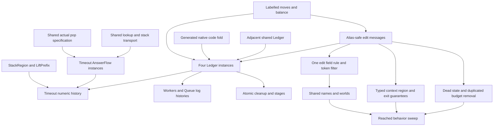

# Shared accounting and the original goals

Base: `4bc3efc44`, rebased on the consolidation packet at `4ca0b2a7a`.
The original scenario goals and machine-base obligations remain active.
Stop extending independent scenario command and evaluator censuses.
Keep source-specific producers as instances of shared laws.

## Finishing criteria

Retain the original scenario statements, including the settled timeout amendment.
Complete their proofs without dependencies on planned goals.
Consolidate duplicate traversals and accounting before adding further scenario history machinery.
Keep every replaced theorem's name and statement; remove the old proof in the same slice.
Build each slice narrowly, audit it, and report measured line changes.
Run reached behavior gates after executable changes at the sweep.
Never push.

## Immediate ownership

| Lane | Work | Consumer |
| --- | --- | --- |
| Coordinator | R2 integration, shared observer paths, accounting and full law acceptance | Existing invariants and the original goals |
| Timeout | Actual attempt, cleanup, and completed-form phase history through shared laws | Numbers and Declared |
| Machine structure | R2 source review; then the field rule and canonical token filter | Item 10 and existing machine invariants |
| Typed context | R2 typing adapters; then the approved context region and exit guarantees | B6 and the context service chain |

`Machine.Ledger` is assigned to the adjacent L1 seat by the packet.
It lands at `0d1acfd87` as `StackLedger` and passes the independent integration build.
It accounts for saved stacks; active-code weights wait for the edit-message repair or a justified generalization.
The checked replacement removes the duplicate FinalizerBookkeeping and FinalizerCommands proofs through exact reading connectors.
The generated primitive fold, labelled moves, pop provenance, and FiberSum connectors are checked foundations.
Their receipts retain the measured scope and remaining application obligations.

## Placement and limits

FinalizerCredits serves scope-lifetime-finalization, R11, through the original Atomic cleanup clause.
Its shared scalar model counts exactly the already saved selected finalizer frames.
The connector changes no hypotheses, behavior, progress claim, or host boundary.

Labelled moves serve reactive-scheduling and scope-lifetime-finalization through the four ledgers.
Their labels must retain actual emitted events and the source of replacement code.
A free replacement-code premise alone cannot establish a source-specific weight bound.

The pop specification serves the same consumers and AnswerFlow's restricted contract instances.
The actual popped list includes hook-injected frames.
Distinguish the consumed original prefix from hook contributions; do not equate them without proof.

Interference's current backward classification does not alone prove forward lookup survival.
Retain the old NativeStacks statement through an existing survivor law or the shared classification's strengthened census.

Control stack credit depends on the active response and can change between identical saved frames.
The generated primitive fold must retain that contextual input.

## Subsequent order

The self-interrupt repair first probes self-aliasing join, countdown, and scope-link arms.
Its implementation moves record edits after the running fiber's write-back.
Retain `E4-RUN-CE-046` as a repaired regression and run the packet's truth and compiler gates at the sweep.
FreshSupply, AppendOnly, Census, and Linear follow their placed consumers.
Row 349 now rules option A at `1cda0752d`: typed context reading and a provideContext region.
The constructor migration precedes B6 and context transformers.
The worktree cleanup follows the retained housekeeping receipt.
The owner approves separate success and failure service guarantees for continuations.
The context signature change follows the R2 integration checkpoint.
Item 10 follows the checked field-rule probe and removes both remaining executable token-filter copies.
Item 11 then consolidates names, worlds, and pointwise relations in the packet order.

## Preserved work

Pre-packet Routing probes check suffix-parametric local reply composition and source-head restrictions through the existing fold fusion.
They remain research files and are not imported into the library or scenario graph.
The native command-prefix connection remains open.
The three application lanes preserve their checked producer facts without adding another command pass.
