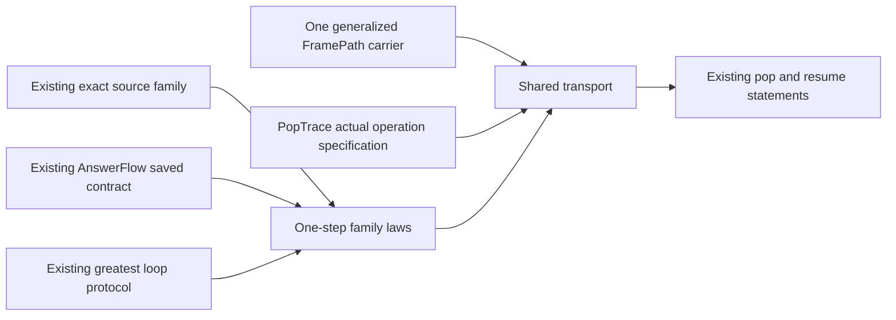

# AnswerFlow family seam investigation

The checked control shows why the direct inductive connector is too strong for a safe continuing loop.
Use an external frame contract family with one-step closure laws.
Keep the existing Timeout source family as an instance.
Keep one frame-path carrier.
This note proposes a proof interface, not an amendment to a frozen statement.

## Placement

Concepts: residual-program-typing R4 and scope-lifetime-finalization R11.
Question: shared native frame transport serves Timeout's existing source and numeric goals without duplicating the pop traversal.
Proof role: shared contract interface investigation.
Evidence status: checked control and checked one-step instance; proposed generic interface.
Scope: existing primitives, their actual callbacks, and saved frame lists.
Limits: no reached history, attempt-count bound, progress, fairness, or outside-runtime agreement.

The consumer remains `HostTimeoutFrames.pop_from` and its actual resume consumers
(`Test/Dogfood/Proofs/HostTimeoutFrames.lean`).
The numeric producer still owes the original `Timeout.retries_declared` and `Timeout.cleanup_keeps` goals
(`Test/Dogfood/Scenario/Timeout.lean`).

## Checked obstruction

`Test.Machine.AnswerFlowLoop.not_saved` (`Test/Machine/AnswerFlowLoop.lean`) uses unit alphabets and an actual primitive interpreter.
Its loop always returns a successful unit body and saves the same loop again.
Its value, cause, and code predicates accept every value of their unit alphabets.
Its finalizer lookup returns none.

The actual `Prim.armA` equation passes a kernel control.
Mutual induction over `AnswerFlow.SavedAt`, `StackAt`, and `ResultAt` proves that this loop has no inductive saved contract.
The induction follows the actual answer callback into its returned saved-loop proof.
It would require a smaller proof of the same excluded loop.

This is a generic interface control.
It does not show that Timeout's concrete bounded loop runs forever.
It does not change any source predicate or goal statement.

`loop_step_closed` in the same battery proves a one-step family instance for the exact same loop.
`loop_protocol` proves membership in the existing greatest-invariant carrier.
Thus the interface can state partial correctness of each resume without claiming termination.

## Existing theory to reuse

`Contracts.FrameProtocols.loop` (`src/Effect4/Laws/Program/Typed/Contracts.lean`) is a protocol premise closed over later worlds.
It does not embed an inductive proof of each future saved loop inside its frame constructor.

`Contracts.Greatest` in the same file is the greatest predicate closed under a step.
Its coinduction theorem admits a supplied invariant and its one-step closure law.
The file explicitly distinguishes safe continuing loops from the least fixed point.

`LoopStep` and `LoopProtocol` (`src/Effect4/Laws/Program/Typed/Residual.lean`) instantiate that theory at actual loop resumes.
They retain the future world, completed view, incoming answer, returned body, and next cursor.
`docs/core/semantics.md` records this protocol-directed continuation route and the separation between invariance and progress.

## Proposed interface

Let `P world input output frame` be an external predicate over the existing primitive frame.
An interface supplies its one-step laws rather than constructing another recursive proof inside `P`.

| Law | Actual operation and premises | Required result |
| --- | --- | --- |
| value skip | absent value arm; incoming admitted value | admitted value at the next class |
| cause skip | absent cause arm; incoming admitted cause | admitted cause at the next class |
| value answer | actual `armA`; admitted incoming and provided exits; absent installed program | admitted returned code and a path over `P` for the actual pushed frames |
| cause answer | actual `armE`; admitted delivered and provided exits; absent installed program | same result at the saved output class |
| native finalizer | actual installed program; admitted captured exit | admitted installed code at the saved output class |
| discard | actual interrupted handler and `skippedCause` equation | admitted actual sanitized cause at the next class |

Keep future-world premises wherever the existing semantic contract reads them.
Keep pending-cause admission and native-finalizer interception explicit.
Do not infer either premise from the existence of a saved frame.

The shared pop transport can additionally take a predicate on intermediate classes.
The semantic instance uses admitted incoming values or carried causes.
The exact Timeout source instance uses input-class equality at a value pop.
This retains the stronger source witness without strengthening every semantic frame contract.



## Path ownership and migration

`Contracts.FramePath` currently fixes its objects to `EffTy` and arrows to `ScopeFrame`.
Native frame families need `Kind` and `Prim` at the same categorical interface.
Generalize that existing carrier's parameters and laws before introducing a native instance.
Retain the current specialized statement names through connectors or specializations.
Do not add a second native path library.

The source family already has one-step callback theorems:
`HostTimeoutFrames.value_arm` and `cause_arm` (`Test/Dogfood/Proofs/HostTimeoutFrames.lean`).
The loop case returns its actual code and constructs its next source `SavedAt.loop` directly.
It does not recursively construct a semantic saved-contract proof.
These theorems supply the source instance's answer laws.

The existing `AnswerFlow.SavedAt` constructor supplies the semantic instance's laws through its fields.
Its current statement remains available as a sufficient family instance.
The new interface need not assert that every safe family converts back into that inductive contract.
The checked loop control refuses that assertion.

Move the pop and resume consumers to the family interface in the same slice that introduces it.
Delete their old proof chains in that slice.
Retain their exact source predicates, theorem types, assumptions, and stronger source witnesses.
A callback-family connector is not the missing numeric history producer.

## Verification

```text
LEAN_NUM_THREADS=3 lake build Test.Machine.AnswerFlowLoop
Build completed successfully (445 jobs).

LEAN_NUM_THREADS=3 lake env lean -DwarningAsError=true /private/tmp/answerflow-loop-audit.lean
#axiom_audit: 10 declarations within [propext, Quot.sound], 0 of them modulo planned goals; 0 planned goals
```

The coordinator adds `Test.Machine.AnswerFlowLoop` to `Test/All.lean` when retaining this battery.
No executable definition changes.
No outside-runtime gate is owed for this control.
