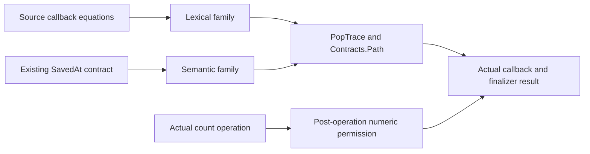

# Native callback family proof receipt

The original Timeout retry and cleanup goals remain open.
This slice replaces saved-stack transport proofs with one external callback family.
The coordinator must add the new reader to `Test/All.lean` and run the acceptance build.

## Placement

Concept: store-typing R4 and scope-lifetime-finalization R11.
Question: `HeapSites.heap_sites_keep`, `Timeout.cleanup_keeps`, and `Timeout.retries_declared`.
Consumers: the existing semantic resumers, lexical native transport, and the actual Timeout count binder.
Reach: existing primitive frames, actual pop results, future worlds, and the existing ordered path.
The family supplies no reached-history producer, source admission, current-code weakening, or progress.



## Contract

`AnswerFlow.Model` stays unchanged.
`SavedFamily` parameterizes its saved edges over existing primitive frames.
`FamilyResult` retains current code and the existing `Contracts.Path`.
The family has six callback obligations.

1. Missing value arms transport the actual incoming value.
2. Missing cause arms transport the actual incoming cause.
3. Value arms consume actual supplied exits and absent finalizer interception.
4. Cause arms consume actual supplied exits and absent finalizer interception.
5. Installed finalizer programs consume the actual delivered exit.
6. Interrupted handlers transport the cause from the actual sanitize equation.

Every callback obligation quantifies the permitted future world.
Mask insertion remains an explicit identity-edge premise.
Crossing a store update requires an edge map through `Contracts.Path.map`.
The semantic instance uses `saved_mono`.
The lexical instance keeps its world-independent source predicate.
No fact weakens arbitrary current code across a future world.

## Consolidation

`AnswerFlowPop` and `AnswerFlowCausePop` retain their old theorem names and statements.
Their pop, callback, and finalizer bodies delegate to the external family.
`NativeFrameScope.popFrom_at` removes its private induction and consumes `PopTrace.Family`.
Its value and cause resumers consume the lexical callback family.
The source callback equations remain the local producers.
Recursive lexical callbacks need no finite inductive `SavedAt` construction.
The existing native current-code proof remains unchanged.

## Retained bytes

Worktree base: `125865d206dfedd3434d460010366f4fd136d84b` with checked coordinator dependency copies.
Reviewed coordinator checkpoint: `1591530e9978b1d1d07c5646f093f55d923294b1`.
The three replaced files match the coordinator bytes before this patch.
The patch contains six explicit proof and reader paths.
It changes no machine behavior or root import.

| Path | Lines before | Lines after | SHA256 |
| --- | --- | --- | --- |
| `src/Effect4/Laws/Machine/AnswerFlowFamily.lean` | 0 | 117 | `e59bf150e90085536bfd00b9aa582d85d4309c64839a7954b928e0bdbc820fc7` |
| `src/Effect4/Laws/Machine/AnswerFlowFamilyPop.lean` | 0 | 300 | `6aa5d2adcef05f5376431fe9d152f6b4f783d0ba19a6fa8b9811cd6ef1bc63e1` |
| `src/Effect4/Laws/Machine/AnswerFlowPop.lean` | 156 | 122 | `07a78c4438947b0a6d1ea4d886c08004581ef03c039bac6e53cfe99d67f909dd` |
| `src/Effect4/Laws/Machine/AnswerFlowCausePop.lean` | 182 | 113 | `e159d886b6669220730345b2a2fe6a9c2bca03b0247a87a58761e533f8e2d93d` |
| `src/Effect4/Laws/Program/NativeFrameScope.lean` | 254 | 333 | `cb6d7a96f080836787a98013d5de6641804c2b568da630718f185c42e0a06426` |
| `Test/Dogfood/Proofs/AnswerFlowFamilyReader.lean` | 0 | 51 | `216d06b11aea851fa9dc8c80e15997a88d0708f272f9eae7163edb096ff4b79d` |

Patch: `/private/tmp/answer-flow-family.patch`.
SHA256: `a18c9b1f980299c9d66eaf350113236e14575ca2b9b352305e9f2f6cda1f7028`.
Snapshots: `/private/tmp/answer-family-check/`.
No patch includes the unchanged dependency copies.

## Checks

Each changed module compiles privately with `LEAN_NUM_THREADS=1` and `-DwarningAsError=true`.
The overlay precedes the checked worktree artifacts on `LEAN_PATH`.
These are isolated proof checks, not a whole-library acceptance.

```sh
LEAN_NUM_THREADS=1 lake env sh -c 'LEAN_PATH="/private/tmp/answer-family-check:/private/tmp/timeout-shared-check:/private/tmp:$LEAN_PATH" lean --root=/private/tmp/answer-family-check -DwarningAsError=true -o <output> <source>'
```

Accepted logs:

- `/private/tmp/answer-family-none-check.log` checks the shared core.
- `/private/tmp/answer-family-resume-check-3.log` checks the shared pop and resumers.
- `/private/tmp/answer-family-semantic-pop-check-2.log` checks the unchanged semantic value headers.
- `/private/tmp/answer-family-semantic-cause-check-2.log` checks the unchanged semantic cause headers.
- `/private/tmp/answer-family-native-final-check.log` checks the lexical consumers.
- `/private/tmp/answer-family-production-reader-check.log` checks the intended reader module.
- `/private/tmp/answer-family-number-counted-check.log` checks the unchanged actual count-entry consumer.

The production reader checks the actual Timeout source and its actual count binder.
Its control refuses a failure exit at the real pre-body unit class.

```sh
LEAN_NUM_THREADS=1 lake env sh -c 'LEAN_PATH="/private/tmp/answer-family-check:/private/tmp/timeout-shared-check:/private/tmp:$LEAN_PATH" lean --root=/private/tmp /private/tmp/AnswerFlowFamilyProductionAudit.lean'
```

Result: 209 declarations within `[propext, Quot.sound]`, zero modulo goals, and zero planned goals.
Output: `/private/tmp/answer-family-production-audit.log`.
The earlier 202-declaration audit predates the common finalizer-absence clause and the admission control.

A mechanical header comparison retains all 30 existing theorem headers in the three replaced modules.

## Remaining producer

The numeric instance must assign actual root, attempt, and timer owners from source-qualified births.
It must retain actual captured cells and the retry cursor.
The pre-count prefix uses the original budgets through `StackRegion` and `LiftPrefix`.
Live numeric positions retain their exact current image.
Retired exits retain persistent cleanup evidence from the actual source operation.
A completed race restores its result through an already-exited attempt or an actual completed loser join.
A timer-only join supplies no attempt membership.
Returned-form permission precedes the next retry cursor.
The actual source test must establish declared failure before that cursor advances.
This slice transports those permissions; it does not produce them from every history.
