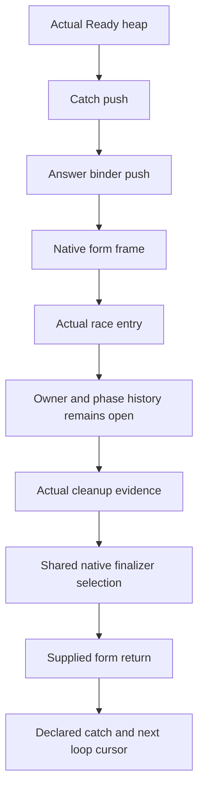

# Timeout entry and native form connections

The original cleanup and retry claims remain open.
This slice joins checked local producers under the shared ordered callback laws.
Read the newest audit before applying the source patches.

Concept: scope-lifetime-finalization R11 and translation-simulation R10.
Question: Timeout.cleanup_keeps and Timeout.retries_declared in Test/Dogfood/Scenario/Timeout.lean.
Role: shared helpers and concrete source instances.
Scope: actual source captures, supplied exits, native finalizer selection, and the stated heap phase.
Consumer: the joint generation history through the existing command and decision contracts.
The local results supply no reached-history, token, allocation, progress, or public-cut claim.

Retain the existing semantic and lexical theorem statements.
Use shared success and failure push laws for their existing frame branches.
Map existing path endpoints to join native cleanup and root callback classes.
Handle actual native selection once, then replace the two form-finalizer reductions with adapters.

The current entry constructors require the actual Ready heap.
Their saved output classes describe the expected next generation.
Those classes do not assert that its count or cleanup write has already executed.
Retain the actual cleanup hook in the mixed model.
Keep raw cleanup causes separate from the declared-failure retry policy.

Compile the shared and lexical consumers first.
Compile the retained numeric dependencies in import order against the integrated source.
Remove only the obsolete Pending field from the retained registration literal.
Audit the shared modules and all retained numeric instances together.
No executable definition changes, so this slice owes no behavior comparison.
