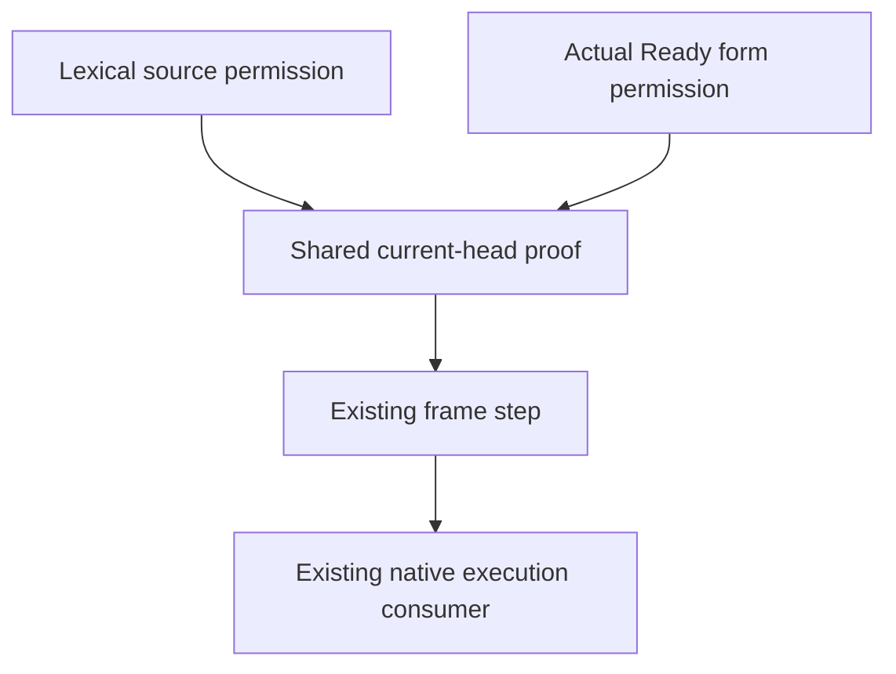

# Shared current-head permission

Concept: store-typing R4 and scope-lifetime-finalization R11.
Question: HeapSites.heap_sites_keep and the original Timeout numeric history goals need actual current-head permission.
First consumer: NativeFrameScope.frame_step_at retains its existing lexical statement.
Second consumer: TimeoutReadyEntryProbe.form_entry consumes the same proof for its actual onExit push.
Reach: existing native code, the present store, and ordered saved edges.
Actual return producers retain the supplied exit and selected current head.
The pure frame step establishes no executed native store effect.
PrimitiveProducer continues to own actual native execution.

Replace the existing lexical frame proof with the shared frame theorem.
Keep every existing lexical and Ready theorem statement.
Retain the distinction between pure frame sync and executed native sync.
Build the affected native consumer and the actual numeric readers.
Audit the affected modules at the existing trust ceiling.
Finish this slice after the readers, header comparison, and audit pass.
Reached permissions, completed cleanup, and public command room remain open.
