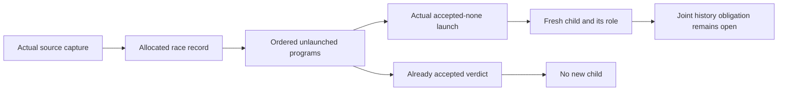

# Actual race allocation and launch

The original Timeout cleanup and retry claims remain open.
Read the newest audit before this slice.

Concept: scope-lifetime-finalization R11 and translation-simulation R10.
Question: Timeout.cleanup_keeps and Timeout.retries_declared in Test/Dogfood/Scenario/Timeout.lean.
Role: shared source producers and concrete numeric consumers.
Reach: actual race action, source capture, unlaunched program head, accepted verdict, and fresh child lookup.
Consumer: the joint generation assertion through the existing command and decision contracts.
These local producers establish no reached-history assertion, cleanup completion, retry permission, or public-cut budget room.

Enrich the existing race allocation proof with its actual record and parameterized program permissions.
Retain all previous source transport statements as adapters.
Keep actual launch equations in the shared Clauses bank.
Assign a child only when the accepted-none launch executes.
An accepted race with an unlaunched head leaves that head without a child role.

Replace the retained numeric probe's private clause import with the production Clauses module.
Build the changed modules and their direct consumers on the integration branch.
Compile the numeric ownership reader against those outputs.
Audit the shared producers and actual reader together.
No executable definition changes, so this slice owes no behavior comparison.
