# Timeout public-cut room

The local count prefix needs four remaining commands. Its fresh scheduler counter does not supply them.

Concept: reactive-scheduling and scope-lifetime-finalization R11.
Question: `Timeout.cleanup_keeps` and `Timeout.retries_declared`.
Reach: compile4000, drive2000, original cleanup scripts and plain retry scripts.
Consumer: `HostTimeoutNumberCounted.count_prefix_region`, then the joint reached assertion.
This plan states no completed history, progress, or fixed command bound.

## Boundary

A public cut is the machine retained after a complete public move calls driveState2000.
Fuel exhaustion retains a live command residue.
A local scheduler cut instead follows the acting fiber's maxOpsBeforeYield and currentOpCount.
These boundaries have different counters.

The exact launch equation queues evaluate(child), enrollRace, then launch(remaining).
Evaluate installs running=true and currentOpCount=0 before the child loop.
That reset supplies the local count+3 scheduler premise under inherited maxOps2048.
It supplies no lower bound on remaining drive fuel.

Let u be the commands consumed since the current public drive starts.
At the evaluate(child) head, the needed conclusion is u+4<=2000.
At its following loop(child) head, the needed conclusion is u+3<=2000.
The assigned child must retain its source entry, absent deferred interruption, and absent yield override.
These facts must arise before the public cut exposes that child.

## Joint potential

Use the existing PlaceLedger places and command/task/frame weight folds.
Track the pending public word, acting current code, saved callbacks, unlaunched race programs, and detached tasks.
Retain source generations and the actual partial race allocation separately from those weights.

Let P be the remaining command-work potential of the current drain episode.
Let U be its consumed-command count, initially zero.
Establish U+P<=B at the public entry from the actual history, with a symbolic bound B<=2000.
Every actual command consumes one unit and retains U+P through shared command accounting.
When evaluate(child) begins the count entry, its potential must include at least four units.
Then U+4<=U+P<=B<=2000.

The loop(child) head retains three units for the known count chain.
Use count_prefix_region and LiftPrefix for the arbitrary remaining suffix.
Do not reintroduce a fixed4+1996 proof producer.

A mere nonnegative potential is insufficient.
The critical four-unit reservation must remain attached to the actual assigned child and command head.
An allowance issued whenever a loop acts supplies no finite B by itself.
The finite B must arise from source permission and its decreasing generation or list positions.

```mermaid
flowchart LR
    A[Public move entry: U=0 and P<=B] --> B[Actual shared command debit]
    B --> C[Accepted-none launch: assigned child]
    C --> D[Evaluate child: four reserved units]
    D --> E[Loop child: three reserved units]
    E --> F[Count committed through LiftPrefix]
    F --> G[Registration installs waiting cancellation]
    G --> H[Public cut after complete critical sequence]
```

## Phase reservations

| Phase | Required source position | Remaining work reservation |
| --- | --- | --- |
| Initial capture | three actual returned reference keys | allocation callbacks and initial loop entry |
| Ready | exact Fin4 cursor and saved root loop | the next declared test, race registration, and entrant entries |
| Pre-count | accepted-none assigned attempt, exact onExit entry | evaluate plus three count loops |
| Active | count committed and live attempt identity | host exit processing, protected cleanup, and race observation |
| Cancellation | actual race plus remaining live targets | bounded interrupt walk, attempt cleanup, and join restoration |
| Cleaned | actual attempt exit or completed join containing it | form publication and its selected-exit restore |
| Published | exact returned form and successor cursor | finish or the next Ready entry |

Each local work coefficient must come from an existing exact prefix or checked command debit.
No numerical coefficient or global B is assumed in this plan.

The source bounds generation advance by the actual Fin4 cursor, not by the observed count cell alone.
Race launch and cancellation list positions decrease through their actual head/tail equations.
Early acceptance leaves unlaunched roles absent.
The join cannot reserve attempt cleanup merely from a timer-only target list.

## Existing candidates and missing facts

StackRegion and LiftPrefix carry the known count region and arbitrary remaining budget.
The actual race launch reader retains its ordered programs and assigned child.
The numeric callback family retains Fin4 source cursors and actual selected exits.
PrimitiveProducer retains executed sync operations and their returned frame.
The existing place accounting supplies the shared places and folds.
The first PlaceFunding.command_funded instance assumes NoQueue and assigns zero race, command, and task weights.
It cannot fund the nonzero pending work proposed here.
A joint instance must supply precise transfers for those places through the existing shared fold.
Retain the zero-place theorem as its existing instance.

SourceOpportunityHistory.history_budget excludes this loop/race route.
Its Fragment and race-free premises cannot be substituted.
Its opportunities can contribute weights only where this actual source permission supplies their premises.

The first missing potential fact is a decreasing work credit for the actual recursive root cursor.
The generated PrimAlgebra already retains both iterator and whileLoop cursor arguments.
PrimWeights.currentAlgebra chooses to ignore those arguments.
Instantiate that existing algebra with argument-sensitive iterator and whileLoop fields.
Prove the actual source/cursor debit and finite funding through the shared place accounting.
The representation needs no extension and no additional current-code traversal.

The second missing fact is the actual public-entry funding bound for pending commands and detached tasks.
The same reached assertion must establish bounded live roles, queued callbacks, and pending registrations.
Local numerical Image permissions alone do not establish those queue facts.

The third missing fact is critical-prefix reservation across public controls and deferred/yield handling.
A forced verdict at an exposed cut may be consumed before the count prefix.
That ordering must follow from the actual source and command path.
It cannot be assumed from a plain-script premise because cleanup covers all original moves.

Until those facts check, neither the four-command room nor the absence of public residue is proved.
