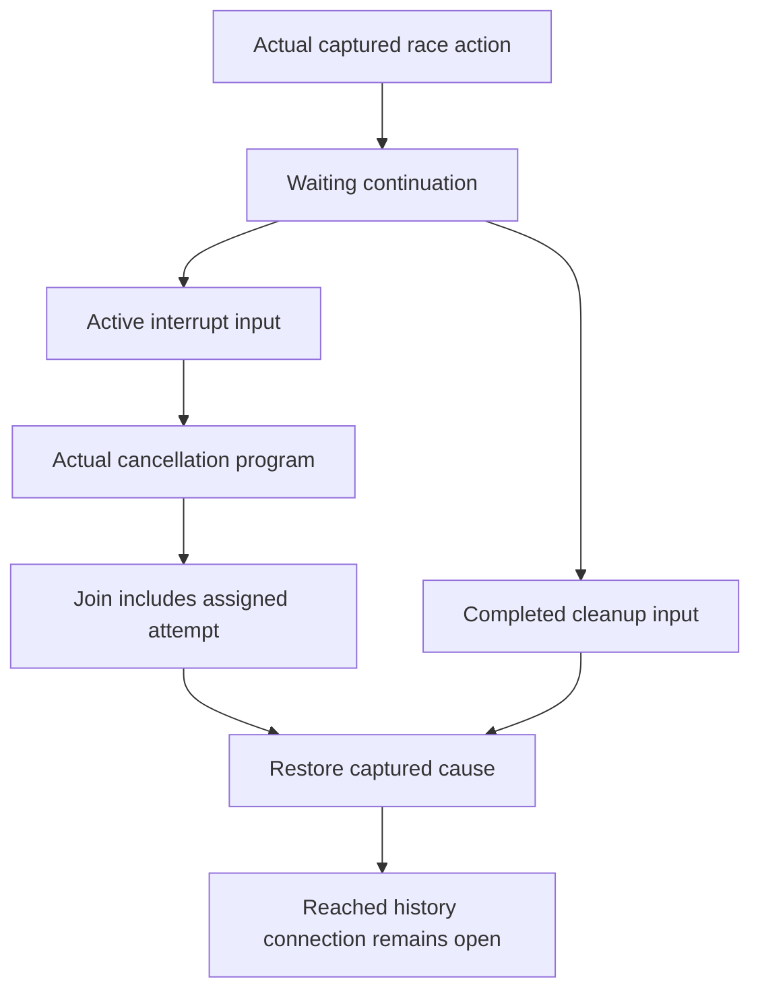

# Actual race waiting and cancellation input

The original Timeout cleanup and retry history claims remain open.
Read the newest audit before this slice.

Concept: scope-lifetime-finalization R11 and translation-simulation R10.
Question: Timeout.cleanup_keeps and Timeout.retries_declared in Test/Dogfood/Scenario/Timeout.lean.
Role: local producers for the joint generation history assertion.
Reach: actual source capture, current action, absent park hook, returned waiting continuation, and race registration.
The cancellation reader also retains the actual cause and a completed join containing the assigned attempt.

Add the exact withFiber action equation to the existing Clauses bank.
Keep its actual current head, absent park hook, and successful action result as premises.
Read that equation from the waiting instance without repeating the evaluator cases.
Use the same race record and captured program permissions for waiting and ownership.

The future cleanup class does not assert an executed cleanup write.
A waiting success or noninterrupt failure needs an already completed cleanup image.
An actual interrupt may enter cancellation with the active image.
The existing numeric family gains this distinction without changing its earlier phase meanings.
Its actual re-failure callback retains the original cause after cancellation finishes.
The settlement callback retains the actual selected exit through masked cancellation.
Its reader requires an already exited attempt or a completed join containing that attempt.
A timer-only join cannot supply the assigned attempt's retirement witness.

These producers establish no reached-input fact, completed cleanup writer, public command room, or progress.
The public cut and actual retirement producer remain separate obligations.
The host boundary stays unchanged.

Build the changed shared module before checking its actual numeric readers.
Batch its direct-consumer build with the shared command integration.
Check existing numeric readers after extending their input class.
Retain earlier phase meanings and theorem headers.
Audit every landing module and its actual reader.
This proof slice changes no executable definition and reaches no behavior gate.
