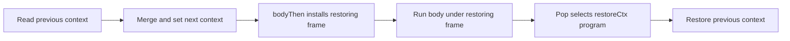

# Typed context reader and providing region

The ratified repair changes object-language syntax and the type of context values.
It retains native administrative context reads and writes for region entry, restoration and captured finalizers.
A stack-only context relation misses actual installation and restoration phases.
The B6 invariant must include those existing callbacks and active restoration programs.

## Authority and scope

Decision row 349 ratifies option A.
The design follows `context-transformers.md` sections 4 and 6 in the machine-from-the-base packet.
`TyCore.lean` owns the constructor carrier rule.
`docs/GENERATED.md` owns generation order and output ownership.
`docs/core/semantics.md` owns context-requirements and scope-lifetime-finalization.
`docs/DESIGN-BASIS.md` DB-12 requires one context per fiber.
`wire-tags.json` owns active and retired tags.
`conservativity.py` owns constructor retirement and verdict migration policy.

This slice adds research files only.
It proves row facts and checks type signatures against existing native producers.
It neither implements the new checker nor closes the context invariant.
No new program representation, source widening or private evaluator pass enters the slice.

## Proposed canonical signatures

| Owner | Change | Meaning |
| --- | --- | --- |
| `Program.TyCore` | append `Ty.contextOf (keys : Requirement)` | a context promises every key in the canonical row |
| `Program.Eff` | retire `ActionTerm.getContext` and `ActionTerm.setContext`; append `ActionTerm.context (keys : Requirement)` | read the current context with its selected row |
| `Program.Eff` | append `Eff.provideContext (context : Term) (body : Eff Op)` | merge the supplied context around the body |
| `Program.Checker` | reader answers `contextOf keys`, error `never`, requirements `keys` | reading a typed context requires its keys |
| `Program.Checker` | region checks the term at `contextOf supplied`, checks child zero, subtracts `supplied` | keep the body's answer and error; remove only promised keys |

The context term and body introduce no binders.
The body uses child zero, as `provideService` does.
The row remains the existing `Requirement`, an alias of canonical `Row ServiceKey`.
The new type is appended; it is not encoded as target text or an application of an unrelated type.

Current `Ty.context` is a definition of `.handle Ty.contextTarget`, not a constructor.
That source alias must migrate to the row-bearing type.
A bare `.handle Ty.contextTarget` must not provide evidence for `contextOf keys`.
Otherwise declarations could recover the same unchecked context promise through a legacy handle spelling.
Internal layer answers migrate to `contextOf layer.out`, rather than treating every layer result as an untyped context.
The signature supplies the service carrier of each promised key.

Subtyping follows rc.112's contravariant `Context<in Services>`.
`contextOf available` is below `contextOf promised` when `promised.Subset available`.
Structural value membership checks decoded context shape and promised key presence.
Semantic value membership also retains the existing world-indexed service-value fitness for every actual binding.
These conditions stay distinct; key presence alone does not type service values.
Foreign reply admission must keep context values internal, as it does for the current context handle.

The first public slice adds only merge provision.
The internal replace action remains context-transformer metadata and native machinery.
A future exposed replace region must check its whole body requirement against the supplied row.
The raw setter is never reintroduced as a sequential source action.

## Existing execution route

The reader compiles through `EffThunk.getCtx` and the existing `WithFiberAction.getContext`.
Its selected row changes source typing, not the context value returned by the machine.

The region evaluates its context term and decodes `Val.context?`.
It follows `provideLayerBodyK`'s exit short circuit and context provision.
For a non-exit body it calls `updateContextAt (.provide supplied.services) (.program childZero)`.
The existing `updateThenK` uses a right-biased merge and recomputes the context caches through `Ctx.withServices`.
It retains the identity shortcut for a nonempty previous map merged with an empty supplied map.
`bodyThen` installs `onExit body (restoreCtx previous) false`.
The existing finalizer program restores `previous` through administrative `setCtx`.
Failures retain pre-failure state and still take the finalizer route.
Forks copy the current context through the existing spawn rule.
No new action in `Machine.Fibers` is needed for this source cut.

The non-identity path has these actual callback phases:

## Placed obligations

These are proposed semantics registry placements for the implementation slice.
They introduce no planned goals in this research-only slice.
Each implementation pointer replaces its own planned goal in place.

| Claim and role | Concept and required property | Reach and hypotheses | Consumer and limit |
| --- | --- | --- | --- |
| `typed-context-reader`, preservation | context-requirements; presence at a typed read | admitted row-bearing reader, context satisfies its row, service values fit the world | typed compile/read clause; not presence at all other positions |
| `provide-context-row`, preservation | context-requirements; provide-discharges | typed supplied context and typed body; ambient satisfies the row difference | region checker and call typing; not dynamic restoration |
| `provide-context-region`, preservation | scope-lifetime-finalization; region bracket | actual merge/entry/restoring-finalizer route, shared region transport | region exit proof; not termination or completion |
| `ctx-chain`, preservation | context-requirements; context matches its open regions | admitted repaired source; native current callbacks, ordered saved frames and actual restoration phases | B6 and row 117 presence; not progress |
| `param-context-transformer`, preservation | context-requirements; parameter starts under its site's action | checked definitions, declared parameter transformer, actual invocation/parameter route | higher-order call rule; not source completeness or printing |
| `call-requirement-transformed`, preservation | context-requirements; provide-discharges at calls | invocation context satisfies transformed call row; every replace action covers the callback row | HO3-REQ-01 and R9; not target execution |
| `context-transformer-print`, compatibility | context-requirements; emission-requirements-complete | checked transformer and supported printed type signature | HO3-REQ-01 and generic callback headers under tsgo 7; not machine preservation |

R5 and R9 use the context claims; R11 uses the restoring-region claim.
The shared M6 invariant transport supports their admission-to-execution connection.
The implementation adds the new properties to semantics and their registry placements in the same slice.
The research placement does not mark those claims proved.

## B6 and transformer shape

`CtxChain` must use existing current code, callback names and ordered frames.
`updateThen` sets the next context before `bodyThen` installs the restoring frame.
A finalizer pop removes that frame before `restoreCtx` finishes its program.
A relation over saved stacks alone cannot cover either cut.
Fork bases are the actual copied context at the fork, not the root context.
Captured releases enter their captured context and restore the interrupted owner's previous context.
The relation must track these actual producer phases, without a second execution carrier.

Use shared `AnswerFlow` for kind-indexed callbacks and ordered saved kinds.
Use `PopTrace` and the labelled move transport for frame removal and installed finalizer programs.
Use the existing interference law for other fibers and R2's coordinated write-back repair.
Use shared `DecisionLift` composition for history; add no new per-scenario command pass.
A source typing clause supplies each region's context update.
The invariant connects that update to the actual live context and restoration callback.

A parameter transformer uses first-order metadata over the existing canonical rows.
Its mode inherits the invocation context or replaces it with a fixed row.
Its supplied row adds keys in either mode.
Composition applies the outer action first, then the inner action.
A replace action discards the preceding action; later inheritance unions its supplied keys.

For a callback row `required`, inheritance charges `required` minus supplied keys.
Replacement refuses unless its fixed and supplied keys cover `required`.
A header with multiple sites charges the union of their remaining rows.
Each replace site must separately pass the coverage test.
Recursive definitions use declared transformer metadata and a checked body contract first.
Finite inference may follow; no unbounded inference enters this first slice.
The implementation uses the existing source path fold for site actions.
It does not hand-walk definitions or create another program tree.
The printed inheritance result is `Exclude<R, Supplied>`; replacement is a generic bound.

## Generated and compatibility migration

1. Append `Ty.contextOf`, `ActionTerm.context` and `Eff.provideContext` at the ends of their declarations.
2. Retire source `setContext` tag 12 and `getContext` tag 13 in the ActionTerm wire family.
3. Keep those numbers reserved. Assign fresh tags to every appended constructor; move no surviving constructor.
4. Add binder rows for the new action and region; the region's body adds zero binders.
5. Update the profile from raw machine-only setter to supported typed reader and region.
6. Regenerate `derived`, then `lcnf`, `eff`, `wire`, `cas`, `ts` and `readme` in the existing order.
7. The derived manifest rebuilds Ty equality/extras/view, program folds, node lenses, binders, scoped views, authoring lifts and codecs.
8. Ty folds name the new row-bearing leaf explicitly; formation, normalization, subtyping, membership and profile admission receive named clauses.
9. The LCNF roots stay in `ocaml/gen/roots.json`; their changed closure includes the revised program and type declarations automatically.
10. Regenerate all four LCNF artifacts before `eff` rebuilds the engine's structure mirror from `api_engine.ml`.
11. Regenerate the OCaml codec, manifests, goldens and engine layout; edit no generated ML file by hand.
12. Update `ocaml/engine/layout-allowance.json` only for a measured bridge requirement; do not hide an unsupported carrier shape.
13. Update TypeScript templates, writer and source reader together: `Effect.context<Row>()` and `Effect.provideContext(body, context)`.
14. Record named constructor retirements and affected CE001 vector/verdict migrations in the existing compatibility policy.
15. Keep bytes and verdicts for every unaffected baseline fixture. Add new vectors for typed contexts and the region.
16. Rebuild the case-site inventory, inspect each new default cover, and update `tools/Conform/Effect4/cases-policy.json` by reviewed named clauses.
17. Check closure roots, generated state source positions, proof style and traversal bills at integration.
18. At the executable sweep run compiler, native, truth, OCaml, target and TypeScript-reader gates reached by this change.

No baseline fixture is rewritten or promoted during this research slice.
The implementation retains the old CE001 witness as legacy bytes and refusal controls.
A source file naming retired constructors must migrate, rather than silently translating raw writes into a different effect.
The replacement region control merges a captured empty context and retains the provided service.

## Proposed ownership partition

| Seat | Exact primary owners | Boundary |
| --- | --- | --- |
| source/type lane | `Program/TyCore.lean`, `Program/Ty.lean`, `Program/Eff.lean`, `Program/Checker.lean`, `Program/Typed.lean`, formation and annotation clauses, generator input JSON | canonical source and checker; coordinated generated outputs |
| source/compiler lane | `Program/Compile.lean`, source typing and native source-provenance consumers | reuse existing context producers; no `Machine/Fibers.lean` edits |
| target lane | `Codegen/Types.lean`, `Codegen/Templates.lean`, source read/print clauses, TypeScript ingest reader | typed row text and real target signature |
| coordinator | root imports, lakefile, decisions, compatibility policy, LCNF/OCaml sweep and final merged gates | reconcile source/target cuts |
| existing machine seat | `Machine/Fibers.lean` R2 edits | no typed-context overlap |
| existing root lane | labelled moves, PopTrace and Footprint | context proof consumes those laws |

The next source slice needs agreement on this partition before any core edit.
