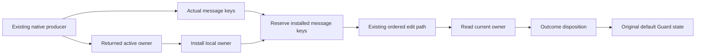

# Guard R2 proof receipt

The original native settlement and reached-history statements keep their headers.
Their proofs now consume the actual addressed-message order.
The coordinator must run the joint full Laws build before committing the runtime patch.
This lane supplies proof patches only.

## Base and scope

Base: `125865d206dfedd3434d460010366f4fd136d84b`, containing coordinator checkpoint `f821dd533`.
This work uses the frozen R2 runtime patch and checked dependency copies.
No executable patch enters this proof delivery.
No push occurs.

Concept: reactive-scheduling, R4, and scope-lifetime-finalization, R11.
Question: the existing reachable guard ownership and command authority claims retain their observations under actual native messages.
Proof role: the actual producer capability, message transport instance, and native settlement composition.
Evidence status: checked Lean proofs and one checked raw-state control.
Reach: arbitrary native source parameters, stores, returned fibers, row tables, and explicit local validity premises.
The actual command endpoints retain their original hypotheses.
Limit: arbitrary message words have no producer provenance.
The proof establishes neither progress nor an outside-runtime simulation.
The original Timeout numeric history goals remain open.

## Composition

`NativeState.NativeStep` extends the existing producer classification with `Messages.MessageKeys`.
The existing source census supplies that capability once.
`NativeState.StateStep.races` also carries the actual race-host observation.
The old state theorem names remain projections.

`GuardState` and `FiberGuardState` use one optional active-owner parameter.
Their default instance retains the original idle obligation definitionally.
The active instance permits the local running owner to be parked during message interpretation.
The final outcome removes that exception.

`Messages.GuardEdge` supplies payload premises to the existing `Contracts.Path`.
`Edits.fiberWords_path` records each interrupt against its actual prefix lookup.
`Edits.run_preserves_at` composes the existing Guard instance once.
There is no second edit-word carrier or evaluator.

`Messages.reserved_editKeys_install` derives message reservation from the actual producer and local-owner installation.
`NativeAssembly.guardState_settle_messages` saves the local result before interpreting its addressed messages.
It reads the retained owner from the resulting machine.
`Settle.settledFiber_valid_of_active` then applies the outcome disposition and restores the default Guard state.
The original native and iteration settlement endpoints consume this composition.

The original request-fate endpoints also follow the addressed messages.
They retain a request or its interruption marker through the shared lookup word.
They do not retain an interrupted request by assuming a stale local record.

## Other consumers

The canonical countdown and scope plans replace eager helper unfolding in allocation, memo, and external-request readers.
The memo settlement reader consumes `Edits.settle_keeps`.
The fork observer reader uses constructive transfer facts.
The registration settlement reader consumes evaluate-only commands from `RunMachine.applyFiberEdits_shape`.
All old public history theorem names and statements remain.

The universal `NativeStateLinks` theorems lack an initial Guard-state premise.
They therefore cannot project from the conditional state classification alone.
Their existing census remains for this checkpoint.
It consumes one shared `OtherEdits` request and interruption reader instead of repeating message interpretation.
Moving those universal structural outputs into one common producer result remains open consolidation work.

## Raw helper limits

`Settle.guardState_settle` and `Settle.requestOf_settle_other` now require an empty edit list.
Their old arbitrary-iteration statements are false under R2.
The actual native endpoints use the producer composition and retain their original headers.

`RawMessageControl.lean` starts with a valid loaded machine and supplies one unreserved observer message.
The resulting machine demands `0 < 0` from its key bound.
This is a checked raw-state control.
It is not a reached-source or admitted-history counterexample.

The coordinator separately owns queue helpers and their internal control-domain correction.
Those files do not enter this lane's final four-file proof patch.

## Verification

All commands run sequentially with `LEAN_NUM_THREADS=3`.

| Command | Result |
| --- | --- |
| `lake build Effect4.Laws.Program.Guard.NativeStateLinks` | Pass, 382 jobs. |
| `lake build Effect4.Laws.Program.Guard.NativeStateExternal` | Pass, 380 jobs. Existing heartbeat limit unchanged. |
| `lake build Effect4.Laws.Program.Guard.ForkLedger Effect4.Laws.Program.Guard.RegistrationNested` | Pass, 384 jobs. |
| `lake build Effect4.Laws.Program.Guard.NativeAssembly` | Pass, 390 jobs. |
| `lake env lean /private/tmp/r2-guard-links-audit.lean` | Pass, 1181 declarations, zero goals and zero declarations modulo goals. |
| `lake env lean /private/tmp/r2-guard-assembly-audit.lean` | Pass, 986 declarations, zero goals and zero declarations modulo goals. |
| `lake env lean /private/tmp/r2-guard-raw-message-control.lean` | Pass. |

The first sibling audit finds `Classical.choice` through the fork observer's automatic negated-forall simplification.
The repaired proof disables that simplification and uses explicit constructive transfer facts.
The final combined audit passes within `[propext, Quot.sound]`.

The final four-file patch is `/private/tmp/r2-guard-final-proof.patch`.
Its SHA256 is `9d1318211b564fcf227d83fb1569c8fa4d7f2014a375d9831084b80c6a313d1e`.
It changes `Messages`, `Settle`, `NativeAssembly`, and `ForkLedger` against the coordinator's current working files.
Earlier checked snapshots supply the remaining Guard migration files.
The coordinator owns joint full-Laws verification and runtime behavior gates.
No outside behavior gate result is claimed by this receipt.
