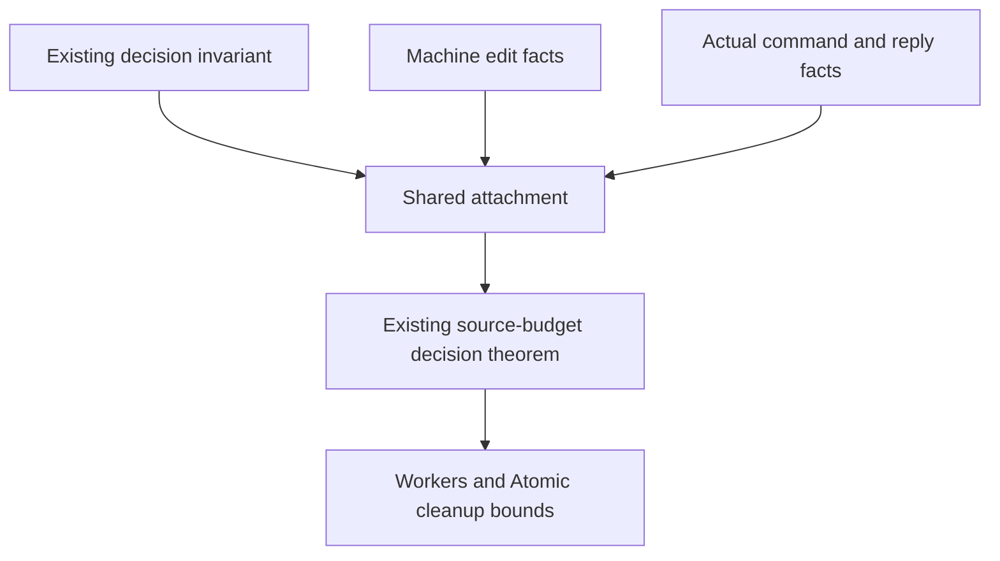

# Attach accounting to an existing decision invariant

Concept: scope-lifetime-finalization, R11.
Question: the original Workers and Atomic cleanup bounds retain their actual source-use budget through every decision.
Role: shared helper of the existing scenario claims.
Consumer: `Opportunities.budget_decision_lift` in `src/Effect4/Laws/Program/SourceOpportunityHistory.lean`.
Later writer accounting supplies the same machine-fact obligations.

The existing `Lift.DecisionLift` carries source ownership, command ownership, and drained tasks.
Attach a machine fact through the existing `Lift.MachineEdits` and actual command preservation.
An actual answer needs its fact after preparation and the first resume.
Keep that premise explicit; source admission alone does not supply it.
The construction keeps the original world and every queue and task premise.

Keep all old consumer statements unchanged.
Remove the source consumer's private thirteen-field construction in this slice.
No machine definition or program representation changes.
A conditional budget invariant establishes no progress or host agreement.
The helper serves R11 through the original application goals and their current source fragment.

Build the shared law, its source-budget consumer, and their direct application consumers.
Audit the changed modules and compare every old theorem statement.
