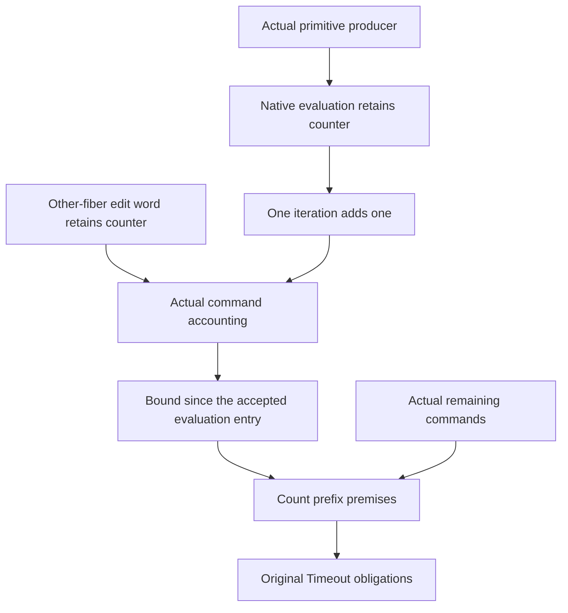

# Operation charges through the shared machine laws

Read `../../AUDIT.md` before this slice.

## Placement

Concept: reactive-scheduling, R11.
Property: the run-loop budget counts actual iterations within one evaluation entry.
Question: the original Timeout numeric producer serves `Timeout.cleanup_keeps` and `Timeout.retries_declared`.
Role: a shared accounting helper for their entry-prefix premises.
Consumer: `count_prefix_region` and `count_entry_typed` in `Test/Dogfood/Proofs/HostTimeoutNumberCounted.lean`.

The property observes `RunFiber.currentOpCount` on the actual returned fiber.
The native evaluator retains that counter.
The iteration adds one before native evaluation.
Other-fiber messages retain the counter.
These facts alone establish neither a command-history bound nor progress through the count prefix.
They leave the host boundary unchanged.

## Design

Read the existing `PrimitiveProducer` in `src/Effect4/Laws/Program/PrimitiveProducer.lean`.
Refine the existing evaluation footprint with its unchanged counter projection.
Retain each existing theorem statement as an erasing adapter.
Enrich the current shared branch proofs instead of repeating their evaluator census.
Read `OtherEdits` in `src/Effect4/Laws/Program/Interference.lean` for environment interference.
Use the actual native scoped-entry and scoped-exit definitions for the native wrapper.
Use the shared iteration definition for its single charge.

Keep the current frame and event classifications unchanged.
Do not add a Timeout evaluator or command census.
Do not infer counter facts from a frame projection that omits the counter.

A command-history bound needs a separate checked connection through actual settlement and commands.
The counter resets at an actual accepted `evaluate` command.
A fresh fiber starts at zero, but freshness alone says nothing about its queue position.
The public drive limit and the scheduler budget remain separate quantities.
A bound below the scheduler budget does not supply the commands needed to finish the count prefix.

## Acceptance

Retain every existing declaration statement.
Build only the shared modules and their actual consumers.
Audit the slice with `#axiom_audit`.
Keep the history connection open until its actual producer consumes these facts.

## Observer update connection

The same R11 operation-counter obligation also consumes actual observer updates.
`Edits.observer_producer_path_metadata` in `src/Effect4/Laws/Machine/EditObserverWords.lean` already classifies their writes.
Its update hook exposes frame equality but omits the unchanged operation counter.
Frame equality alone cannot establish a counter bound.

Enrich that existing producer with the counter equation at each actual update.
Keep its old statement as an erasing adapter.
The new `observer_producer_path_accounting` supplies the shared command ledger's metadata hook.
Its scope remains the actual observer word and its stated local obligations.
It establishes no reached-history bound or progress.
This adds no observer traversal and changes no executable definition.

## Fixed-owner counter instance

The next instance reads one owner's currentOpCount through the existing PlaceLedger fiber field.
Its other places and event weights are zero.
The shared finite-map split identifies its total with the actual owner lookup under distinct fiber ids.
The existing interference relation supplies unchanged counters for old rows and zero counters for newborn rows.
No private evaluation cases are needed.

The native evaluator supplies allowance zero.
The loop supplies allowance one from iteration_currentOpCount.
The shared command law will consume these local debits with its actual metadata and reset hooks.
This serves the same count-prefix budget premise under reactive-scheduling R11.
It supplies neither a bound since a public reset nor remaining command room by itself.
Keep both history obligations explicit.
