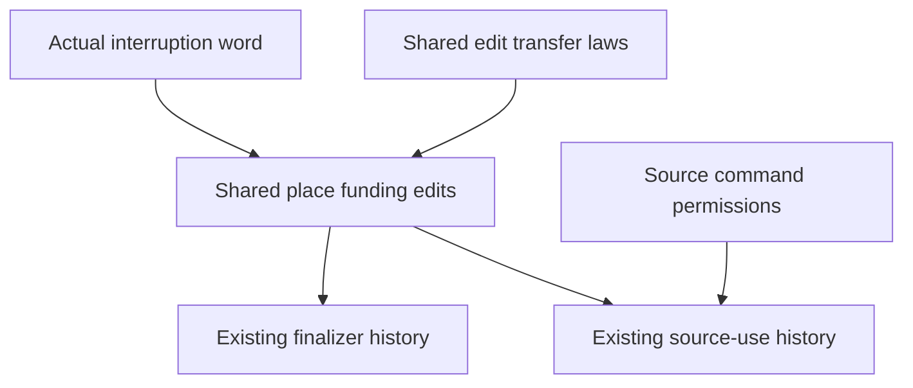

# Shared funding through outer machine edits

The current command theorem does not carry its balance through external decisions.
Each ledger still supplies eight outer edit proofs.

Concept: scope-lifetime-finalization and reactive-scheduling, R11.
Question: the existing finalizer custody claim needs funding at every reachable machine.
First consumer: `StackLedger.edits` in `src/Effect4/Laws/Program/LedgerRun.lean`.
Second consumer: `budget_decision_lift` in `src/Effect4/Laws/Program/SourceOpportunityHistory.lean`.
The Atomic writer instance consumes the same interface after its actual evaluator debit lands.

Reach: frame machine edits, distinct fiber ids, and zero readings for races, commands, and detached tasks.
Clock updates and prepared replies carry explicit state-weight premises.
The source invariant still supplies permission for commands that import code.
These facts establish no source permission, progress, or host observation.

Use the existing edit alphabet and path composition.
Place the interrupt decision's actual event and update sequence beside the existing decision lift.
Make the saved-stack and place-accounting proofs consume that shared path.
Build one `MachineEdits` instance from the existing place transfer laws.
Move `StackLedger.edits` to that instance without changing its statement.
Keep the existing decision lift and its actual prepared-reply obligation.

Finish when both actual history consumers, the header comparison, and the module audit pass.
Retain every old theorem name and statement.

