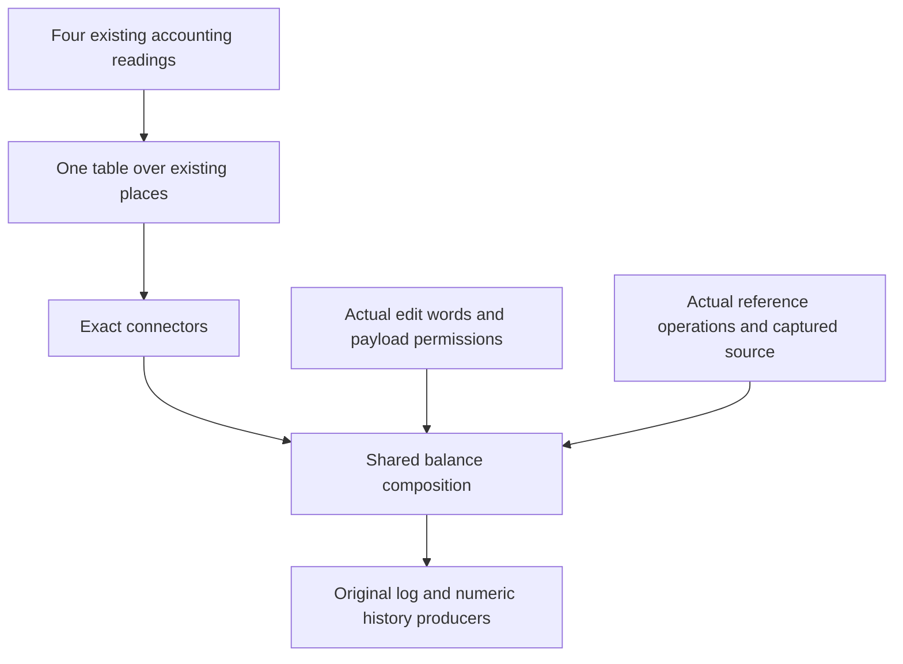

# One accounting model over the existing places

## Placement and acceptance

Concept: scope-lifetime-finalization, R11, and reactive-scheduling.
Question: the proposed place-ledger claim serves the original log debit and source-use claims.
Consumers: `StackLedger.Funded`, release custody, source opportunities, and Atomic's active writer budget.
Observation: consumed events plus outstanding code and data weights, bounded by produced events and an initial allowance.
The model supplies accounting composition. Each instance still supplies source permissions, local transfers, and initial funding.
The model establishes no progress, acquired-value identity, cleanup order, or host agreement.

Finish the representation slice when all four existing readings connect and at least one old composition proof becomes an instance.
Check the exact old statements, narrow builds, trust audit, and line changes before committing.
Do not add a command or evaluator analysis.

## Existing carrier and arrows

Use the existing machine, pending command list, and drained task snapshot.
The new table holds observation functions into natural numbers.
It introduces no stored syntax, execution state, or alternative program representation.

| Place | Weight reads |
| --- | --- |
| Stored fiber | Its current code, stack, and dispatcher |
| Unlaunched race | Its existing programs |
| Store | Scope entries and selected reference content |
| Pending command | Its retained program |
| Drained task | Its retained program |
| Trace event | Its produced and consumed weights |

Sum each existing finite collection once.
The accounting inequality includes the pending commands and detached task snapshot explicitly.
Draining a dispatcher transfers weight into that snapshot; dropping it from the invariant would lose an outstanding place.

Keep nonadditive weights inside their existing observation functions.
Release custody's response-sensitive stack weight must retain its actual active response.
A table of additive leaf weights does not replace that dependency.

## Existing instances

| Reading | Places | Event weights |
| --- | --- | --- |
| Stack ledger | Saved stacks; other places weigh zero | Existing produced and consumed functions |
| Release custody | Fibers, scopes, race programs, commands, tasks | Registration produces; release consumes |
| Source opportunities | Current and saved source reservations | Registration consumes the initial allowance |
| Atomic cleanup | Active writer reservations and committed log entries | The actual finalizer start produces |

The connectors retain each reading's hypotheses and equality direction.
In particular, an arbitrary current-code weight need not survive interruption.
R2 prevents stale write-back, but each weight must still prove its interruption inequality.

## Order

First check the connectors in a retained probe.
Then move shared arithmetic and edit composition, keeping the original names and statements.
Settlement supplies a balance between the actual installed owner and the settled configuration.
Funding follows that balance through the same composition law.
Use the existing path, command, and decision lifts.
Keep callback compilation, allocation identity, and phase transitions as explicit instance obligations.

## Literature boundary

The retained [Atkey text](../store-labels/Atkey2011.pdf) combines heap locality with outstanding resource requirements.
Its role and adaptation are recorded in the adjacent [store design](../store-labels/PLAN.md).
This slice applies that separation to the existing machine places.
It does not introduce the paper's assertion language or assume that scalar balance proves ordered cleanup.

## Installation and real consumers

The shared local debit omits the acting stored row and counts its returned row once.
Its installation theorem uses `FiberSum.split` and `FiberSum.install_le`.
The source owner must occur in the old table, both tables have unique identities, and the returned identity agrees.
The theorem serves the same R11 release and cleanup claims through their existing local debit statements.
It neither proves the evaluator debit nor establishes ownership of captured values.

Keep `ReleaseCustody.install_funded`, `ReleaseCustody.settle_funded`, and Atomic's `WriterMachine.settle_debit` unchanged by name and statement.
Replace their arithmetic with the shared installation and settlement balance.
The arbitrary pending suffix and detached task snapshot occur on both sides.
Their weights cancel without erasing either place from the model.

## Installation certificate

The shared balance accepts the actual fiber replacement bound as its installation certificate.
Release custody supplies `FiberSum.install`, using its existing selected-row lookup.
Atomic supplies `FiberSum.install_le`, using its existing unique identities and returned key.
This keeps every old premise and header while sharing the accounting composition.
No instance adds a replacement case analysis.
