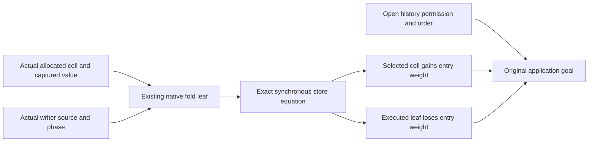

# Native writer leaf probe

The probe checks local code-to-data exchanges for the actual Timeout, Atomic, and Workers writer shapes.
It does not supply a reached-history producer.
The original numeric and log-history goals remain open.

## Placement and finishing criteria

Concept: store-typing, R4, and scope-lifetime-finalization, R11.
Consumers: `Timeout.cleanup_keeps`, `Timeout.retries_declared`, `Atomic.Cleanup.log_debits`, and `Workers.Assertions.logs_step`.
Proof role: local write balance and source-shape inspection.
Evidence status: checked symbolic probe, plus one finite observation control.
Reach: actual writer expressions, symbolic stores, and explicit captured environments.
Limit: no progress, source confinement, issued permission, or whole command history follows from these equations.
The host boundary stays unchanged.

The slice finishes when each writer shape has a compiling exchange example, an independent trust audit, and an explicit inventory of missing history premises.
No library module, runtime definition, or scenario statement changes.

## Existing carrier and local balance

`PlaceWrites.model` supplies a leaf table to `Machine.PrimWeights.Model`.
`PlaceWrites.current` uses the existing generated `cata_prim`.
The table counts one selected actual operation, including its captured environment.
It assigns zero to callback names.
This local table therefore supplies no bound for future callback compilation.
A production instance must retain the callback's source permission and actual cell capture.

`PlaceWrites.append_debit` accepts an actual `Ref.update` row, its heap read, and its evaluated append expression.
It applies `refStep_update` and `refPeek_poke_self`.
The selected cell gains the entry's weight exactly when the synchronous code loses that weight.
The weight may project literal identities, acquired values, paired entries, or list length.
There is no new syntax fold or indexed-heap traversal.

`PlaceWrites.timeout_cleanup_debit` applies the actual source equation `HostTimeoutNumberSteps.cleanup_note`.
`PlaceWrites.timeout_count_debit` applies the actual native equation `HostTimeoutNumberEntry.count_sync`.
`PlaceWrites.atomic_append_shape` joins Atomic's paired-entry term to the same append expression.
`PlaceWrites.atomic_debit` consumes `Atomic.Writer.note_heap_count`.
`PlaceWrites.workers_source` checks the actual first release source for every total.
`PlaceWrites.workers_debit` consumes the shared append exchange under its actual captured literal and destination.

The finite control supplies one balanced append carrying number seven while the observation expects number one.
`Observation.cleanupKeeps` rejects that log.
This control is not an admitted-history counterexample.
It shows why a scalar balance alone cannot prove Timeout's ordered observation.



## Available facts and missing premises

| Family | Available exact facts | Missing history premise |
| --- | --- | --- |
| Timeout allocation | `HostTimeoutNumberSteps.count_make`, `cleanup_make`, `completed_make` allocate handles zero, one, and two in order. | Every live writer's environment retains those actual allocation handles. |
| Timeout source | `HostTimeoutSlots.EnvAt` retains source roles and a retry cursor below four. `refPaths_eq` lists the eight reference leaves. | The cursor equals the committed count at attempt entry. An address or environment length alone proves no key identity. |
| Timeout count | `count_sync` increments the actual counter and keeps both logs. `count_prefix_region` protects the actual saved attempt region. | Prior cleanup and form prefixes are complete before the next count write. The region theorem retains explicit entry and prefix premises. |
| Timeout cleanup | `ReferenceAt.cleanupNote` binds the count read, cell handles, and active cleanup gap. `cleanup_native_write` returns the post-write contract. | Actual history produces that reference contract. The saved read equals this attempt's count and next cleanup position. |
| Timeout form | `completed_native_write` retains the captured selected exit. `form_saved` consumes completed loser cleanup. | Actual loser-join completion produces the cleanup phase before form publication or retry. The parked root cannot assume that phase. |
| Atomic source | `Writer.actual_note_at` and `Writer.resolve_note` select the literal-identity note and its captured cell. `WriterSource.operation_bound` relates the source address to its leaf. | History retains the captured environment and confines writers to the admitted source roles. |
| Atomic data | `Writer.note_heap_count` counts identities across all reference cells. `observe_count_le_heap` bounds the selected observation by that aggregate. | The aggregate avoids a destination-alias premise locally. History still issues one active note permission at each actual finalizer start. |
| Workers allocation | Research `MachineWorkersSlots.initializer_native` and `initializer_resume` check concrete allocation answers and the five-binding root prefix. | Every live root and worker frame retains the exact prefix through actual commands and child creation. |
| Workers capture | Research `MachineWorkersCapturedSlots.acquired_capture`, `acquired_registration`, and `close_selected_writer` retain connection literals and effective release destinations. | Actual history supplies their leading-prefix, answer-class, selected-capture, and scope-state premises. |
| Workers permission | The actual release expression appends its acquired literal once under matching slots. | The release start issues its permission. The selected writer consumes it. Native scoped finalizer interception retains the exact captured program. |

The Workers research facts remain conditional probes.
This slice does not promote them to library closure or rebuild their earlier evidence.

## Proposed production leaf predicates

These predicates are design inputs, not checked history instances.
They use existing operation, term, environment, and cell data.
They add no program carrier or machine field.

| Writer | Leaf identity | Required source-value witness |
| --- | --- | --- |
| Timeout cleanup | Cell one, `cleanupTerm`, and environment slot six equal the selected attempt number. | Slot six comes from the actual preceding counter read. The active count equals the next cleanup position. |
| Timeout count | Cell zero and `countTerm`. | The retry cursor admits the next attempt after complete cleanup and form publication. A unit leaf alone gives no four-attempt bound. |
| Atomic note | `Store.noteAt id env.length`, as the existing `WriterPhase.operation` table already checks. | The literal identity belongs to the selected request source. Aggregate heap counting avoids a cell-key restriction for this local debit. |
| Workers first release | Actual released cell, `appendOne 7 (.var 5)`, and slot five equal the selected connection literal. | The released handle comes from allocation one. The acquired callback captures the connection in slot five. |
| Workers second release | Actual released cell, `appendOne 8 (.var 6)`, and slot six equal the selected connection literal. | The previous worker handle occupies slot five. The second acquired callback captures the connection in slot six. |

The probe's selected-operation model deliberately fixes the entire environment.
This provides a checked local exchange before a production predicate supplies callback compilation bounds.
An unrestricted callback can compile more weighted code than a zero name leaf reserves.
The proposed production instance therefore cannot reuse the probe's zero callback table as a global invariant.

## Shared seams

P1 and P2 remain the coordinator's separate work.
The heap's per-key frame law already exists in `RefKernel`.
P2 needs its machine lift, including actual source and synchronous state transfer.
`ControlSteps.native_sync_answer` already connects an exact native store operation to its post-state saved-frame contract.

The actual native synchronous transition uses `MoveKind.answer`.
A frame/event label alone certifies no store transition.
This probe derives no store fold or written-cell set from labels.

P3 needs a callback leaf bound under an allocation-site capture premise.
Atomic already supplies an address-to-leaf bound, using its actual source census.
Timeout and Workers additionally need the value read or acquired at that source slot.
The compiler supplies concrete keys only after the captured request evaluates to a cell.
Allocation equations do not establish preservation of those captures across the actual history.
No new generic callback contract or second evaluator census is proposed here.

## Verification

Base: `d158f096b`.
The probe and evidence stay under `machine-models/codex/place-writes`.
Commands use one Lake process at a time and `LEAN_NUM_THREADS=3`.

```text
lake env lean -DwarningAsError=true --root=docs/research/2026-10-11-machine-models/codex/place-writes -o .lake/build/lib/lean/PlaceWrites.olean docs/research/2026-10-11-machine-models/codex/place-writes/PlaceWrites.lean
lake env lean -DwarningAsError=true docs/research/2026-10-11-machine-models/codex/place-writes/PlaceWritesAudit.lean
```

The first compile reveals a multiline record-expression parse error, two incorrect term constructor names, and two missing type qualifications.
The repaired probe compiles with warnings treated as errors.
The first audit finds an order-derived number equality instance through `atomic_debit`.
The explicit structural number equality instance removes that dependency.
The final build and audit repeat after the repair.
The final audit reports 22 declarations within `[propext, Quot.sound]`, with zero planned goals and zero declarations modulo goals.
The adjacent evidence file records that output.
No outside behavior input changes, and no behavior gate is reached.
