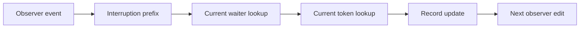

# Machine guard and observer edit instances

Apply the checked snapshots before the whole law build.
The existing scenario statements remain unchanged.
No runtime commit precedes that build.

## Revision and files

The patch base is `662b978ff`.
The worktree HEAD is `80eb3feb278bb9fcfa75efffe20228868a29ea8f`.
This slice supplies checked snapshots for coordinator integration.

| Path | Change |
| --- | --- |
| `src/Effect4/Laws/Program/Guard/Continuation.lean` | Existing command equations include `settleOutcome`. |
| `src/Effect4/Laws/Program/Guard/ControlRemainder.lean` | Scope-link registration transport uses the shared evaluate-only message observation. |
| `src/Effect4/Laws/Program/Guard/ReturnCommands.lean` | Existing queue settlement uses actual forward lookup, retained command fields, and an owner-free message prefix. |
| `src/Effect4/Laws/Machine/EditObserverWords.lean` | `Edits.observer_path` interprets the existing observer word through `Contracts.Path`. |
| `src/Effect4/Laws/Machine/EditWords.lean` | `Edits.interrupt_path` and `Edits.link_plan_path` expose actual-prefix leaf obligations. |
| `src/Effect4/Laws/Machine/Ledger.lean` | Existing `StackLedger.interrupt_payload_path` becomes an interrupt-path instance. |
| `src/Effect4/Laws/Program/LedgerRun.lean` | Existing `StackLedger.observer_same` becomes an observer-path instance. |

## Placement

| Part | Placement |
| --- | --- |
| Concept and property | `reactive-scheduling`, R11: native command authority and edit composition. `scope-lifetime-finalization`, R11: stack-ledger accounting. |
| Question and role | Structure helpers serve the packet's proposed `evaluation-moves` and `ledger-run` claims. Existing queue and ledger endpoints consume them. |
| Reach | Arbitrary native programs and row tables under each existing endpoint's hypotheses. Generic edit paths require explicit per-edit edges and exact helper results. |
| Limits | The paths establish no callback admission, progress, outside-implementation agreement, or source-value ownership. |
| Requirement | Shared command authority and accounting support the existing R11 release and finalizer endpoints. |

`ReturnCommands.settle_generatedQueue` retains its original statement.
Its actual forward lookup excludes the raw missing-owner arm under the existing `Present` premise.
It adds no distinct-ID premise.
Messages preserve the running owner's command fields through `Moves.OtherEdits.controls`.
Their generated commands have no command owner.
The existing disposition proof consumes the resulting owner and command prefix.

Nine identifier-presence helpers now project the existing interference census.
The touched action and primitive proofs use generated function cases.
All 104 existing theorem headers across the three Guard files and `LedgerRun` remain unchanged.
The existing `interrupt_payload_path` header also remains unchanged.

`observer_path` supplies actual looked-up records at each update.
Its update edge requires the returned record's original identifier and frame.
The interruption prefix uses `interrupts_path`.
It then reads the current waiter and token before the countdown update.

`link_plan_path` exposes the exact successful `scopeLinkFiber` result at the initial machine.
The state write is first in each applicable plan word.
Its other leaves expose halt and the exact diagnostic events.
The path adds no invariant premise at an unrelated machine.

The ledger observer proof falls from 391 file lines to 359 file lines.
Its old observer case analysis is removed.
The interruption instance also removes its private found-or-missing case analysis.

## Verification

Every source check uses `LEAN_NUM_THREADS=3` and `-DwarningAsError=true`.
The checks use the coordinator's checked dependencies through a temporary `LEAN_PATH` overlay.
The coordinator performs the whole law build on the integrated source graph.

| Check | Result | Log |
| --- | --- | --- |
| Three assigned Guard source checks | Pass | `/private/tmp/machine-guard-continuation-check.log`, `/private/tmp/machine-guard-control-remainder-check.log`, `/private/tmp/machine-guard-return-commands-check.log` |
| Guard combined `#axiom_audit` | 417 declarations; zero modulo declarations; zero planned goals | `/private/tmp/machine-guard-return-audit.log` |
| Observer path source check | Pass | `/private/tmp/machine-observer-path-final-check.log` |
| Interrupt path source check | Pass | `/private/tmp/machine-interrupt-path-check.log` |
| Link plan path source check | Pass | `/private/tmp/machine-link-plan-path-check.log` |
| Ledger interruption instance source check | Pass | `/private/tmp/machine-ledger-interrupt-path-check.log` |
| Whole `LedgerRun` source check | Pass | `/private/tmp/machine-ledger-run-final-check.log` |
| Combined edit, observer, ledger and `LedgerRun` audit | 505 declarations; zero modulo declarations; zero planned goals | `/private/tmp/machine-observer-ledger-audit.log` |

The final combined audit uses the host agent's constructive `Guard.ForkLedger` repair.
An earlier stale artifact reports `Classical.choice` through its previous observer proof.
The final audit contains no such dependency.

These are theorem and proof-trust checks.
They add no finite runtime comparison claim.
The earlier R2 regression receipt retains the seven finite cuts and CE046 control.
Whole-law acceptance and reached behaviour gates remain with the coordinator.
