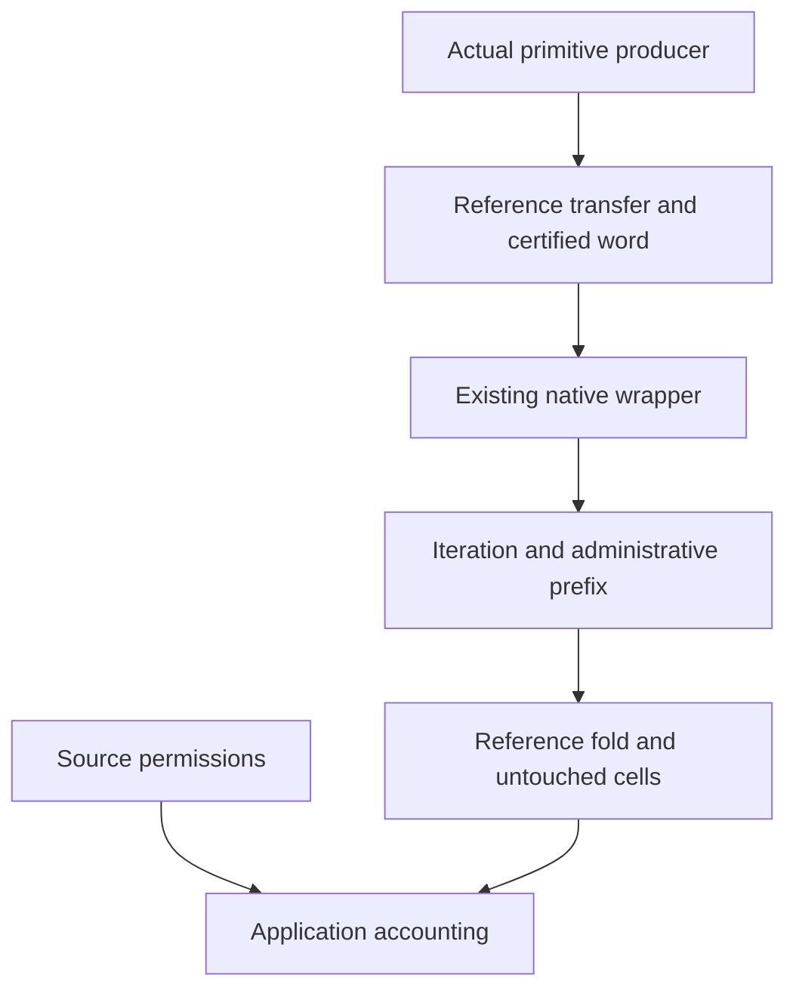

# Connect actual iterations to reference words

Concept: store-typing R4 and reactive-scheduling R11.
Question: `cell-invariant-from-write-sites`, serving the original application accounting goals.
The existing `primitive_refTransfer`, `native_refTransfer`, and `iteration_refTransfer` consume the stronger results.
The observation is exact reference lookup, including absent keys.
Scope, timer, deferred, and memo observations remain separate.

The shared primitive producer is indexed by the actual returned iteration.
The new connector takes that same producer as its input.
It returns the old reference transfer and a certified word over the existing move labels.
The synchronous branch keeps the actual operation and answer, even when references stay equal.

A certified word alone establishes its reference reading and frame observation.
It does not classify every operation that executed.
The primitive producer supplies execution evidence; a source instance supplies generation and phase permission.
Reference equality grants neither permission.

Replace the existing scoped-exit, native-wrapper, and iteration transfer proofs with paired readings.
Keep each old theorem's name and statement as its first projection.
Compose the administrative iteration prefix with the native word.
Use the existing reference-equality branch for injected yield, which cannot execute a synchronous head.

The word reading uses `Contracts.Path` over the existing reference heap.
Its fold and conservative cell footprint are the checked probe's laws.
The footprint includes reads and allocation's actual returned key.
List membership represents finite union; duplicate entries change no membership judgment.
This is reference safety, not progress or outside runtime agreement.

The allocated-read reader consumes the actual producer connector.
Concrete readers compose a write and allocation, and retain an untouched existing cell and an absent cell.
The original accounting history obligations remain open until their source permissions and balances are proved.

Acceptance requires the actual source build, direct consumers, unchanged old theorem headers, and `#axiom_audit` over changed modules.
No runtime definition changes in this slice.

