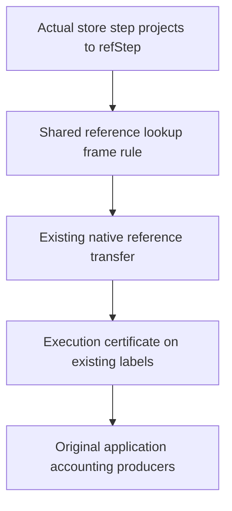

# Connect store effects to the existing move labels

## Placement

Concept: store-typing, R4, and reactive-scheduling, R11.
Proposed claim: `cell-invariant-from-write-sites`; the helpers also serve the original Atomic, Workers, QueueWorkers, and Timeout accounting goals.
The next reader is the existing `StoreExecution.RefTransfer` classification of actual native execution.

The observation is reference lookup, including absent keys. Scope, deferred, timer, and memo state remain outside this observation.
The laws establish safety. Source permissions, allocation-site identity, accounting balance, and progress remain separate obligations.

## Checked source facts

`MoveKind.answer` records the successful native synchronous branch today.
`MoveKind.step` records delegated frame evaluation, which leaves the machine store unchanged.
`TracedMoves` certifies the frame word and event suffix. Its definition does not constrain the store.
Therefore, the store fold needs an execution certificate in addition to that existing relation.
No scenario may infer store preservation from the event suffix alone.

`SyncOp.refKernel` describes existing-cell operations. `refMake` appends to the reference heap and returns its old length as the key.
Allocation belongs in the reference effect. Otherwise, a claim about unchanged absent keys is false.
The scope name supply does not allocate reference keys.

## Order

First prove the projection and frame rule beside `RefKernel`.
Use its existing kernel table, with allocation handled explicitly.
Then connect the actual native transfer and consolidate a real consumer.
Refine the existing labelled relation only after its store certificate is specified and checked.
Do not introduce another program representation or another scenario command traversal.

## Acceptance

Retain a control showing that event labels alone permit unrelated stores.
Retain allocation, existing-cell, and absent-cell readers.
Build touched modules and their direct consumers. Audit every landing module.
Keep the operation's actual answer in allocation evidence.

## Literature and adaptation

[Atkey, 2011](https://bentnib.org/amortised-sep-logic-journal.pdf), Lemma 3.1 and Remark 3.2, separates local heap mutation from the untouched heap.
Theorem 3.3 combines future resource requirements with prior consumption.
Section 4.3 explains why resource preservation needs a constraint on heap changes.
The packet retains the primary text as `Atkey2011.pdf`.

Our adaptation uses the existing reference heap and exact lookup equality outside one operation's footprint.
It does not introduce a separation-logic syntax or claim the paper's logic as an Effect4 theorem.
The frame law supplies locality. Each accounting instance must still prove its code-to-data balance and source permission.

## Dependency boundary

Land the new laws in `Laws/Machine/RefFootprint.lean`, importing `RefKernel`.
Keep `RefKernel` unchanged so unrelated kernel consumers do not rebuild for future footprint extensions.
The native connectors extend `StoreExecution.RefTransfer` in `NativeHeapExecution`.
They classify represented operations without another evaluator traversal.
Keep the compilation module `StoreExecution` unchanged; it has many unrelated source-proof consumers.

## Producer refinement after R2

`Footprint.evaluatePrim_tracedFootprint` uses `AdministrativeTrace.answer` for both synchronous execution and administrative replacements.
An existing synchronous-looking head can also be parked or replaced by yield injection.
Therefore, an `answer` label's input code does not prove that its synchronous operation ran.

The shared producer must retain the actual returned frame together with each store equation.
An executed synchronous branch supplies its operation, answer, and `syncOpStep` equation.
A branch that leaves references alone supplies reference equality.
`CommandRefTransfer` and the old lexical source statements remain projections.

The Timeout generation instance needs the same distinction when an operation advances its phase without changing the heap.
Its numeric annotation must follow the executed source position and returned frame.
The native transport pass should expose these facts once.
Parameterize that pass before adding a store-certificate or scenario consumer.
The existing `Lift` transports its command contract; it does not produce that contract.

## Checked word annotation

Keep `MoveLabel` and annotate each label with an optional actual synchronous operation and answer.
Use `Contracts.Path` over the existing reference heaps.
An executed edge requires its real store-step equation and matching answer label.
A quiet edge requires equality of the complete reference heap.
This adds proof evidence, not executable program syntax.

The reference reading folds the annotated operations in order.
A successful store operation with no reference projection leaves this observation unchanged.
The edge certificate remains required; the reading alone admits no operation.

The footprint is conservative and includes reads and allocation's actual key.
Represent its finite union by list membership; duplicate entries change no membership judgment.
The checked concatenation law supplies union under that observation.
The frame rule keeps every cell outside that footprint, including absent cells.

`RefWordsProbe.lean` checks the fold, frame rule, annotation erasure, and composition.
Its readers compose a write and allocation, retain untouched existing and absent cells, and record a successful read.
The audit checks 35 declarations within the allowed axioms, with no planned goals.
The actual primitive producer connector remains open; the library representation has not landed.

Next strengthen the shared primitive store projection with this certificate.
Derive its existing `RefTransfer` theorem as a projection and delete the replaced proof.
Retain the synchronous annotation even when the operation leaves references unchanged.
Do not add another evaluator or command classification.
