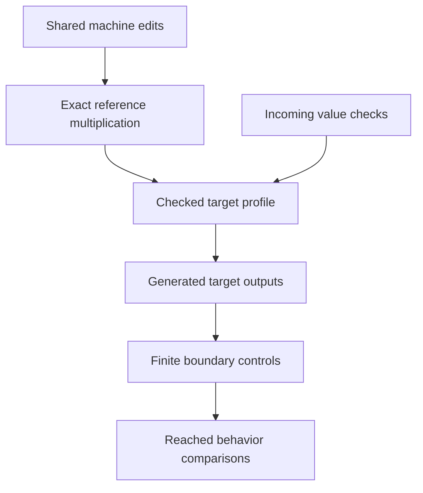

# Numeric target boundaries after the shared machine edits

The owner assigns R-T2 and R-T8 in `../../CODEX-PROMPT.md`, item 12.
The design follows `../../../2026-10-11-type-interface/README.md`.
This note records a proposed implementation, with no new verification claim.

## Placement

Concept: translation-simulation, R8 and the printed part of M7.
Question: extend the existing `profile-plus-exact` claim to multiplication within the selected profile.
Consumer: `NativeAtom.eval` in `src/Effect4/Machine/Term.lean`, its emitted TypeScript prelude, and the generated OCaml engine.
Reach: natural operands within the declared target profile, with refusal when the product exceeds that profile.
The reference computes the exact product.
The target refuses outside its profile before exposing a rounded or saturated result.
This establishes no general Lean-to-OCaml simulation.
The foreign host and incoming-value boundaries remain explicit.

## Multiplication choice

Retain the atom and route it through `Profile.scale` beside `Profile.grow` in `src/Effect4/Machine/Integers.lean`.
The existing `Test/Dogfood/P1HttpCache.lean` program uses multiplication.
Removing the atom would change that admitted program without helping its proof obligations.

The Lean definition remains exact multiplication.
The OCaml row uses exact Zarith multiplication followed by `E4_clock.to_profile_nat`.
The TypeScript prelude uses its existing `inProfile` helper on the product.
The reference theorem and target domain remain separate.
Keep `Nat.mul` unchanged for internal indices and compiler bookkeeping.

Propose the corresponding decisions row in the receipt.
Do not edit the coordinator's register.

## Incoming values

`E4_engine.answer_async_success` in `ocaml/engine/e4_engine.ml` currently constructs `Val_nat` from any host integer.
Reject a negative argument before constructing the decision.
Keep this refusal outside the modeled program exit.
Audit other public incoming-value paths before claiming that every ingress checks the profile.

`Val_float` currently stores its unsigned bit pattern in an OCaml `int`.
A checked boundary must reject an unsigned pattern that the carrier cannot represent.
Do not reinterpret truncation or a negative machine integer as an admitted float.
Keep this finite representability check distinct from support for every IEEE-754 value.

Restore warning 8 in the generated header's owner, `src/OCaml5/Tools/LcnfGen.lean`.
Regenerate its outputs instead of editing generated OCaml.
The compiler then exposes any unmatched constructor migration during the sweep.

## Acceptance

1. Finish item 10's checked machine edit landing.
2. Retain the smallest controls for the repaired numeric boundaries.
3. Build the touched Lean modules and audit their declarations.
4. Regenerate the reached TypeScript and OCaml outputs.
5. Run the relevant `dune test` controls through `opam exec --switch=effect4`.
6. Run the reached behavior comparisons at the planned sweep.

Check zero, an ordinary product, the profile boundary, and the first product above it.
Check negative natural input and float bit patterns on both sides of the carrier boundary.
Keep the old source theorem statements unless an owner-approved amendment names the changed claim.

